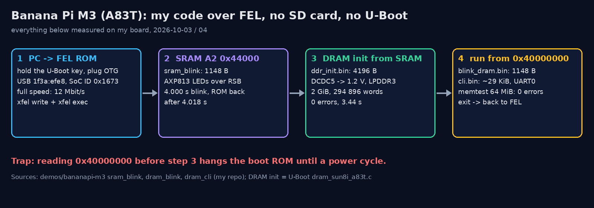

# Banana Pi M3
{: .no_toc }

The BPI-M3 is Banana Pi's octa-core board: an Allwinner A83T (two clusters of four Cortex-A7), 2 GB of
LPDDR3, 8 GB of eMMC, an AXP813 PMIC, Gigabit Ethernet and an AP6212 Wi-Fi/BT module. The spec sheet
says 1.8 GHz. Mine still had the vendor's Ubuntu 16.04 image on the eMMC, kernel 3.4.39 from 2017.

I picked it up again right after my Allwinner D1 board, because the A83T has the same trick: hold a key,
plug in USB, and the boot ROM waits for the PC (FEL mode). That means I can run my own code on it
without an SD card, which matters because my PC has no card reader. The other pull was the eight cores
on two clusters: I wanted to see how Linux even wakes the second cluster.

## Timeline

| When | What happened |
|---|---|
| 2026-10-01 | Read the Banana Pi docs, built a mainline U-Boot + Linux 6.18 SD image. Never booted it (no card reader here) |
| 2026-10-03 | Board on a USB-serial adapter. Measured the vendor image: 8 cores, 11 CPU frequencies up to 2016 MHz. FEL works |
| 2026-10-03 | First bare-metal program from SRAM: blinks the two LEDs that hang off the PMIC |
| 2026-10-03 → 04 | DRAM brought up from SRAM over FEL, 2 GiB, then the same blink running from DRAM |
| 2026-10-04 | A bare-metal command line in DRAM with one command per peripheral |

## The write-ups

Each one is Situation / Task / Action / Result, with the numbers I measured on my board.



## Still open

The mainline image from 1 October is still unbooted, so every Linux number here is from the vendor
3.4 kernel. The eMMC root file system of the vendor image also has EXT4 errors; I haven't written
anything to it and won't until I can fsck it unmounted.
