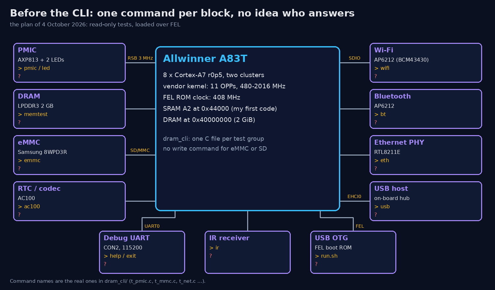
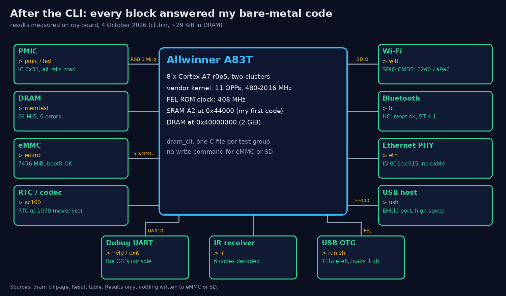

# A bare-metal command line for every peripheral on the board
{: .no_toc }

[Back to the Banana Pi M3 hub](/embedded/boards/bpi-m3/)

1. TOC
{:toc}

## Situation

4 October 2026. DRAM worked over FEL, so I had 2 GiB and a CPU that does exactly what I tell it. What
I didn't have was any idea whether the rest of the board was alive under my code: eMMC, the SDIO Wi-Fi,
Bluetooth, the Ethernet PHY, the IR receiver. The vendor image talks to most of it through blobs.


*The plan for the CLI: one command per block, and at that point a question mark on every one of them.*


## Task

One program on UART0 (CON2) with a command per peripheral, read-only for storage, that I can load,
poke, and `exit` back to FEL for the next build. No U-Boot, no OS.

## Action

`dram_cli/` is loaded by `run.sh` the same way as the DRAM blink: `ddr_init.bin` first, then `cli.bin`
at 0x40000000. One C file per test group (`t_pmic.c`, `t_mmc.c`, `t_net.c`, ...). There's no write
command for eMMC or SD, on purpose.

```
$ make                      # cli.bin, about 29 KiB
$ sh run.sh                 # board in FEL: DRAM init, load, start
$ python3 cli.py /dev/ttyUSB0 help info pmic emmc
$ python3 cli.py /dev/ttyUSB0 exit
```

The rules I wrote down while getting it to run, each one learned the hard way:

| Rule | Why |
|---|---|
| anything written before `.bss` is cleared must not live in `.bss` | otherwise `exit` restored a stack pointer of 0 |
| invalidate the I-cache before enabling it | FEL writes the new image behind the cache |
| build with `-mno-unaligned-access` | MMU off means unaligned loads fault |
| start the SD/MMC module clock before the controller reset completes | the reset never finishes otherwise |
| throw away the first temperature sample | it reads 0 until the first conversion ends |
| every polling loop reaches its timeout test on every path | one path that skipped it is a hang |

One issue from that session is still open. My suspect: I had a second serial terminal on the same port
while `cli.py` ran, and two readers on one port split the bytes between them.

## Result

Measured on 4 October 2026:

| Command | Result on my board |
|---|---|
| `info` | Cortex-A7 r0p5, 408 MHz (ROM clock) |
| `memtest` | 64 MiB, 0 errors, 16 MB/s with caches off |
| `pmic` | AXP813 IC 0x51, ACIN + VBUS present, every rail read |
| `emmc` | Samsung 8WPD3R, 7456 MiB, MBR, boot0 checksum OK |
| `temp` | 3 sensors, about 39 to 44 °C |
| `eth` | RTL8211E, PHY ID 001c:c915, link down (no cable) |
| `wifi` | SDIO CMD5 answers: Broadcom 02d0 / BCM43430 a9a6 |
| `bt` | HCI reset ok, BT 4.1, Broadcom, subversion 2209 |
| `usb` | EHCI0 port enabled, high-speed device (on-board hub) |
| `ir` | 12-bit fixed-code remote, 6 codes decoded |
| `ac100` | RTC running, still at 1970 (never set) |
| `i2c` | TWI0 to 2 scan: nothing on CON1 (nothing plugged in) |


*Same diagram after 4 October: every block answered, from the AXP813 (IC 0x51) to the IR receiver (6 codes).*


Also there: `timer` (Timer1 at 24 MHz; the ARM generic timer isn't counting, the ROM leaves it off),
`led`/`key`, `pin`/`header` (all 40 pins of CON1 with function and level), `sd` (no card in the slot).

## What I'd do next

Close that open issue for real, with only one program on the port. And use this as the
test bed when the mainline image finally boots: every number in the table above is something Linux
should agree with.
