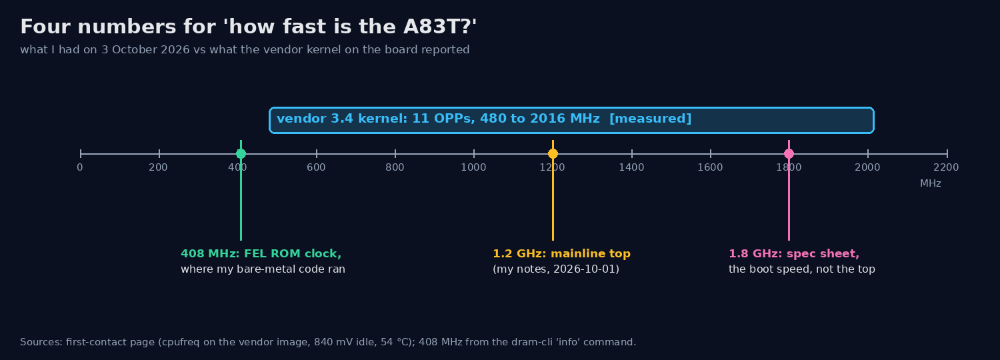
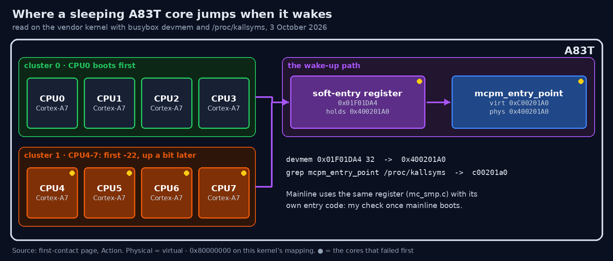

# First contact: what the vendor image says about eight cores and 2 GHz
{: .no_toc }

[Back to the Banana Pi M3 hub](/embedded/boards/bpi-m3/)

1. TOC
{:toc}

## Situation

October 2026. I had a list of open questions from reading the docs two days before:
the spec says 1.8 GHz but mainline Linux tops out at 1.2 GHz, the board has two CPU clusters and I
didn't know how the second one gets started, and I wasn't sure FEL works on this SoC at all. I also had
a ready mainline SD image, and no way to write an SD card on this PC.


*The clock question I walked in with: 1.8 GHz on the spec sheet, 1.2 GHz in mainline, and the vendor kernel on the board says 11 steps up to 2016 MHz.*


So the board came up on a new FTDI adapter on the debug UART (CON2, 115200 8N1), still running whatever
was on its eMMC.

## Task

Answer those questions on the real board, today, with the software that's on it. And not break
anything: it's an installed system, not a scratch image.

## Action

I listened for 5 seconds before sending anything, so I wouldn't mess up a boot log in progress. Two NUL
bytes, then silence. One empty line got me a login prompt:

```
Ubuntu 16.04.2 LTS bpi-iot-ros-ai ttyS0

bpi-iot-ros-ai login:
```

That's the vendor image, so every number below is for the vendor BSP, not mainline. Fine by me: that's
exactly the comparison my mainline notes were missing.

A small script of mine logs in and runs each command with echo off, so the output comes back clean.
Only read commands:

```
$ uname -a
Linux bpi-iot-ros-ai 3.4.39-BPI-M3-Kernel #1 SMP PREEMPT Thu Jul 13 09:32:18 UTC 2017 armv7l ...
$ cat /proc/device-tree/model
cat: /proc/device-tree/model: No such file or directory
```

No device tree at all: this kernel takes its board description from `script.bin`. Then the numbers:
RAM 2009 MiB, eMMC 7.3 GiB, the vendor boot0 (`eGON.BT0`) at sector 16. All eight Cortex-A7 r0p5 cores
online, one cpufreq policy with 11 OPPs from 480 to 2016 MHz, governor ondemand, 840 mV on the CPU
rails at idle, 54 °C.

The two-cluster question turned out to have a nice answer. CPU4 to CPU7 first fail with `-22` and come
up a bit later. The address a secondary core lands on sits in a "soft entry" register, and I could read it:

```
$ busybox devmem 0x01F01DA4 32
0x400201A0
$ grep mcpm_entry_point /proc/kallsyms
c00201a0 T mcpm_entry_point
```

0xC00201A0 virtual is 0x400201A0 physical. So the vendor kernel parks the wake-up address of every
secondary core there, and mainline uses the very same register (`mc_smp.c`), just with its own entry
code.


*How a sleeping core finds its way back: 0x01F01DA4 holds 0x400201A0, which is `mcpm_entry_point` (0xC00201A0 virtual) on the vendor kernel.*


Last, FEL. The kernel has no symbol with `efex` or `fel` in it, so there's no "reboot into FEL" here:
it's the U-Boot key or nothing. I held the key and replugged OTG, and the PC saw
`1f3a:efe8 ... in FEL/flashing mode`. `xfel version` answered with SoC ID 0x1673 (A83T), full speed.

What I skipped on purpose: no CPU hotplug, no fsck, no writes. The boot log has two
`EXT4-fs error (device mmcblk0p2)` lines at 19.9 s and 23.5 s, so the root file system was already
damaged before I touched it.

## Result

All 8 cores come up on the vendor kernel, with 11 OPPs from 480 to 2016 MHz. So the "1.8 GHz" on the
spec sheet is the boot speed, not the top. At idle it sat at 840 mV and 54 °C.

The second cluster wakes through the soft-entry register 0x01F01DA4, which holds 0x400201A0, the
physical address of `mcpm_entry_point`. FEL works, but only with the key, and only at USB full speed
(12 Mbit/s). Small extra: the board clock was 2 h 8 min ahead of the PC (no RTC battery, no NTP).

## What I'd do next

Boot the mainline image and read the same register: it should then hold the physical address of
`sunxi_mc_smp_secondary_startup`. If it still says 0x400201A0, mainline's SMP code didn't run.
Also read the dmesg lines between "Brought up 4 CPUs" and the late CPU4 start, which I didn't capture.
