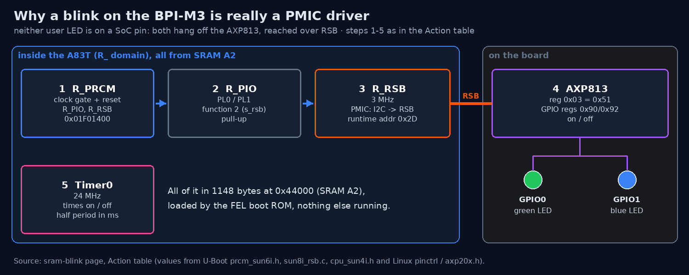
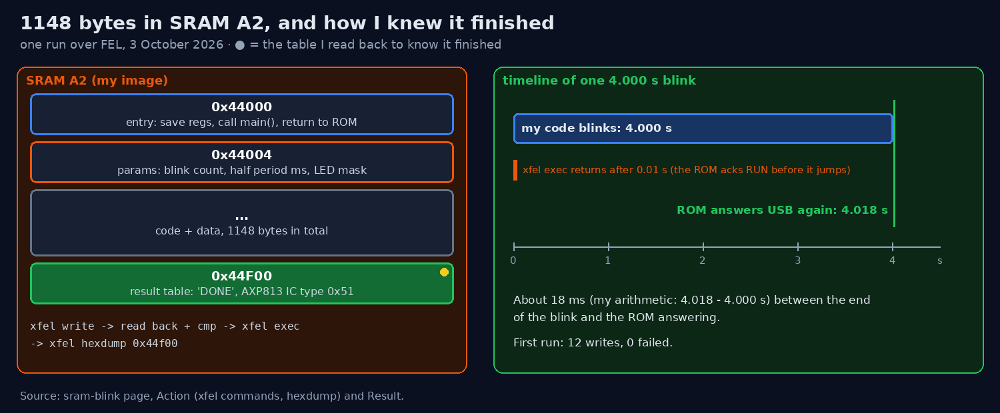

# Blinking an LED that lives on the PMIC, from 1148 bytes in SRAM
{: .no_toc }

[Back to the Banana Pi M3 hub](/embedded/boards/bpi-m3/)

1. TOC
{:toc}

## Situation

Same evening as the first contact. The board was still sitting in FEL
mode. I'd done a bare-metal blink on the D1 before and wanted the same "hello world" here: my code,
loaded by the boot ROM, nothing else running.

## Task

A program that runs from SRAM (DRAM isn't up in FEL), blinks an LED a given number of times, and then
hands the CPU back to the ROM so I can load the next thing without a power cycle.


*What "blink an LED" turned into on this board: five blocks to set up before the PMIC's GPIO0 (green) or GPIO1 (blue) changes.*


## Action

First surprise, from the device tree: neither user LED is on a SoC pin. Green is GPIO0 and blue is
GPIO1 of the AXP813 PMIC. So "blink an LED" really means "talk to the PMIC", and the A83T talks to its
PMIC over RSB, Allwinner's two-wire bus. In FEL nobody has set that up.

So the program does it all itself, in five steps. It opens the clock gate and reset for R_PIO and
R_RSB in R_PRCM (0x01F01400), and puts PL0/PL1 on function 2 (`s_rsb`) with pull-ups. It starts RSB
at 3 MHz, switches the PMIC from I²C to RSB mode and gives it runtime address 0x2D. Then it reads
AXP813 register 0x03 (the IC type) to see that anyone is listening, and writes 0x90/0x92 for on/off.
The on/off timing comes from Timer0 at 24 MHz. All the register values are from U-Boot and Linux, I
didn't invent any.

It's linked at 0x44000 (SRAM A2), has a small parameter block at 0x44004 (blink count, half period in
ms, LED mask) and writes a result table at 0x44F00. The entry just saves registers, calls `main()` and
returns to the ROM. Built with `arm-none-eabi-gcc`: 1148 bytes.

Load, check, run:

```
$ xfel write 0x44000 blink.bin
$ xfel read 0x44000 1148 readback.bin && cmp blink.bin readback.bin && echo "readback identical"
readback identical
$ xfel exec 0x44000
exec_elapsed=0.01 s
$ xfel hexdump 0x44f00 48
00044f00: 44 4f 4e 45 05 00 00 00 00 00 00 00 00 00 00 00  DONE............
00044f10: 00 00 00 00 51 00 00 00 07 00 00 00 07 00 00 00  ....Q...........
```

The `exec_elapsed=0.01 s` confused me for a minute. The ROM acknowledges the RUN command before it
jumps, so `xfel exec` returns right away. The only way to see the program finish is to wait until the
ROM answers USB again. The `0x51` is the AXP813 IC type, so the PMIC really answered.

Then I ran it three more times with other parameters by writing the parameter words with
`xfel write32` before each exec.

## Result

The AXP813 answered with IC type 0x51, and all 12 LED writes went through, none failed. Timer0
counted 72 000 000 ticks, 3.0 s, for that first run. For a 4.000 s blink the ROM answered the next USB
request after 4.018 s, which is as close as I could get to a stopwatch. On the later runs the PMIC GPIO
registers read back what the previous run had left (0, not the power-on value 7), so the writes stuck.


*Where the 1148 bytes sit in SRAM A2, and the only clock I had: the ROM answered USB again 4.018 s after a 4.000 s blink.*


Honest gap: the program proves the PMIC took the writes. I didn't note down whether I watched the LEDs
blink.

## What I'd do next

That was the next step anyway: DRAM. See [DRAM init over FEL](/embedded/boards/bpi-m3/dram-init).
