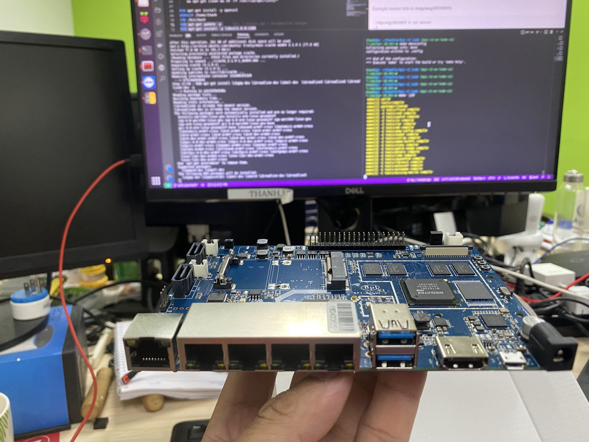
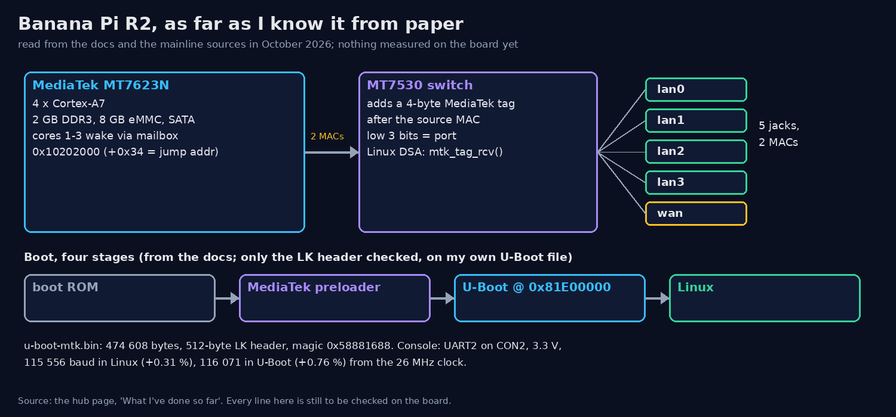

# Banana Pi R2
{: .no_toc }

The BPI-R2 is Banana Pi's router board: a MediaTek MT7623N (four Cortex-A7), 2 GB of DDR3, 8 GB of
eMMC, SATA, and five Gigabit jacks (four LAN, one WAN) behind an MT7530 switch. I got it for OpenWrt,
wrote an empty placeholder post for that back in 2023, and got no further.

In October 2026 I came back to it with the docs, the mainline U-Boot and the Linux device tree, to know
what I'm dealing with before I plug anything in. The board wasn't on the bench then and still isn't,
so there's no STAR write-up with a result yet. This page is honest about that.

*Everything on this page in one drawing: the MT7623N, the MT7530 that turns five jacks into two MACs, and the four boot stages. All from paper, none of it checked on the board.*

## What reading taught me

The only thing I've actually run is a build on my PC: mainline U-Boot with `mt7623n_bpir2_defconfig`
gives a 474 608-byte `u-boot-mtk.bin` in 19.7 s. The rest is from the docs and the sources, and none
of it is checked on the board yet.

Boot is four stages: boot ROM, MediaTek preloader, U-Boot at 0x81E00000, then Linux. The U-Boot image
carries a 512-byte LK header with magic 0x58881688; that part I did check, on the file.

The five-jacks-on-two-MACs trick is the MT7530 adding a 4-byte MediaTek tag after the source MAC. Its
low 3 bits are the port number, and Linux DSA (`mtk_tag_rcv()`) turns that into `lan0..3` and `wan`.
Cores 1 to 3 wake through a mailbox at 0x10202000: the jump address goes at +0x34, then three magic
keys, then an IPI.

The console is UART2 on the 3-pin CON2, at 3.3 V. With the 26 MHz clock the divisor gives 115 556 baud
in Linux (+0.31 %) and 116 071 in U-Boot (+0.76 %). On paper both are fine. I'd like to see it.

## The write-ups



## What's next

Plug it in. Then, in this order: capture a boot log on CON2, settle the 5 V vs 12 V input question (the
docs contradict themselves, so I'll check the board's own jack before powering it), read
`clk_summary`, see the DSA ports come up, and count the CPUs. After that, finally, the OpenWrt build
the old post promised.
