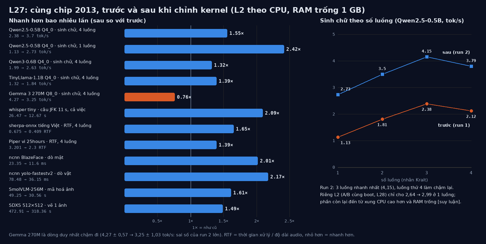

# Local AI on a 2013 phone chip, and an L2 cache stuck at 576 MHz
{: .no_toc }

[Back to the DragonBoard 8074 hub](/embedded/boards/db8074/)

1. TOC
{:toc}

## Situation

16 to 19 November 2026. The board had a working Android 15 and a GPU. My question was simple: this
hardware has a GPU, so which AI models can it run? Then I looked closer. The Adreno 330 has no compute,
OpenCL or Vulkan path in Mesa, and the Hexagon DSP has no FastRPC node in the device tree. There's no
NPU. So the honest version of the question is: what can four 32-bit Krait cores with NEON do?

## Task

Run a fair set of real models on the board (chat LLM, speech-to-text, text-to-speech, face and object
detection, an image captioner, an image generator) and write down the numbers, good or bad.

## Action

I built llama.cpp, whisper.cpp, stable-diffusion.cpp, ncnn and sherpa-onnx for 32-bit ARMv7 (Android
NDK) and wrote one bench script that runs every part on the board over adb. Run 1 on 18 November,
run 2 on 19 November with a newer kernel.

While doing that I noticed llama.cpp token generation stopped scaling past 3 threads. The 2 MB L2
shared by the four cores sat at 576 MHz no matter what the CPUs did. The stock Intrinsyc kernel moves it
up to 1728 MHz; mainline (I checked up to 7.3.4) has no L2 scaling for Krait at all. So I wrote one:
`qcom-krait-l2` (patch 0130) sets the L2 to the highest rate any online CPU needs, from 16 OPPs
(576 to 1728 MHz) copied from the stock tables (0132), each with its voltage corners and a CPU-to-DDR
bandwidth vote (0131).

To measure only the L2, I did an A/B on the same boot by moving the cap: 576 MHz, then 1036.8 MHz,
then 576 again. It's a module parameter, so it applies immediately:

```
echo 576000 > /sys/module/qcom_krait_l2/parameters/l2_max_khz
```



## Result

**The L2 driver** (same boot, cap 576 / 576 / 1036.8 MHz):

| Test | 576 MHz | 1036.8 MHz |
|---|---|---|
| memory read, 4 threads | 4433 / 4407 MB/s | 7084 MB/s |
| latency, 64 KB | 29.25 / 29.24 ns | 19.30 ns |
| Qwen2.5-0.5B Q4_0, 1 thread | 2.64 / 2.72 tok/s | 2.99 tok/s |

At 4 threads the LLM difference is inside the noise.

**AI on four Krait cores** (run 2):

| Model | Number | Notes |
|---|---|---|
| Qwen2.5-0.5B Q4_0 chat | 4.15 tok/s at 3 threads, 3.70 at 4 | fluent Vietnamese, wrong content |
| whisper tiny | 11 s JFK clip in 12.67 s | Vietnamese comes out as nonsense |
| sherpa-onnx zipformer-vi | RTF 0.409 (2.4× faster than real time) | readable Vietnamese |
| Piper Vietnamese TTS | RTF 2.30 | model load not counted |
| BlazeFace (ncnn) | 11.6 ms, about 86 fps | one core, see below |
| yolo-fastestv2 (ncnn) | 36.2 ms | one core |
| SmolVLM-256M | called four llamas with guitars "four people holding guitars" | |
| SDXS 512 × 512 | 318.36 s per image, peak RSS 1 118 132 kB | |

Run 1 to run 2 at 1 thread was 1.13 to 2.73 tok/s, but three things changed at once (the L2, free
memory from 55 MB to 1029 MB, and the CPU clocks the thermal limits allowed). Going by the clean A/B
above, I think most of that gain is not the L2.

One trap in my own build: ncnn gives the same time at 1 and 4 threads (11.62 / 11.60 ms), because my
build script turned OpenMP off. Every ncnn number here is one core.

## What I'd do next

Rebuild ncnn with OpenMP and re-run. Then the bigger one: an offline Vietnamese assistant
(listen, think, speak, sentence by sentence) with a model kept loaded. It works end to end in emulation
on my PC; on the board my estimate is 9 to 10 s to the first sound, but that's an estimate, not a
measurement, until it runs there.
