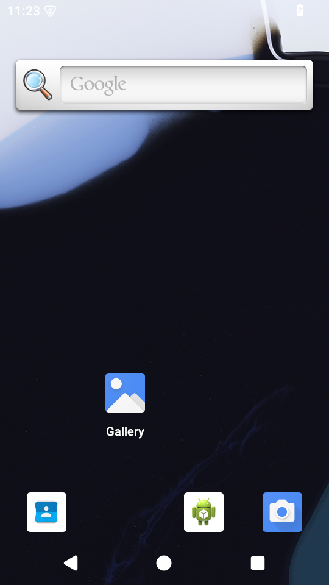
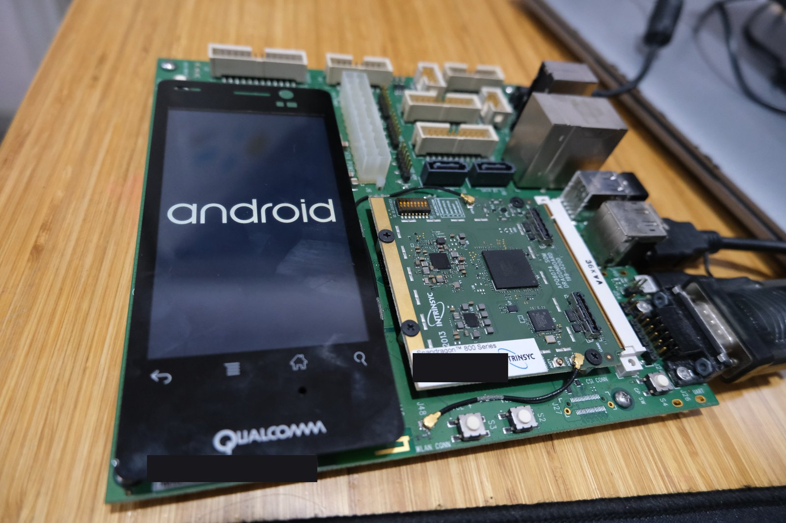
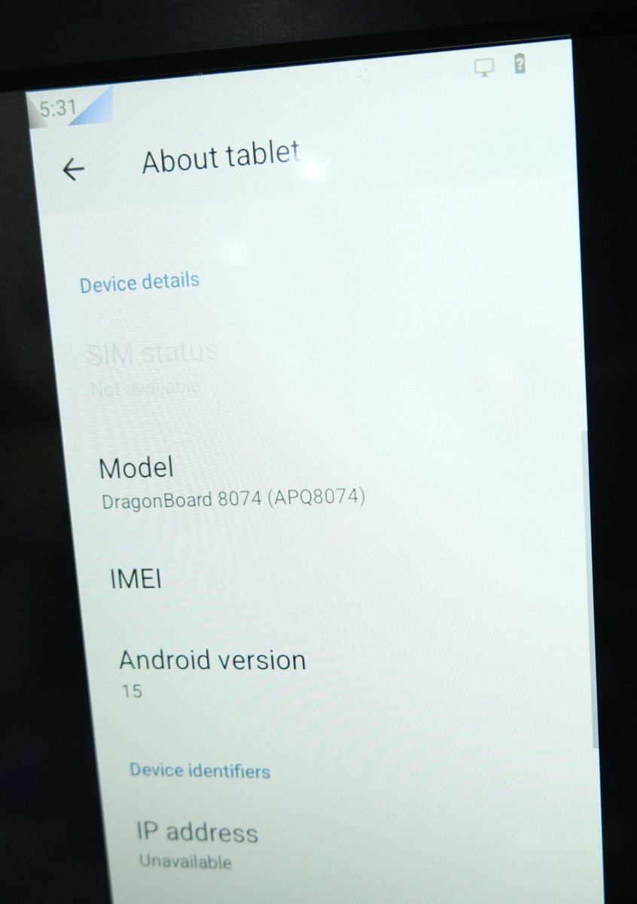

# Android 15 on a board that shipped with Android 4.3
{: .no_toc }

[Back to the DragonBoard 8074 hub](/embedded/boards/db8074/)

1. TOC
{:toc}

## Situation

November 2026. The DragonBoard ran its stock Android 4.3 on a 3.4 kernel. Mainline Linux still has a
device tree for it (`qcom-apq8074-dragonboard.dts`), and a community bootloader, lk2nd, still supports
MSM8974.



## Task

Get Android 15 with kernel 6.6.162 LTS to a usable home screen, without ever writing the stock boot
chain (sbl1, rpm, tz, aboot). If I lose aboot, I lose the board (and, as I found out later, it has no EDL mode to
recover from).

## Action

**Build.** android-15.0.0_r36 is the last Android 15 tag: 1030 projects, a 122 GB tree. I wrote a
32-bit `armv7-a-neon` device for it. First trap: the release config `trunk_staging` (what a lot of
boards use) builds "Baklava", Android 16 flags, from this Android 15 tree. I switched to `bp1a`, the
release that matches the tag's build ID. Output: `boot.img` 14 194 688 bytes (kernel + DTB + 200
modules) and a 1 GB sparse `super.img`.

**Safety net.** Before trying anything, I backed up all 16 small eMMC partitions with SHA-256 sums.
That backup is still my way back to stock.

**First boot, from RAM only.** Stock aboot → `fastboot boot lk2nd.img` → `fastboot boot` my image.
Six tries, each fix found on the serial log: a lk2nd DTS for msm-id 184 / board-id 10, a v0 boot
image with the DTB appended, lk2nd's ramdisk/DTB addresses moved up so they don't overlap the kernel
(that one was a silent hang), and SELinux in the LSM list. Then Android's first-stage init started at
4.57 s and stopped at 30.6 s: `partition(s) not found after polling timeout: super`.

**Up to adb.** Two causes, not one. The RPM never probed because in 6.6 `mbox_request_channel()`
returns `-ENOENT` and `qcom_smd` only falls back on `-ENODEV`. One patch, and suddenly eMMC, USB and
UART stop being deferred. And super had to live somewhere: I chose to overwrite the eMMC userdata
partition (12 GiB, the only one big enough). That needed two settings, not one,
`androidboot.super_partition=userdata` plus `BOARD_SUPER_PARTITION_METADATA_DEVICE := userdata`.
Then `bpfloader` exited 2 and init rebooted, because the arm32 BPF JIT doesn't do atomics, so I patched it
to fall back to the interpreter. And `g_ether.ko` in the ramdisk grabbed the only USB device controller,
so adb never showed. Removed it.

```
$ adb shell getprop ro.build.version.release
15
```

**Up to the screen.** Five NoC bus clocks failed (6.6 moved them, the interconnect driver still asked
for the old names), another patch. The Adreno had no IOMMU, so I gave it a 128 MiB VRAM carveout and
`cma=256M`. `system_server` died on `ashmem`, which mainline doesn't have: `sys.use_memfd=true`.
That got me the boot animation.


*Android 15's boot animation on the board's own panel. The S/N and MAC labels are painted over.*


**Up to the launcher.** Seven more, one after another: init.rc overriding my memfd setting back to
ashmem, no audio HAL (audioserver had crashed 162 times in one log), a missing `xi:include` file, a
vendor extension nobody serves, ext4 without POSIX ACL, an OCMEM lock failure after a warm reboot, and
the missing `android.software.app_widgets` feature. Rendering was still software (ANGLE on
SwiftShader): the GPU had no firmware yet.

**Persistent boot.** lk2nd at offset 0 of the 16 MiB eMMC boot partition, my Android
boot image at 512 KiB, stock aboot untouched. A small patch so `adb reboot bootloader` reaches fastboot
again. New kernels go in from Android itself:

```
14270464 bytes (14 M) copied, 0.709 s, 19 M/s
```

## Result

Android 15 (BP1A.250505.005.D1) on kernel 6.6.162, with Launcher3 on the panel. The first
`boot_completed=1` came after 264 s, still with software rendering. Once lk2nd and my boot image sat
on the eMMC, it booted by itself at power-on and reached the home screen after 66 s. The stock boot
chain was never written, and the backup still matches its SHA-256 sums.


*"About tablet": DragonBoard 8074 (APQ8074), Android version 15. A photo of the screen, a bit blurry.*


The 264 s was painfully slow. That's the [next story](/embedded/boards/db8074/speed-up).

## What I'd do next

The stock aboot still can't flash a sparse super image (`Unknown chunk type`), so super updates go
through lk2nd's fastboot. I'd like one flashing path for everything.
