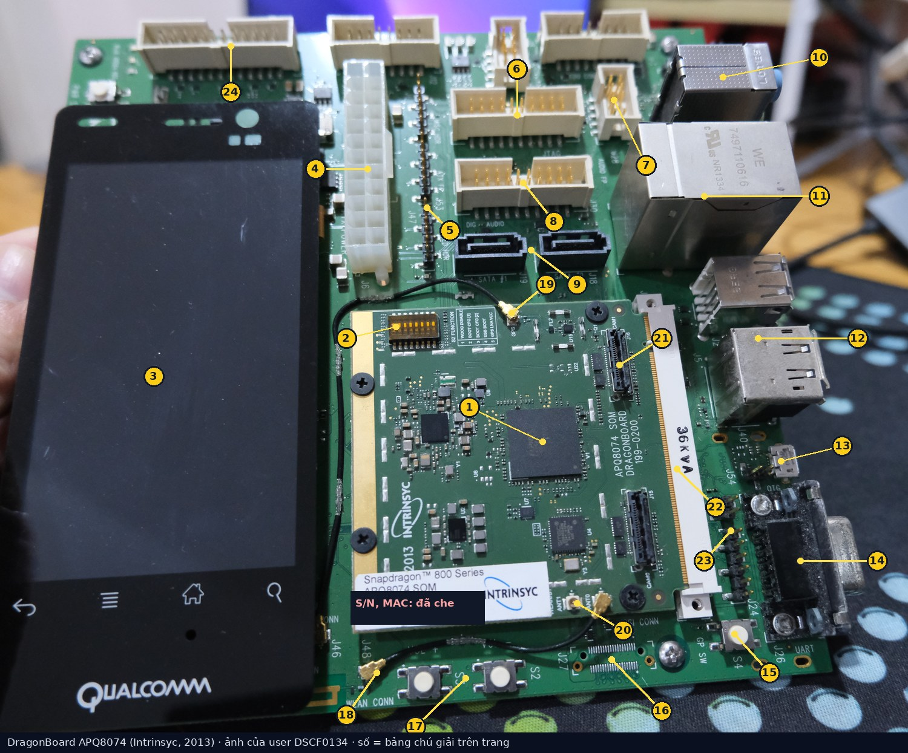
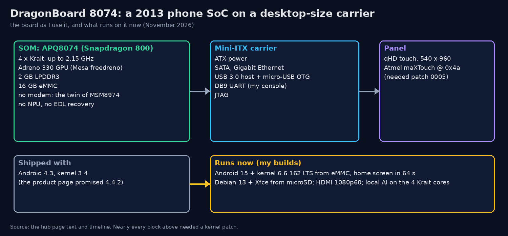

# DragonBoard 8074
{: .no_toc }

This is Intrinsyc's DragonBoard 800 development kit from 2013: a Qualcomm APQ8074 (Snapdragon 800, the
modem-less twin of the phone chip MSM8974) on a small SOM, plugged into a Mini-ITX carrier with ATX
power, SATA, Gigabit Ethernet, USB 3.0, a DB9 UART and JTAG. Four Krait cores up to 2.15 GHz, an
Adreno 330, 2 GB of LPDDR3, 16 GB of eMMC, and a qHD touch panel. Same chip family as the Galaxy Note 3.

Mine shipped with Android 4.3 and a 3.4 kernel (not the 4.4.2 the product page promised). I wanted to
know how far a 13-year-old phone SoC can go with today's software. The answer turned out to be: a lot
further than I expected, but nearly every block needed a kernel patch, and a couple of them nearly
cost me the board.

*The board in one picture: APQ8074 SOM on a Mini-ITX carrier, the qHD panel, and what runs on it now vs what it shipped with.*

## Timeline

| When | What happened |
|---|---|
| 2026-11-14 | Identified the board from a photo, read the old Intrinsyc pages and the mainline device tree |
| 2026-11-14 → 15 | Built Android 15 (android-15.0.0_r36) with kernel 6.6.162 LTS on my build PC |
| 2026-11-15 | First boot from RAM, then Android 15 up to adb, the boot animation, and the Launcher3 home screen |
| 2026-11-16 | Touch, GPU (Mesa freedreno), CPU at 2.15 GHz: boot to home screen from 264 s down to 64 s |
| 2026-11-16 | Boots by itself from eMMC; HDMI driven by kernel 6.6 with a ported PLL |
| 2026-11-17 | Debian 13 + Xfce from microSD; USB host ports; sound on the HDMI monitor; Bluetooth; a GPU hang fixed |
| 2026-11-17 → 18 | IOMMU for the GPU and display; the backlight flicker traced to the WLED switching frequency |
| 2026-11-18 | eMMC re-partitioned: /data from 864 MiB to 10 GiB |
| 2026-11-18 → 19 | AI on the four Krait cores, and an L2 cache driver that lifts memory bandwidth |

## The write-ups

Each one is Situation / Task / Action / Result, with the numbers I measured on the board.



## Still open

The hardware video codec (Venus) is ported but not running. The offline Vietnamese voice assistant
(listen, think, speak, sentence by sentence) works end to end in emulation on my PC, but hasn't run on
the board yet, so it isn't written up. HDMI still needs enabling by hand after each boot.
