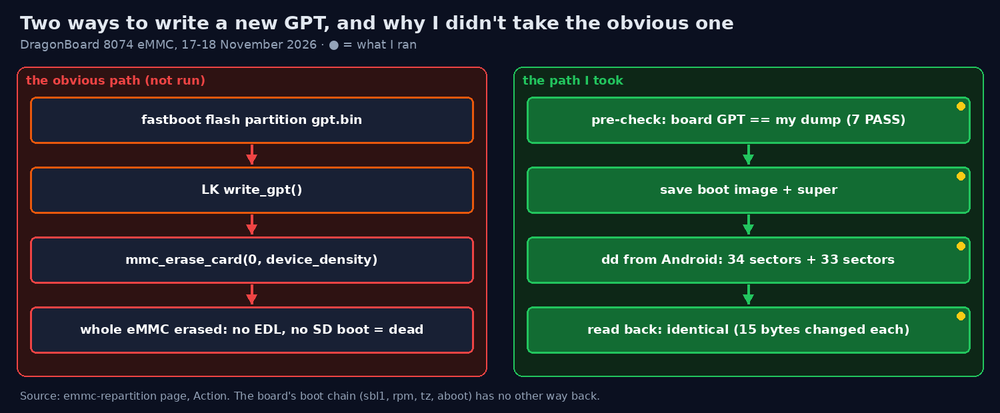
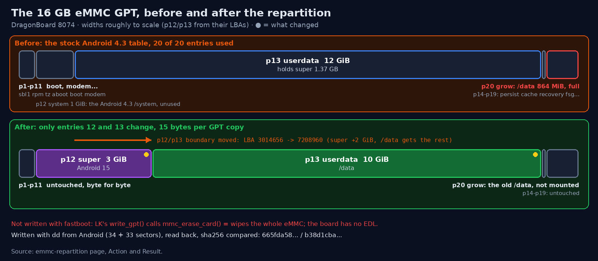

# Re-partitioning the eMMC without the command that would have erased it
{: .no_toc }

[Back to the DragonBoard 8074 hub](/embedded/boards/db8074/)

1. TOC
{:toc}

## Situation

November 2026. Android warned about low storage. When I put super into the userdata
partition back in the first bring-up, /data had to move somewhere, and it landed on the 864 MiB "grow"
partition. So a board with a 16 GB eMMC had less than 1 GB for apps.

## Task

Give /data real space, keep super, and keep every byte of the boot chain (sbl1, rpm, tz, aboot, modem,
persist) exactly where it is.

## Action

**The trap first.** The obvious tool is `fastboot flash partition gpt.bin`. In LK,
`write_gpt()` calls `mmc_erase_card(0, device_density)` before writing: the whole eMMC is erased. This
board has no EDL mode and no SD boot for the boot chain, so it would never start again. So, no fastboot
for the GPT. I'd write it with `dd` from Android, and read it back.


*The two roads: fastboot's `write_gpt()` erases the whole eMMC first (no EDL here, so that's the end), my road writes 67 sectors and reads them back.*


**The layout.** The GPT was full, 20 of 20 entries, so I couldn't add a partition. But two neighbours
were useless as they were: p12 "system" (stock Android 4.3, 1 GiB, unused) and p13 "userdata"
(12 GiB, holding super). I moved the boundary between them:

| Partition | Name | LBA | Size |
|---|---|---|---|
| p12 | super | 917504 to 7208959 | 3 GiB |
| p13 | userdata | 7208960 to 28180479 | 10 GiB |

Everything else stays byte for byte. A small script builds both GPT copies from the dumped originals;
the diff is 15 bytes in each.

```
primary: 15 bytes differ
backup: 15 bytes differ
```

**Pre-checks.** Before writing, the script checks the board's GPT against my dump from the night
before, saves the boot image and super, and refuses to go on if anything differs:

```
00:08:37 verify_gpt.sh: 7 PASS, 0 FAIL
00:08:41 board GPT == dump of 2026-11-17 23:42: OK
00:08:41 PRECHECK OK
```

**The write**, 34 sectors at the start and 33 at the end, then read back:

```
00:16:05 dd new_primary_gpt.bin -> LBA 0..33, new_backup_gpt.bin -> LBA 30212063..30212095
17408 bytes (17 K) copied, 0.003 s, 5.5 M/s
16896 bytes (17 K) copied, 0.005 s, 3.2 M/s
00:16:05 NEW GPT WRITTEN and read back identical. Next: to-fastboot
```

Then my own check stopped me: lk2nd reported the "grow" partition as 0x35ff9a00 bytes and my script
expected 0x35ffda00. Entry 20 turned out identical in old and new GPT, so the expectation in my script
was wrong, not the disk. Fixed the number, went on: flash super (100 s), erase userdata, flash boot.



## Result

```
00:40:13 boot_completed=[1] after 22 s
/dev/block/mmcblk0p13  10G 345M  9.2G   4% /storage/emulated/0/Android/obb
```

/data went from 864 MiB to 10 GiB (9.2 GiB free), and super has its own 3 GiB partition. Each GPT
copy changed by 15 bytes, and nothing else on the eMMC moved. The first boot reached `boot_completed`
after 22 s.

## What I'd do next

The 864 MiB "grow" partition is unused now. The stock Android 4.3 system partition is gone with the
old p12; I saved a full copy of it before the write, so going back to stock is still possible, just
slower.
