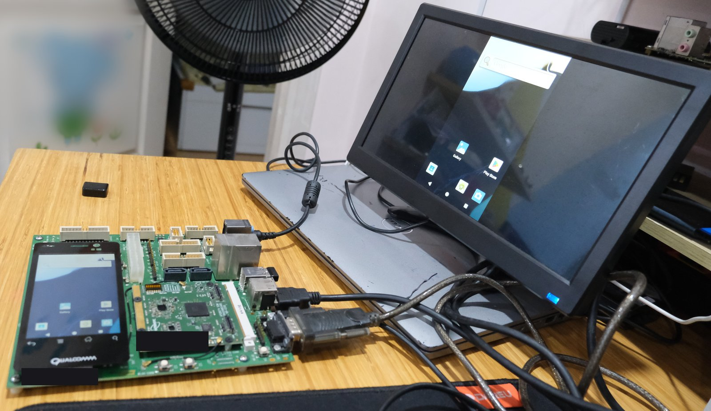
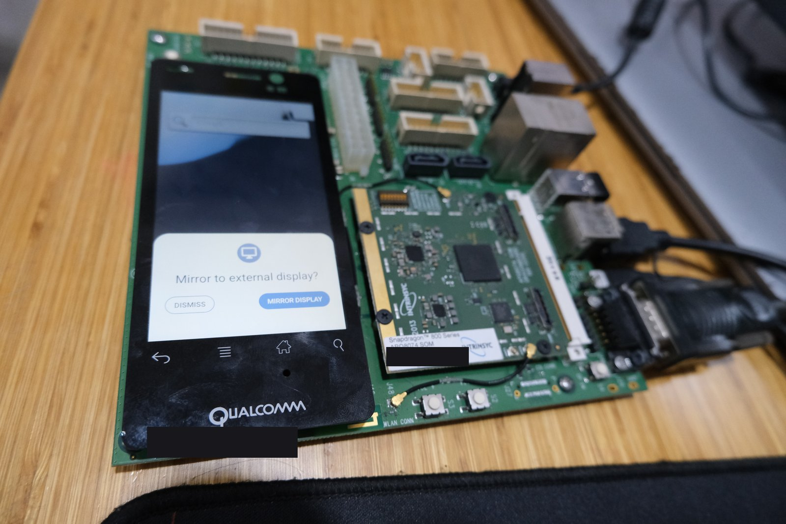
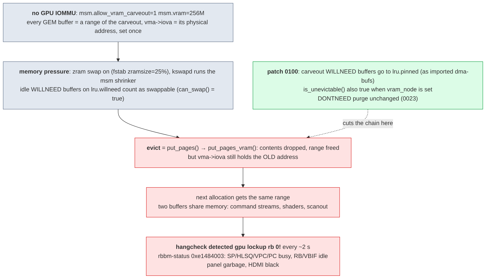
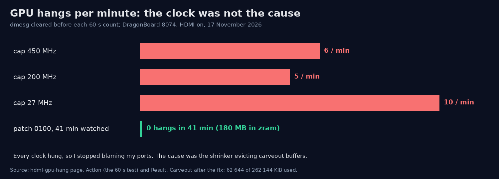

# HDMI from an unmerged patch, then a GPU hang that wasn't the GPU
{: .no_toc }

[Back to the DragonBoard 8074 hub](/embedded/boards/db8074/)

1. TOC
{:toc}

## Situation

16 November 2026. Touch and the panel worked, HDMI showed nothing. No mainline kernel has the HDMI PLL
for MSM8974; it lives only in the vendor 3.4 kernel. A day later, with HDMI working, a new problem: after
some minutes of use the screen turned to garbage and then HDMI went black.


*My desk with HDMI working: the panel and the external monitor both showing Android. Labels painted over, the room behind blurred.*


## Task

Drive HDMI from kernel 6.6. Then make the board survive more than a few minutes of real use.

## Action

**The PLL.** I started from Dmitry Baryshkov's "drm/msm: add support for HDMI on msm8974" RFC from May
2023, never merged, but tested on this very board, with the PLL code from Brian Masney's 2019 RFC.
That became patch 0012 (`hdmi_pll_8974.c`, 749 lines), plus 0013 for the SoC nodes and 0014 for the
board's connector and supplies. I didn't trust the tables blindly: every register value of the 7
pixel rates I kept was checked against the vendor's `clock-mdss-8974.c`, 38 writes each.

On the board the kernel side came up at once: PLL registered, 7 rates from 25.2 to 148.5 MHz, the
connector `connected`, EDID 256 bytes. Still black. Two blockers above the kernel:

1. drm_hwcomposer put 6 planes on one CRTC, and the MDP5 v1.2 mixer refused it about 60 times a
   second (`too many planes! cnt=6`). Fix: `vendor.hwc.drm.use_overlay_planes=0`.
2. Android 15 waits for the user to confirm mirroring to a new display. Fix:
   `cmd display enable-display 2`.


*Blocker 2 in the flesh: Android 15 asking on the panel whether to mirror to the new display. Until someone answers, HDMI stays black.*


Then `hdmi_pll` = 148 500 000 Hz (1080p60) and a picture on the monitor.

**The hang.** The log, every couple of seconds:

```
msm_mdp fd900100.display-controller: [drm:hangcheck_handler] *ERROR* 3.3.0.1: hangcheck detected gpu lockup rb 0!
msm_mdp fd900100.display-controller: [drm:recover_worker] *ERROR* 3.3.0.1: offending task: RenderThread (com.android.systemui)
```

My first suspects were my own ports and the GPU clock. Neither: an older known-good kernel hung the
same way, and every rate gave 5 to 10 hangs per minute:

```
max 450000000: 6 hangs in 60 s
max 200000000: 5 hangs in 60 s
max 27000000: 10 hangs in 60 s
```

I'd briefly believed "cap the GPU at 320 MHz and it stops". Wrong: the dmesg ring buffer had wrapped,
so my hang counter simply stood still. The test above clears dmesg first.

The real cause is in the figure. With no IOMMU, every GPU buffer lives in a 256 MiB VRAM carveout, and
its GPU address is set once. With zram on, kswapd runs the msm shrinker, which "evicts" idle buffers.
For a carveout buffer that means: drop the contents, free the range, and leave the GPU and the display
still pointing at the old address. The next allocation gets the same range, and two buffers share
memory.



Patch 0100 keeps carveout buffers that are in use off the shrinker's list; 0101 adds
`/sys/kernel/debug/dri/0/vram` so I can see the carveout.

## Result

- HDMI driven by kernel 6.6 at 1080p60 (148.5 MHz pixel clock), with the DSI panel still working.
- GPU hangs: 5 to 10 a minute before; after patch 0100, 41 minutes with HDMI on and 180 MB in zram,
  0 hangs. The carveout used 62 644 KiB of 262 144.

```
carveout 0x68100000 size 262144 KiB used 62644 KiB free 199496 KiB largest-free 190368 KiB
```


*Why I stopped blaming the GPU clock: 6, 5 and 10 hangs a minute at three caps, then 0 in 41 minutes with patch 0100.*


## What I'd do next

The carveout was a workaround for "no IOMMU". The same evening I asked myself why there's no IOMMU at
all, and backported Baryshkov's (also unmerged) MSM8974 IOMMU series: Adreno and MDP5 in their own
IOMMU groups, no carveout. In a 17-minute watch that gave 4 hangs, all in the first 2 minutes, none
after, and 0 IOMMU faults. Those early hangs are still unexplained. HDMI also still needs enabling by
hand after every boot.
