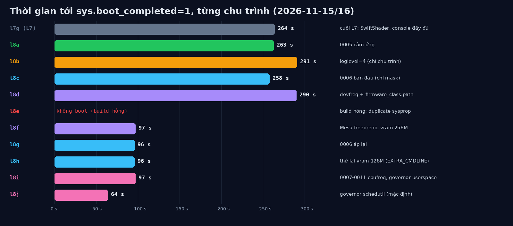

# From 264 s to 64 s: touch, a real GPU, and the Krait cores at 2.15 GHz
{: .no_toc }

[Back to the DragonBoard 8074 hub](/embedded/boards/db8074/)

1. TOC
{:toc}

## Situation

15 to 16 November 2026. Android 15 reached the home screen, but touch didn't work, HDMI was black,
and the whole thing was very slow: 264 s to `boot_completed`, and sluggish after that. The CPU sat at
0.80 GHz and the GPU wasn't used at all.

## Task

Touch first. Then make the CPU run at its real maximum and get the GPU doing the drawing.

## Action

**Touch.** The panel's Atmel maXTouch at 0x4a on BLSP1 I2C1 is in the stock device tree but not in
mainline. I copied the node across (patch 0005) and enabled the driver:

```
atmel_mxt_ts 0-004a: Family: 129 Variant: 1 Firmware V2.0.AB Objects: 16
```

**GPU.** Mesa freedreno instead of SwiftShader. That one change took the boot from 290 s to 97 s.

**CPU.** Mainline has no Krait frequency tables for this chip. Patches 0007 to 0011 port the vendor
ones; the fuse reads speed bin 2, PVS 4, PVS version 0, which picks 13 OPPs from 422.4 to 2150.4 MHz.
With schedutil, 97 s became 64 s.

**The hidden CPU eater.** Even then one core was busy doing nothing useful. `/proc/interrupts` showed
the DSI error interrupt firing about 59 000 times a second (once per video line), and its worker eating
52 to 100 % of a core. Patch 0006 brings it to about once a second. My first version of 0006 only
looked fixed: the screen had gone to sleep, so of course there were no DSI interrupts. I only caught
that by re-measuring with the screen on.

One thing that didn't help, for the record: changing the console log level alone (291 s).



## Result

- Boot to `boot_completed=1`: 264 s before, 64 s after (chart above, ten cycles).
- CPU 0.80 to 2.15 GHz: measured 2.15033 GHz on all 4 cores at 1100 mV, 60 °C.
- DSI error IRQ: about 59 000/s to about 1/s.
- Touch works.

The catch: under a 4-core load without a heatsink it hits the 75 °C trip and throttles between 0.88
and 2.15 GHz.

## What I'd do next

A heatsink. And the GPU at 450 MHz: I added the OPP later, but the GPU mostly idles, so I haven't seen
it matter yet.
