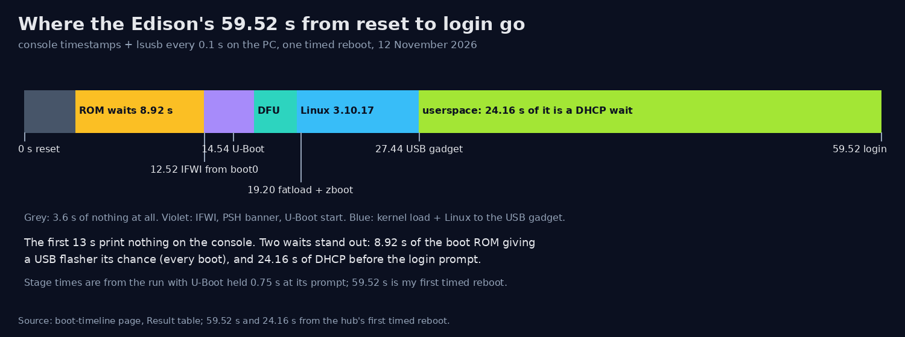
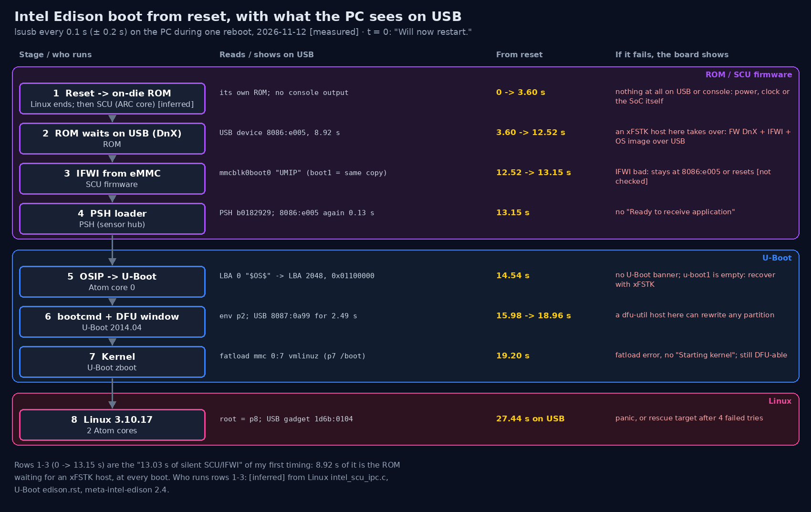

# Timing the Edison boot ROM from the outside, 0.1 s at a time
{: .no_toc }

[Back to the Intel Edison hub](/embedded/boards/intel-edison/)

*59.52 s from reset to login, 8.92 s of it the ROM waiting on USB for a flasher.*

1. TOC
{:toc}

## Situation

November 2026. My Edison booted fine but slowly, and after a reboot the console stayed silent for
about 13 seconds before anything printed. There's no public Intel document for this boot ROM. I also
wanted to know what happens if the eMMC is blank or broken, without making it blank or broken.

*Where my 59.52 s went, drawn from the table further down: 8.92 s of the ROM waiting for a flasher and 24.16 s of DHCP are the two fat ones.*

## Task

Find out what runs in those silent seconds and how long each stage takes, using read-only commands
and one reboot.

## Action

Two views at once. On the console, a script timestamps every line from the reboot command on. On the
PC, a second script polls `lsusb` every 0.1 s, because the stages show up as different USB devices on
the OTG cable even when the console says nothing.

For one run I also stopped U-Boot at its prompt for three read-only commands (`version`, `printenv`,
`mmc part`), about 0.75 s, so the later stages are that much late.

I dumped LBA 0, both eMMC boot partitions and `ext_csd` with `dd` and debugfs (all reads), and
compared them with what xFSTK, the only public flasher for this chip, expects.

## Result

*Each boot stage, who runs it and what the PC sees on USB: 59.52 s from reset to login, 8.92 s of it the ROM waiting.*

| Time from reset | What the PC saw |
|---|---|
| 0 to 3.60 s | nothing at all, on USB or console |
| 3.60 to 12.52 s | USB `8086:e005`: the ROM waits 8.92 s for an xFSTK host |
| 12.52 to 13.15 s | no host, so it reads the firmware (IFWI) from eMMC boot0; boot1 holds the same copy |
| 13.15 s | PSH loader banner, `8086:e005` back for 0.13 s |
| 14.54 s | OSIP at LBA 0 points to U-Boot 2014.04, running from DRAM 0x01101000 |
| 15.98 to 18.96 s | U-Boot's DFU window, USB `8087:0a99`, about 3 s |
| 19.20 s | `fatload` of the kernel from p7, `zboot` |
| 27.44 s | Linux 3.10.17's USB gadget `1d6b:0104` |
| 59.52 s | login prompt, from my first timed reboot (24.16 s of it is a DHCP wait) |

So the 8.92 s USB wait happens at every boot, and that's also the answer to the blank-eMMC question:
the ROM always gives a flasher on USB the first chance. My board's OSIP header matches xFSTK's
template except for 3 bytes, the MBR sector count.

What I didn't do: I didn't actually blank the eMMC. Which code inside the SoC does what before the PSH
banner is my reading of the sources, not something I measured.

## What I'd do next

The cheap win is the 24.16 s DHCP wait. Then build xFSTK and try a real recovery on purpose, so the
"blank eMMC" answer is measured instead of read.
