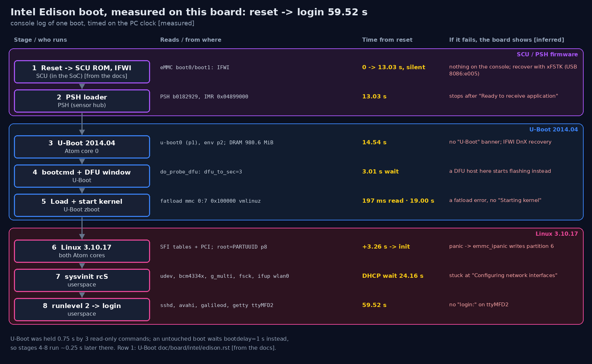
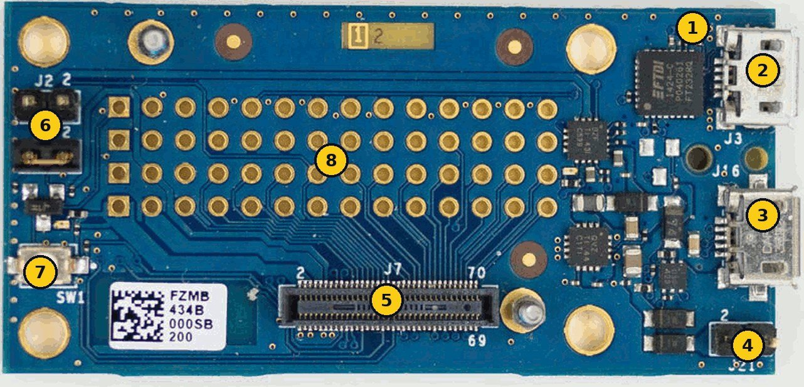

# Intel Edison
{: .no_toc }

The Edison is Intel's 2014 IoT module: a Merrifield/Tangier SoC with two Atom (Silvermont) cores at
500 MHz, 1 GB of RAM, 4 GB of eMMC and Broadcom Wi-Fi, on a module smaller than a matchbox.
Mine sits on the Mini Breakout, which gives it an FTDI console (J3) and a USB OTG port (J16). It still
runs ubilinux (Debian 7.8), kernel 3.10.17 and U-Boot 2014.04.

Why look at it in 2026? It's x86, and every other board on my shelf is ARM. Its kernel has no device
tree; it describes the hardware with SFI tables and PCI instead, which I'd never dealt with. And Intel
dropped it years ago, so whatever I want on it now, I do myself.

*A Mini Breakout like mine (not my board): FTDI console on J3, USB OTG on J16, the 70-pin module connector J7. Photo: Mwilde2, CC BY-SA 4.0, Wikimedia Commons; numbers added by me.*

## What I got it to do

I started with read-only probes on the console: two Atom cores at 500 MHz, 983 516 kB of RAM for
Linux, 11 SFI tables and 36 PCI functions. One timed reboot took 59.52 s from reset to login, and
24.16 s of that was a DHCP wait. The boot ROM prints nothing, so I timed it from the USB side instead,
and that gave me a first answer to what happens when the eMMC is empty. Then I built Zephyr for an out-of-tree
"edison" board and ran it from RAM through the old U-Boot.

## The write-ups

Each one is Situation / Task / Action / Result, with the numbers I measured on my module.



## Still open

Zephyr only uses one core and has no shell yet (UART receive isn't wired up). I haven't tried an empty
or broken eMMC for real, or built the xFSTK recovery tool, so the recovery path is still on paper.
