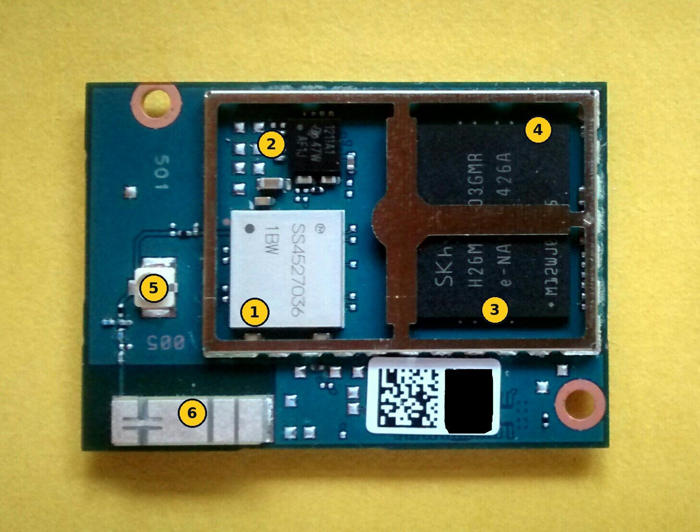
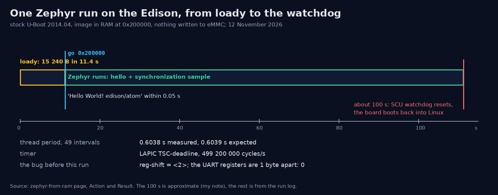

# Zephyr on the Edison: a 15 KB image over YMODEM and one wrong reg-shift
{: .no_toc }

[Back to the Intel Edison hub](/embedded/boards/intel-edison/)


*"Hello World" 0.05 s after `go`, from a 15 KB Zephyr image loaded into RAM over YMODEM.*

1. TOC
{:toc}

## Situation

Same day as the boot timing. I wanted the next step: an RTOS on it. FreeRTOS has no ia32 port that boots from U-Boot's `go`
without writing one. Zephyr has x86 support but no Edison board.


*What's under the shield of an Edison (another module, not mine), parts numbered by me. Photo: Joe Glancy, CC BY-SA 4.0, Wikimedia Commons.*


## Task

Build Zephyr for the Edison and run it from RAM through the stock U-Boot 2014.04. Don't write the eMMC,
don't save the U-Boot environment.

## Action

Built on my build PC: Zephyr v4.5.0-rc1, Zephyr SDK 1.0.1, GCC 14.3.0. I wrote an out-of-tree board
`edison` with every value taken from the running board: the console is the HSU UART at 0xff010180 (the
PCI BAR of 00:04.3 as `/proc/iomem` shows it), the timer is the LAPIC TSC-deadline at 499 200 000
cycles/s, and the console IRQ is 54.

Two build errors first. `#define DT_DRAM_BASE 0x100000` turned into `0x0x100000`, because the
devicetree macro adds the `0x` itself. And the TSC-deadline driver needs `CONFIG_DYNAMIC_INTERRUPTS=y`.
The image lands at 0x200000 (RAM base plus Zephyr's 1 MiB offset on PC-style x86), 15 240 bytes.

U-Boot 2014.04 has `loady`, so I send it over YMODEM:

```
loady 0x200000
## Total Size      = 0x00003b88 = 15240 Bytes
go 0x200000
```

U-Boot said it was starting the application, and then nothing, for 90 s. I'd written `reg-shift = <2>` for the UART from memory. To check, I read the
registers where U-Boot left them: IIR at +2, LCR = 0x03 at +3, so they're one byte apart, reg-shift 0.

Then I made it worse. My third probe was `mw.l` at 0xff010180, a 32-bit write over four 1-byte
registers at once. LCR became 0, 5-bit frames, console gone. At the U-Boot prompt the watchdog is kicked,
so it didn't even reset by itself after 420 s. Power cycle, and the module only came back with both
cables (J3 and J16) unplugged. Use `mw.b` on this UART.

With reg-shift 0:

```
go 0x200000
Hello World! edison/atom
```

Then the synchronization sample, two threads ping-ponging with `k_msleep(500)`, which shows a wrong
timer clock straight away as a wrong period:

```
thread_a: Hello World from cpu 0 on edison!
thread_b: Hello World from cpu 0 on edison!
```

## Result

"Hello World! edison/atom" shows up within 0.05 s of `go`, and 0.05 s is just my script's serial read
timeout, so it could be faster. The thread period came out at 0.6038 s over 49 intervals against about
0.6039 s expected, so the 499.2 MHz TSC-deadline timer is right. Loading is the slow part: YMODEM at
about 1391 B/s, 15 240 bytes in 11.4 s. Nothing was written to the eMMC.

Side effect: Zephyr never kicks the SCU watchdog, so about 100 s after `go` the board resets and boots
back into Linux by itself.


*One run end to end: 11.4 s of YMODEM, "Hello World" 0.05 s after `go`, then about 100 s until the SCU watchdog pulls the board back into Linux.*


## What I'd do next

The second core (it says "cpu 0" for a reason: SMP is off), UART receive for a shell, and feeding that
SCU watchdog.
