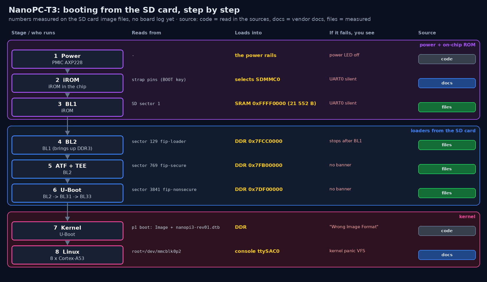
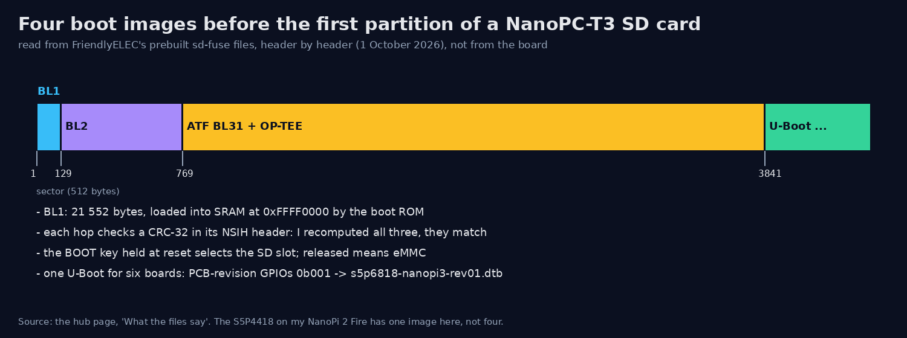

# NanoPC-T3
{: .no_toc }

*Nothing has run on the board yet: these numbers come from the SD card image. Three CRC-32s recomputed, three match.*

The NanoPC-T3 is FriendlyELEC's 100 × 60 mm board with a Samsung S5P6818: eight Cortex-A53 cores
(400 MHz to 1.4 GHz), 8 GB of eMMC, Gigabit Ethernet, Wi-Fi/BT, HDMI 1.4a, LVDS, RGB LCD and MIPI-DSI,
a DVP and a MIPI-CSI camera port. It keeps the interfaces of the older NanoPC-T2.

Its boot ROM is from the same family as the S5P4418 on my
[NanoPi 2 Fire](/embedded/boards/nanopi2-fire/), which I'd already taken apart, so most of my questions
were about what changes when the same design goes 64-bit with ARM Trusted Firmware in the middle.

It hasn't been on my bench yet. So there's no STAR write-up here, only what I've read and checked on
files.

## What the files told me

I read the FriendlyELEC wiki against the schematic, U-Boot and the SD-fuse scripts, then took the
prebuilt SD boot files apart, header by header. Everything below I checked on those files.

The SD card carries four boot images before the first partition, not one like on the S5P4418: BL1 at
sector 1 (21 552 bytes, loaded into SRAM at 0xFFFF0000), BL2 at 129, ATF BL31 + OP-TEE at 769, and
U-Boot at 3841. Each hop checks a CRC-32 in its NSIH header. I recomputed all three and they match.

The BOOT key pulls a strap pin low through a 100 Ω resistor. Released means eMMC, held at reset means
the SD slot, which is why the wiki tells you to hold it when booting from a card. And one U-Boot binary
serves six boards: it reads three PCB-revision GPIOs (0b001 here) and picks
`s5p6818-nanopi3-rev01.dtb`. I also drew the SoC floorplan from the compiled device tree, 86 blocks
enabled.

*The four images in front of the first partition, by sector, as I read them out of the prebuilt files. The S5P4418 on my NanoPi 2 Fire needs one.*

And two mistakes in the vendor wiki I noted: the "aarch64 toolchain" section actually installs the
32-bit armhf compiler from the S5P4418 template, and the kernel output path it gives is the arm32 one.

## The write-ups

None yet: nothing has run on the board, so there is no result to write up.



## What's next

Put it on the bench with a UART on the debug header (UART0, 115200 8N1), capture a boot log and add
real times to each stage of the figure above, then dump `/proc/device-tree` and compare it with the
floorplan I drew from the build.
