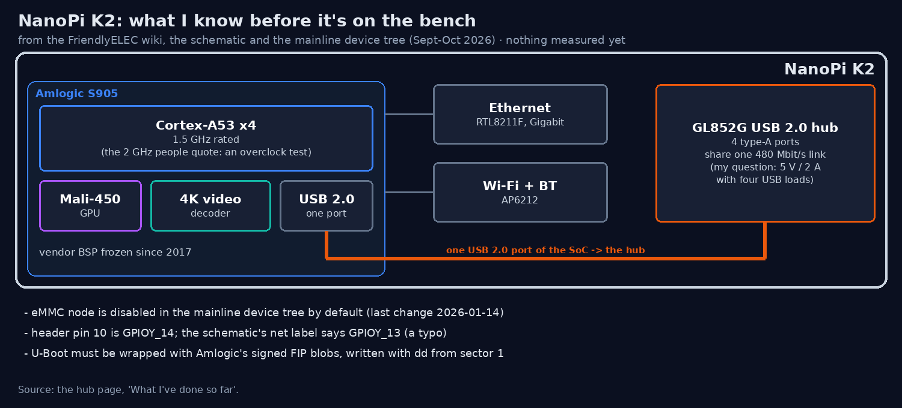

# NanoPi K2
{: .no_toc }

*Ten demos written and four fixed for mainline, none of them run on the board yet. On the left, part of my overview drawing.*

The NanoPi K2 is FriendlyELEC's Raspberry-Pi-sized board with the Amlogic S905: four Cortex-A53 cores
at 1.5 GHz, a Mali-450 GPU, and the 4K video decoder that made the S905 a TV-box favourite. It has
Gigabit Ethernet (RTL8211F), an AP6212 for Wi-Fi and BT, four USB ports behind one hub, and an IR
receiver.

The vendor BSP has been frozen since 2017, so anything current means mainline. I wrote ten small demos
for it (GPIO, CPU governor, thermal, eMMC and network benchmarks, Wi-Fi scan, USB, IR, HDMI framebuffer,
video decode) before having it on the bench, and that's where it still is.

*The K2 as I know it from reading: an S905, its Ethernet and Wi-Fi chips, and the one detail I want to test first, four USB ports sharing one 480 Mbit/s hub.*

## What reading settled

I read the FriendlyELEC wiki, the schematic and the vendor trees, rewrote my pin-out notes from them,
and later checked all ten demos against the mainline device tree. Four needed fixing (GPIO line names,
eMMC, the video decoder, USB).

1.5 GHz is the rated clock. The 2 GHz people quote is FriendlyELEC's overclock test, not a spec. The
four type-A USB ports sit behind one GL852G USB 2.0 hub, so they share 480 Mbit/s. Mainline still
supports the board (its device tree was last touched in January 2026), but the eMMC node is disabled
by default, so Armbian or LibreELEC are the sane OS choices today. Pin 10 of the header is GPIOY_14;
the schematic's net label says GPIOY_13, which is a typo. And U-Boot has to be wrapped with Amlogic's
signed FIP blobs, then written with `dd` from sector 1, keeping the MBR.

Only one demo has run anywhere: `gpio_led_blink` passes against `gpio-sim` on my PC. Every README says
"result when run" with an empty slot for the first real log.

## The write-ups

None yet: nothing has run on the board, so there is no result to write up.



## What's next

Get the board on the bench with Armbian, run all ten demos and paste the real logs. The questions only
the hardware can answer: 4K H.265 decode on mainline, heat without a heatsink, 5 V / 2 A with four USB
loads, and whether it boots eMMC before SD. I also still haven't read the S905 datasheet itself.
