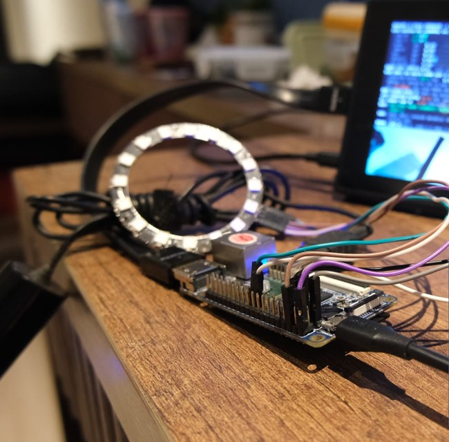
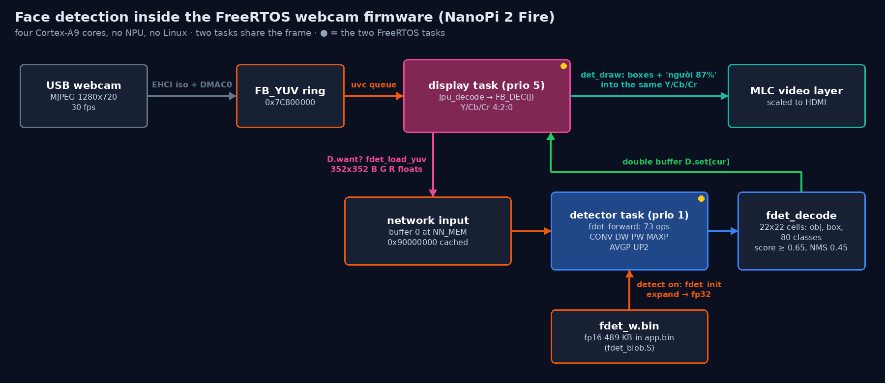
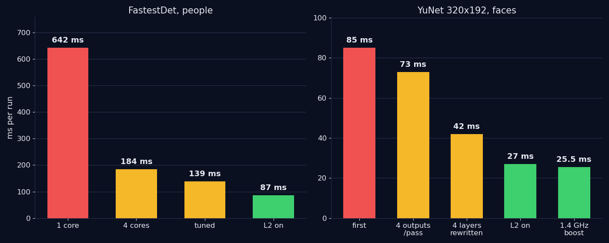

# Face detection on four 2016 Cortex-A9 cores, no NPU, no Linux
{: .no_toc }

[Back to the NanoPi 2 Fire hub](/embedded/boards/nanopi2-fire/)

1. TOC
{:toc}

## Situation

By mid-October the [webcam stream](/embedded/boards/nanopi2-fire/webcam-to-hdmi) used under 2 % of
one core, and cores 1–3 were sitting idle. The S5P4418 has no NPU and no DSP. There's a Mali-400 GPU,
but that's a whole other project. So the only thing to run a neural net on is four Cortex-A9 cores
with NEON, under my own FreeRTOS, with no Linux and no onnxruntime.

*The setup for all of this: board, webcam, HDMI screen, and the 16-LED ring that later counts the people in view.*

## Task

Draw a box around every person on the HDMI picture, live. Then, a week later, only faces, and fast enough that the box keeps up when I move my head.

## Action

### A network runner in plain C

I picked FastestDet (small, 80 COCO classes) and wrote `tools/fdet_gen.py` to lower the ONNX model to
a list of ops (73 of them: conv, depthwise, pointwise, pool, upsample) plus a blob of fp16 weights
(489 KB) linked into the firmware. `fdet.c` runs them in C, with NEON kernels.

Before touching the board I checked it on the PC against onnxruntime, on 17 images. In fp32 the
head matched to 1.3e-4 and every person box matched (IoU ≥ 0.9). With fp16 weights, plain C and NEON
(under qemu) kept every person box, 17/17, so that's what I used. Per-channel int8 I threw out: box
logits off by up to 4.9, and the person count wrong on 5 of 17.

The checker also found my bug: a crowd photo gave 73 candidate cells and my list had 64 slots, so a
0.657 box fell out before NMS. 256 slots now.

### First run on the board

The first load didn't even finish (my USB-serial adapter's TX wire, it turned out). Then a person
run at 352×352 took 642 ms on one core and 184 ms on four (3.49×), and both found the same 6 people.
It worked. It was also hopeless for a moving person.

### Faces only: YuNet

FastestDet has no face class, and cutting the top off a person box isn't face detection. So I lowered
YuNet (OpenCV zoo, MIT) through the same generator: 59 ops, 109 388 bytes of fp16 weights. Two new op
shapes were needed (2×2 max pool, and nearest ×2 plus a skip add fused into one op). Same check: 12/12
images match onnxruntime. On the board, 208 ms a run at 448×256.

Both networks ended up in one firmware (`fdet.c` compiled twice with renamed symbols), switched with
`detect model face|coco` in 2–9 ms.

### Making it keep up

The box lagged my face, for two reasons: the detector was capped at 2 runs a second, and a run took
~205 ms, so the box showed where I'd been 0.2 s ago. Changes:

1. Input 320×192 (near faces are all kept; a crowd photo drops from 29 faces to 4, fine for a webcam).
2. Each box set remembers the tick of the frame it was computed from, and the display moves the box
   by its measured speed up to "now", at most 400 ms ahead.
3. With nobody in view, run 2 times a second and let the worker cores sleep in `wfe`.

Then the slow part, the network itself. I counted multiply-adds from the op shapes and compared with
the times on the board. Pointwise layers ran at ~18 % of what NEON can do, depthwise ~3 %, the first
conv ~4 %. So it wasn't arithmetic, it was memory:

- depthwise went over every channel five times (bias, pad copy, taps, ReLU);
- the first conv rewrote all its output planes (1 MiB, more than the L2) once per input plane;
- the 1×1 layers read planes 61 440 bytes apart, a multiple of 4 KiB, so they all fought over the
  same few sets of the 4-way L1.

I rewrote those four layers to keep values in registers and read each input once. Padding taps are
skipped instead of added as 0 × w, and everything else is summed in the old order, so the result is
the same bits. `tools/fdet_same.py` runs the old and new ARM builds under qemu and compares outputs
byte for byte: 0 of 12 runs differ.

I also tried the JPU decoding a half-size copy just for the network. It saved 0.9 ms of core 0 per run
(7.42 → 6.50 ms). Honest result: small.

## Result

YuNet at 320×192 on 4 cores started at 85 ms a run (9.7 runs/s, face at 0.930). A conv with 4
outputs per pass got it to 73 ms, and the four rewritten layers to **42 ms**, bit-identical.

*Every step I measured, left to right. The green bars come from the [L2 cache story](/embedded/boards/nanopi2-fire/hang-and-l2-cache): FastestDet 642 → 87 ms, YuNet 85 → 25.5 ms.*

Person detection went **642 ms → 184 ms** from 1 to 4 cores, and FastestDet later down to 139 ms.
Faces went **85 → 42 ms** on the CPU alone, outputs identical bit for bit, and the webcam kept 30.00
frames a second the whole time. The worker cores are ~71 % busy with a face in view and 12–14 % with
nobody (they were ~85 % flat out before). `detect max <n>` now gives exactly n runs a second (my
first version undershot: 15 gave 9.9):

| detect max | runs/s | CPU of a core |
|---|---|---|
| 0 (no limit) | 29.1 | 74.7 % |
| 15 | 15.2 | 37.3 % |
| 5 | 5.1 | 12.4 % |

And the LED ring on the header got a job: N people in view, N lit spots chasing each other round the ring.

The story continues in [the hang at 186 s and the L2 cache that was never on](/embedded/boards/nanopi2-fire/hang-and-l2-cache),
which took YuNet from 42 to 27 ms.

## What I'd do next

The 5 face landmarks are computed but not decoded or drawn yet. And pointwise (16 ms) is now the
biggest layer type; that's where the Mali-400 experiment would start.
