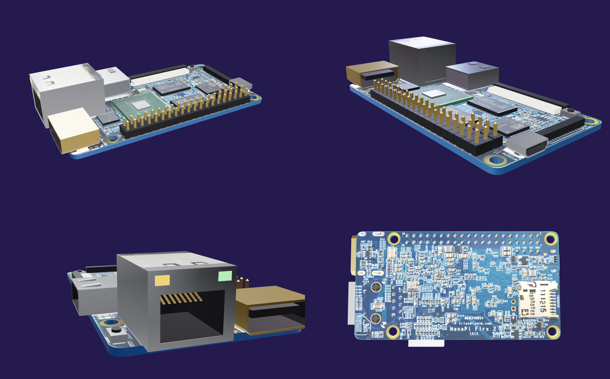
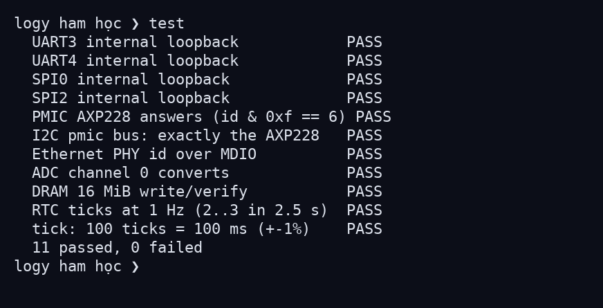
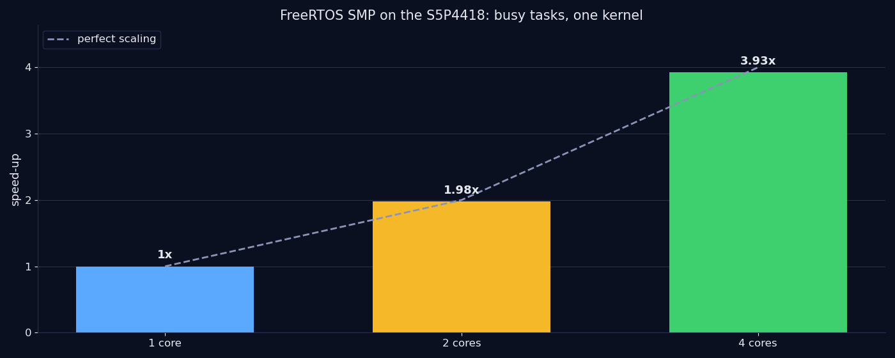

# FreeRTOS on four Cortex-A9 cores: AMP, SMP and one CPSIE too many
{: .no_toc }

[Back to the NanoPi 2 Fire hub](/embedded/boards/nanopi2-fire/)


*The whole story in one picture: 3.93 times the speed on four cores under one SMP kernel, and a 10 µs AMP round trip. The board is my 3D model of it.*

1. TOC
{:toc}

## Situation

After the [USB boot and DRAM work](/embedded/boards/nanopi2-fire/usbboot-dram) I had code running from
DRAM, but only on core 0, and only a toy shell. The S5P4418 has four Cortex-A9 cores and I'd never
started a secondary core by hand on any chip. I also wanted a real RTOS under everything that came
next (webcam, HDMI), not a superloop.



*The board from four sides (a model I put together from FriendlyELEC's drawings). The green square in the middle is the S5P4418: four Cortex-A9 cores, and at this point three of them did nothing.*

## Task

Three steps. FreeRTOS from DRAM, with a shell that tests every peripheral I can test without wiring.
Then AMP: a second, separate FreeRTOS on core 1, talking to core 0. Then SMP: one FreeRTOS kernel
scheduling tasks on two cores, and after that all four.

I started the AMP/SMP part just before going to bed on 1 October and let it run overnight. That
matters later.

## Action

### rtos_cli: FreeRTOS V11.2.0 with a shell

A tiny SRAM loader brings up DRAM and the MMU, then pulls the app over the UART into DRAM. The port is
FreeRTOS's own ARM_CA9 one. It needed the GIC base (at `0xF0000000`, with the SoC's VIC behind it on
PPI 31), unique interrupt priorities and the A9 private timer for the tick.

A few things bit me on the way. The RTC read as dead, but its registers sit behind an
`ALIVEPWRGATEREG` gate and the counter had been running all along (open the gate, read, close it).
PWM duty came out inverted (TCMPB = TCNTB × duty, not the other way). And the AXP228 temperature
formula I took first was the AXP20x one. 24 commands in the end, plus a `test` command that runs 11
checks:



(The prompt in that screenshot is from a later, coloured version of the shell.)

### AMP: waking core 1

Core n is held in reset by bit n of `RSTCON[0]`. Core 0 writes an entry address somewhere, releases
the core, and the core picks the address up. My first try passed the address through an RTC scratch
word. It worked once, then it didn't: core 1 polled that word
41 million times without seeing the value core 0 had written and could read back itself. Writing the
RTC block while core 1 read it even stalled core 1. So the handoff moved to a mailbox in plain DRAM,
and core 1 came up after 3 polls.

The board's watchdog saved me more than once that night: a stuck loader reset itself back into
USBBOOT, and the scripts just reloaded.

### SMP: the lock that never came back

Two cores came up under one kernel, the shell ran on core 1, everything passed except `smp ping`,
which failed two ways: a data abort with `pxCurrentTCBs[core] = NULL`, or a stall where core 0 held
both kernel locks forever.

At about 1 a.m. one of those stalls hung the board hard. Core 0's tick kept kicking the watchdog, so
it never reset; my USB hub can't switch power; I was asleep. It sat dead from 01:01 to 06:29 until I
power-cycled it.

With ticket locks and a lock log in DRAM it got clearer. The serving counter stopped at 2514: core 0
held the task lock and never released it while still taking ticks, so it held the lock *with
interrupts on*. The leaked level was taken by `vTaskSwitchContext()`.

The chain:

```
vTaskSwitchContext()                      // entered with IRQs off (CPSR.I = 1)
  taskCHECK_FOR_STACK_OVERFLOW()
    pxCurrentTCB                          // in the SMP kernel: a call, not a variable
      xTaskGetCurrentTaskHandle()
        portSET_INTERRUPT_MASK() ...
        portCLEAR_INTERRUPT_MASK()        // ends with CPSIE i  ->  CPSR.I = 0
  ...an IRQ nests inside the half-done switch
```

On one core the same `CPSIE` is in the port too, but there `pxCurrentTCB` is a plain variable, so
nothing inside the switch calls the mask functions. The SMP kernel turned a variable into a function
call and the port's assumption broke. Fix in `port.c`: the mask functions only turn IRQs back on if
they were on when called.

### Four cores

`configNUMBER_OF_CORES = 4`. Core 3 sometimes misses its first release and needs a second one
(41 ms later in one boot, first try in another). Nexell's `bl1` retries too, which made me feel
better about it.

## Result

All 11 peripheral tests pass. The AMP round trip from core 0 to core 1 and back is **10 µs**, with
5/5 restarts and 0 lost pings. Under one SMP kernel, two busy tasks on two cores run **1.98×** as
fast as on one, and four on four run **3.93×**. After the CPSIE fix `smp ping` did 33 000 round trips
with no hang, abort or overflow. A lock increment costs 1.7 µs with all four cores fighting for it,
and both locks were still balanced after 10 million operations. The one number I don't like: a
context switch takes ~24 µs on SMP against 5.3 µs single-core, and I haven't profiled it yet.



*Busy tasks under one SMP kernel: 1.98× on two cores, 3.93× on four. The dashed line is perfect scaling; four cores lose about 2 % to the locks.*

One more mistake, found weeks later: the per-core "busy %" was divided by the core's own cycle
counter, which stops while the core sleeps in `wfe`. A core asleep half the time showed 100 %. It now
divides by core 0's tick time.

## What I'd do next

Profile that 24 µs SMP switch. Nothing I've looked at (the SGI, the pending-interrupt wait) explains
it, so it's somewhere in the SMP kernel's switch path.
