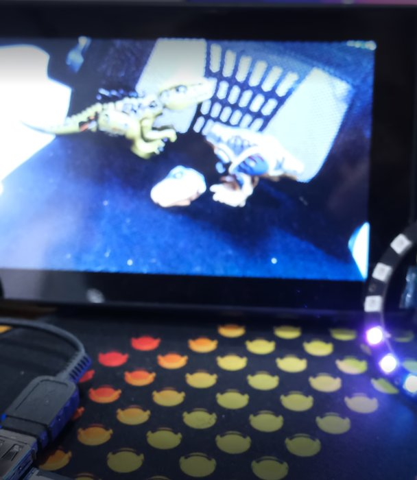
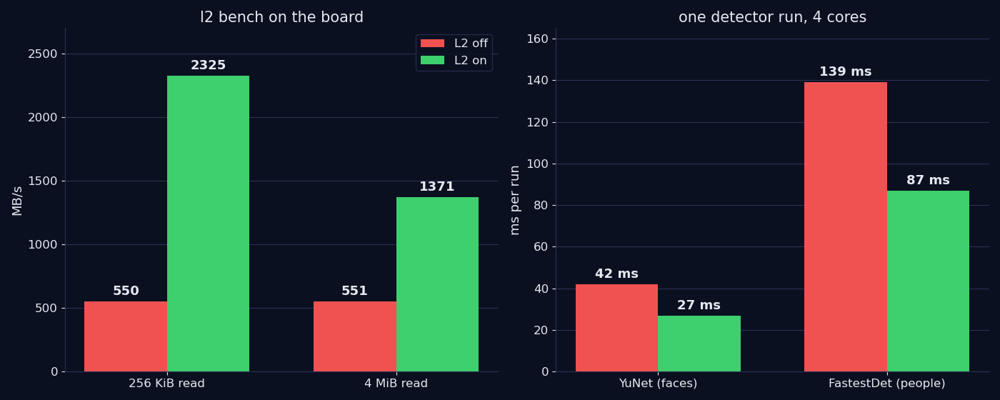

# A hang at 186 s, and a 512 KB L2 cache nobody had switched on
{: .no_toc }

[Back to the NanoPi 2 Fire hub](/embedded/boards/nanopi2-fire/)

1. TOC
{:toc}

## Situation

23 October 2026. The [face detector](/embedded/boards/nanopi2-fire/face-detection) was booting from
the microSD card and running fine, until it wasn't. The board froze: webcam LED still on, HDMI showing
one still frame, nothing on the UART. And the watchdog, which I'd armed weeks before, never reset it.



*My screen on a normal card boot: the webcam looking at two toy dinosaurs, the ring lit on the right. On the bad days it looked exactly like this, except the picture never moved again.*

The day after, with the hang gone, I asked myself a different question: is there anything on this SoC
that should be on and isn't?

## Task

Find why it hangs, and make any future hang reset the board and tell me where it was. Then go
through the CPU setup for anything left switched off, and turn it on.

## Action

### Why the watchdog didn't fire

The tick hook kicked the watchdog whenever `app_alive()` said so, and the default `app_alive()` always
said yes. So the tick kept a frozen board "alive". I replaced it with a real stall detector: stop
kicking if the idle task hasn't run for 5 s, or if no frame has reached HDMI for 5 s while streaming.
Before letting go it prints a black box line straight to UART0: which task holds core 0, the stream and
detector counters, and the last 8 interrupted program counters, which the IRQ handler now saves.

### When and where

Every hang came about 180–190 s after boot: card boot with the LED ring on, with it off, older
firmware, all the same. Loaded over the UART (where saved settings aren't replayed) it ran 774 s fine.
The black box:

```
!!! STALL at tick 186442: no frame reached HDMI for 5 s; core 0 runs task 'uvcdisp'; ...
uvc frames 5556 shown 5406 ...
pc 71025eb0 71024c48 71025eac 71025eb0 71025e74 71025eb0 71025e74 71025eb0
```

`addr2line` on those:

```
DecodeJpegDHT      nx_jpu_api.c:1380
JPU_DecParseHeader nx_jpu_api.c:1560
vld_get_bits       nx_jpu_api.c:848
DecodeJpegDHT      nx_jpu_api.c:1374
```

The vendor's JPEG header parser, reading Huffman tables. One damaged MJPEG frame from the webcam had
a DHT segment whose 16-bit length was 0 or 1. `iLength = length - 2` became −2, and the loop test
compares that `int` with a `uint32_t`, so −2 became 4 294 967 294 and the loop kept reading (and
writing past `huffValue[4][162]`) through DRAM. On my PC the same bytes (`FF D8 FF C4 00 00`, zeros,
`FF D9`) segfault the parser; on the board all of DRAM is mapped, so it just keeps going.

Fix: a DHT must hold at least one table and fit in the bytes left, at most 162 codes per table, a
signed compare, and a bad segment drops the frame.

### The L2 audit

`md 0xcf000000` showed a PL310 L2 controller, and its control register was 0. Off. Nothing in my code
had ever touched it. Anything bigger than the L1 ran at DRAM speed:

```
l2 bench
  16 KiB:   ... 13107 MB/s
  256 KiB:  ... 550 MB/s
  4096 KiB: ... 551 MB/s
```

I invalidated all ways and set Control = 1. The board hung on the spot, every time. I wrote it up as
"needs something from Nexell's secure boot" and made `l2 on` refuse. That conclusion was wrong.

The next day I went through FriendlyELEC's kernel and U-Boot properly, and found two pieces I'd
missed. The kernel gives the PL310 an address filter, `0xC0000000..0xCFF00000`. Without it the L2
sent device accesses (my UART at `0xC00A1000`) to its DRAM port, which is the instant hang. And
U-Boot takes the L2 RAMs out of retention through TIEOFF bits 12–13 (`QUADL2C_L2RET1N_0/_1 = 1`).
With only the filter there was no hang, but the bench read back wrong data.
With both, plus the vendor's latencies (3 4 3) and prefetch offset 7, it works. It now runs from a
hook before the scheduler starts.

### And 1.4 GHz, only when there's a face

The vendor's DVFS table goes to 1.4 GHz at 1.22 V; I was at 1.2 GHz, 1.20 V. `cpu_boost()` raises the
AXP228's DCDC2 to 1.22 V, waits 2 ms, parks the CPU on PLL3, relocks PLL1 at 1400 MHz and moves back.
It goes up when a run finds a face and down 2 s after the last one. The first version cost one JPU
error per clock change; it now waits until the JPU isn't decoding.

## Result

| | Before | After |
|---|---|---|
| Run time past the 186 s mark | hang | **417 s clean**, through two network switches |
| L2 read, 256 KiB | 550 MB/s | 2325 MB/s |
| L2 read, 4 MiB (with prefetch) | 551 MB/s | 1371 MB/s |
| YuNet, one run | 42 ms | **27 ms** |
| FastestDet, one run | 139 ms | 87 ms |
| YuNet with the 1.4 GHz boost | 27.6 ms | 25.5 ms |



*Red is L2 off, green is L2 on, same board, same firmware otherwise. A 256 KiB read goes 4.2× faster, and both detectors drop by about a third.*

From the card, 300 s recorded with L2 on: no reset, no STALL, 29.94 frames/s, 11 362 JPU decodes with
0 errors and 1 bad header. That one bad header is a damaged frame the new DHT check dropped. Before
the fix, it would have hung the board.

Since the first face-detector run on the board, YuNet went 85 → 27 ms and FastestDet 184 → 87 ms.

## What I'd do next

The boost still loses about one webcam frame per clock change in some runs (3 missed over ~6 changes
once). I'd like that at zero. And the stall detector stays in: if this board ever hangs again, it
resets in 20 s and leaves a pc on the UART.
