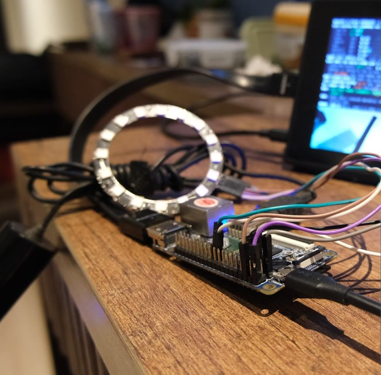

# NanoPi 2 Fire
{: .no_toc }

*YuNet faces in 27 ms on the four A9s, the webcam on HDMI for 1.5 % of a core, 3.4 s from reset to picture, and 3.93 times the speed on four cores.*

The NanoPi 2 Fire is a 75 × 40 mm board from FriendlyELEC (FriendlyARM back then), from around 2016.
It has a Samsung S5P4418: four Cortex-A9 cores rated at 1.4 GHz, 1 GB of DDR3 on a 32-bit bus,
Gigabit Ethernet, HDMI, a microSD slot, one micro-USB and a Raspberry-Pi-style 40-pin header. No eMMC,
no Wi-Fi. The PMIC is an AXP228.

I picked a board this old for two reasons. Its vendor software is only lightly maintained, so if I
want something modern on it I have to build it myself. And the S5P4418 boot ROM falls back to USB when
there's no card, which means I can push code into SRAM from my PC and start from zero: no U-Boot, no
Linux, just my own code and the Cortex-A9 manual.

I had just done a "USB webcam to HDMI" demo on my Allwinner D1 board, so the plan was the same here,
but on bare metal and FreeRTOS. It went a lot further than that.

<video controls muted playsinline preload="metadata" poster="{{ '/assets/images/boards/nanopi2-fire/np2f_sdboot_169_poster.jpg' | relative_url }}" style="width:100%;max-width:720px"><source src="{{ '/assets/videos/boards/nanopi2-fire/np2f_sdboot_169.mp4' | relative_url }}" type="video/mp4"></video>

*My own microSD card booting the board, 147 s: what sits in the first megabyte (loader in sectors 1–32, my table at 64, the app from 128), the boot ROM copying 16 KB into SRAM, RAM ready at 0.2 s, every image CRC-checked by 2.2 s, and the webcam on HDMI 3.4 s after reset. (Vietnamese on-screen text, music.)*

## What I got it to do

The USB boot ROM let me load my own code into SRAM, and from there I brought up the 1 GiB of DDR3 by
hand. On top of that went FreeRTOS with a shell, first one kernel per core and then one kernel on all
four. Then the USB webcam on HDMI, with the copy on DMA and the decode on the JPEG unit, and a microSD
card that boots straight into it. On a different card I ran FriendlyELEC's Android 7.1.2 and drove a
WS2812 ring from it. The last big piece was detection on the webcam stream: person detection went from 642 ms a
run to 87 ms, and faces from 85 ms to 27 ms.

## The write-ups

Each one is written as Situation / Task / Action / Result, with the numbers I measured on the board.



## Still open

Two things aren't written up because there's no result yet. Linux on cores 0–2 next to FreeRTOS on
core 3 is built but has never booted on the board. And the Mali-400 GPU taking over part of the
detector is only a plan, I haven't started it.
