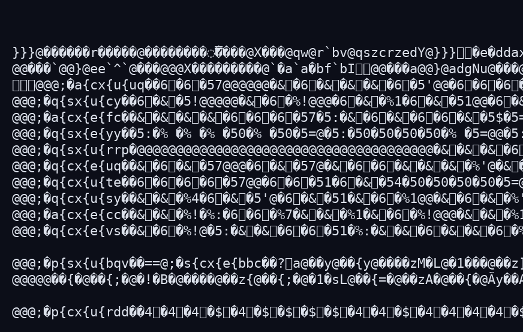
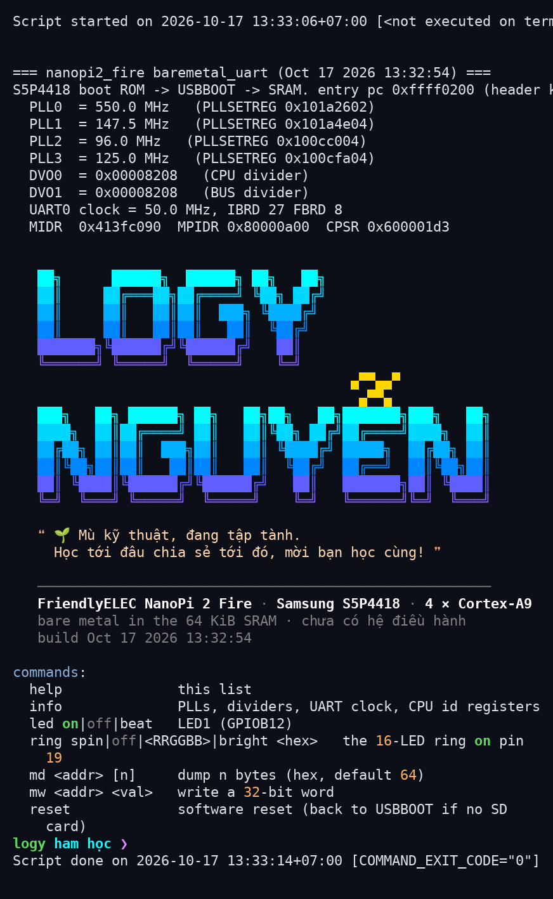
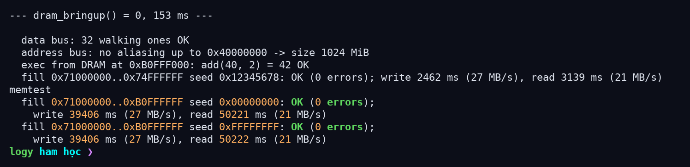

# USB boot ROM, a UART running 9 % slow, and 1 GiB of DDR3
{: .no_toc }

[Back to the NanoPi 2 Fire hub](/embedded/boards/nanopi2-fire/)

1. TOC
{:toc}

## Situation

30 September 2026, late evening. The NanoPi 2 Fire was on my desk with nothing in the SD slot and a
micro-USB cable to the PC. On my D1 board I'm used to FEL: the ROM sits on USB and you push code in.
I wanted to know if the S5P4418 has something like that, because then I could skip U-Boot and Linux
completely and start from my own code.

<video controls muted playsinline preload="metadata" poster="/assets/images/boards/nanopi2-fire/np2f_usbboot_explainer_poster.jpg" style="width:100%;max-width:360px"><source src="/assets/videos/boards/nanopi2-fire/np2f_usbboot_explainer.mp4" type="video/mp4"></video>

*Everything on this page in 107 s: empty slot, the ROM on USB as `04e8:1234`, 15 360 bytes into the 64 KiB SRAM, garbage on the UART, DDR3 training, then FreeRTOS spinning the LED ring from DRAM. The log lines are from my run of 17 October. (Vietnamese on-screen text, no sound.)*

## Task

First, find out what the board does with no card. Then get a bare-metal program of my own running
from the internal SRAM, with a UART shell. And from that SRAM program, bring up the 1 GiB of DDR3
myself and prove every bit of it works.

## Action

### The ROM is already waiting

With the slot empty, `lsusb` showed a new device:

```
$ lsusb
Bus 003 Device 030: ID 04e8:1234 Samsung Electronics Co., Ltd
```

That's the USBBOOT ID from the manual's descriptor table. Vendor class `FF/FF/FF`, bulk EP1 IN + EP2 OUT
at 512 bytes, high speed, no kernel driver. So the ROM tries the SD card, fails, and falls back to USB
on its own. No strap, no button. I didn't send anything yet: whatever lands on EP2 gets executed.

The protocol turned out to be simple. Nexell's `bl1` source has a copy of the same USB-boot code: the
first 512 bytes are an "NSIH" header (load address, size), then the payload, then the ROM jumps. Nothing
ever comes back on EP1. It's "push and jump", nothing like FEL's read/write/exec commands.

I wrote a small `usbboot.py` (pyusb, looks the device up by VID:PID because the device number changes
on every reset) and a udev rule so I don't need sudo.

### First run: garbage at 115200

The ROM took the image and my code ran. I could tell because bytes came out in line-shaped bursts.
But it was garbage, with `}}}` where my `===` banner should be. Wrong baud rate.



*What 115200 looked like: the right number of lines, the wrong bits.*

So I scanned. Open the port at a rate, send Enter, look for my `np2f>` prompt:

```
101000 b'\r\nnp2f> '
...
108000 b'\r\nnp2f> '
good range 100500 .. 110000 count 20
center 105250.0
```

The board was talking at about 105 250 baud, 0.914 × 115200. Its UART clock was ≈45.7 MHz, not the
50 MHz my code had computed. The clock register held exactly what I wrote (PLL0 = 550 MHz, divider
field 10 = ÷11). So either PLL0 was off, or the divider doesn't do what the manual says.



*Same firmware, terminal opened at 105 250 instead: a clean banner. Note it still claims `UART0 clock = 50.0 MHz`: that's the number my code computed, not what the hardware did.*

I changed the divider live with `mw` and scanned again each time:

| Divider field | Manual says | Measured baud centre | Real divider |
|---|---|---|---|
| 10 | ÷11 | ≈105 250 | ÷12 |
| 4 | ÷5 | ≈211 000 | ÷6 |
| 1 | ÷2 | ≈632 000 | ÷2 |
| 2 | ÷3 | ≈317 000 | ÷4 |

PLL0 was fine. The UART0 clock generator rounds an odd divider up to the next even one. I haven't
found that written down anywhere. Fix: only use even dividers. With ÷12 and IBRD/FBRD = 24/55 the
banner came out clean at 115200:

```
=== nanopi2_fire baremetal_uart (Sep 30 2026 23:08:09) ===
S5P4418 boot ROM -> USBBOOT -> SRAM. entry pc 0xffff0200 (header kept at 0xffff0000)
  PLL0  = 550.0 MHz   (PLLSETREG 0x101a2602)
  UART0 clock = 45.8 MHz, IBRD 24 FBRD 55
np2f>
```

I also added a `reset` command (the same PWRCONT/PWRMODE bits U-Boot uses). With no card, a soft reset
drops the board straight back into USBBOOT, so the loop "edit, `make run`, test, `reset`" needs no hands.

### DDR3

The `dram_init` demo raises PLL3 to 800 MHz and calls Nexell's `ddr3_initialize()` from their `bl1`
(vendored, with only `printf` added). The first run trained fine:

```
clocks after PLL3 -> 800 MHz: locked
Gate Leveling Success!!
DLL Lock Value = 154
--- ddr3_initialize() = 0, 68 ms ---
(nothing more)
```

and then hung on the very first test write to `0x40000000`. Board dead, manual reset.

I had assumed DRAM starts at `0x40000000`. It doesn't, on this board. U-Boot's config and the kernel
device tree both say `0x71000000`, and `bl1`'s `membase_calcurate()` adds `0x31000000` for a 1 GB
part. On this SoC a read or write to an address nothing answers never completes, so the core just
stops. Moved `DRAM_BASE` to `0x71000000`, and also flushed the UART before the PLL change because the
first banner had garbage in the middle of it.

## Result

Second run:

```
  data bus: 32 walking ones OK
  address bus: no aliasing up to 0x40000000 -> size 1024 MiB
  exec from DRAM at 0xB0FFF000: add(40, 2) = 42 OK
  fill 0x71000000..0x74FFFFFF seed 0x12345678: OK (0 errors)
```

Then the full memtest over the whole 1 GiB with two complementary seeds:

```
memtest
  fill 0x71000000..0xB0FFFFFF seed 0x00000000: OK (0 errors); write 39045 ms (27 MB/s), read 49430 ms (21 MB/s)
  fill 0x71000000..0xB0FFFFFF seed 0xFFFFFFFF: OK (0 errors); write 39045 ms (27 MB/s), read 49852 ms (21 MB/s)
```

So: **1 GiB of DDR3 at 800 MHz, 0 errors over 2 × 1 GiB**, init in 68 ms, all from a 12 KB SRAM
program. The timer agrees with the wall clock too (177.4 s by the PMU counter, 177 s by `date`).

27/21 MB/s looks awful, and it is. MMU and D-cache are still off in this demo, so it's a "does every
bit work" test, not a bandwidth number. The DLL lock value also moves a bit from boot to boot (152,
154, 159). I think temperature and voltage at training time explain it, but I didn't measure that.



(That screenshot is a later run of the same test, with the coloured shell I added afterwards.)

## What I'd do next

Turn on the MMU and caches to get a real bandwidth number, and check whether a card with no valid NSIH
(blank, or FAT-formatted) also makes the ROM fall back to USB. The manual doesn't say and I haven't
tried it.
