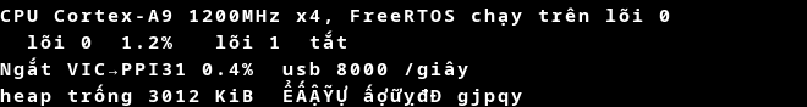

# USB webcam to HDMI on FreeRTOS, from 66 % CPU to 1.5 %
{: .no_toc }

[Back to the NanoPi 2 Fire hub](/embedded/boards/nanopi2-fire/)

*MJPEG to HDMI for 1.5 % of one core instead of 66.5 %, and 3.4 s from reset to the webcam on screen.*

1. TOC
{:toc}

## Situation

I'd already done "USB webcam on the HDMI screen" on my Allwinner D1 board, with a Logitech B525. Same
camera model here. On the NanoPi I had [FreeRTOS running](/embedded/boards/nanopi2-fire/freertos-four-cores)
but no USB host stack, no HDMI driver, nothing. Just the S5P4418 manual, the FriendlyELEC kernel and
U-Boot sources to read, and the D1's UVC code.

## Task

Webcam picture on HDMI, from FreeRTOS, at the camera's full frame rate. Then make the CPU do as little
of it as possible, because I wanted cores free for something heavier later. And then make it work with
no PC at all: power on, picture.

## Action

### First picture

HDMI came first: the PHY locks and the whole bring-up takes 163 ms. One trap on the way: reading the
HDMI block before `hdmi on` had turned its clock on hung the board until the watchdog fired. On this
SoC a read of an unclocked block never completes. `hdmi info` now refuses until the clock is on.

USB: the EHCI controller answered on the first try (`HCIVERSION 0x0100`, 3 ports). Its PHY has no
registers of its own; it's all tie-off bits at `0xC0011000`. Four of the bit positions I'd copied
were wrong and would have poked another block's tie-offs. Caught before anything ran.

The iTDs completed but came back empty at first. That's normal: a UVC camera answers isochronous INs
with zero-length packets until the sensor has a picture. Once it had one: 950 complete frames, no
error of any kind, and the picture right on the monitor.

The catch was the copy from USB buffers into the frame: 59 % of the CPU with `memcpy`.

### Moving work off the CPU

| Step | What does the work | CPU, measured per window |
|---|---|---|
| `memcpy` copy | core 0 | 66.5 % |
| NEON copy | core 0 | 36.8 % |
| PL080 DMA, polled every 1 ms | DMAC | 2.0 % |
| DMA, polled every 4 ms | DMAC | 1.0–1.4 % |
| + JPEG unit (JPU) decoding MJPEG | EHCI → DMAC → JPU → display | **1.5–1.7 %** up to 1080p30 (YUYV: 1.1 %) |

`ps` lied at first. It divided each task's run time by the total since boot, which was mostly time
with no stream, so I added `uvc load <ms>` to measure over a window. Every number in the table comes
from that.

The JPU decoded, but most frames ended in a "bitstream buffer end" interrupt. I'd set the end address
to the data length rounded up to 1 KiB, and the JPU fetches whole pages ahead. Setting the end to the
end of the whole 4 MiB buffer fixed it: 4.86 ms per 720p frame. Also, the camera's MJPEG has no
Huffman table (DHT) in it, so the JPU uses its built-in standard tables. Remember that one, it comes
back in the [hang story](/embedded/boards/nanopi2-fire/hang-and-l2-cache).

Then interrupts instead of polling (one DMAC interrupt per frame, the JPU returns 0.85 ms sooner), and
H.264 from a clip on the VPU: 720p30, 5.4 ms per frame, **0.3 % CPU**, 2397 frames over 7 loops with
0 errors.

Loading that H.264 firmware over the UART took 43.9 s, and my loader only kicked the watchdog after
the whole image. The watchdog was armed for 15 s. So it reset the board mid-transfer, every time.
It kicks every 4 KiB now.

### 275 MHz, not 1.2 GHz

While adding an on-screen display I noticed the cycle counter counted 274 988 850 per RTC second. The
CPU was at 275 MHz the whole time. The registers said 1200 MHz, but writing the divider isn't enough:
the manual wants `PWRMODE.CHGPLL` set, and the vendor's 2ndboot does it from code that is already
in the I-cache because the clocks stop during the change. I wrote the same as `pll_change()`, and the
counter measured 1 199 950 988 Hz.

Then the timers went wrong, because some objects still had `275000000` compiled in. The Makefile had
no header dependencies, so changing `FreeRTOSConfig.h` rebuilt nothing. Classic. At 1.2 GHz the DMA
completion check also started failing: the PL080 stops with `DestAddr` on the last beat, one width
short of the end, and the faster CPU looked sooner. Both fixed.

### Modes, OSD, and a card that boots on its own

`stream <mode> <fps>` picks any of the B525's 50 modes (25 sizes, YUYV and MJPEG). YUYV tops out at
10 fps at 720p because USB 2.0 carries ~18–20 MB/s of image; MJPEG keeps 30 fps at every size. The
OSD shows per-core load in Vietnamese or English for 0.1 % of the CPU, once I moved the clear to a DMA
fill. And `uvc ae manual <ms>` locks the exposure: at 30 ms I get exactly 30.00 frames a second.

<video controls muted playsinline preload="metadata" poster="{{ '/assets/images/boards/nanopi2-fire/np2f_uvc_ae_169_poster.jpg' | relative_url }}" style="width:100%;max-width:720px"><source src="{{ '/assets/videos/boards/nanopi2-fire/np2f_uvc_ae_169.mp4' | relative_url }}" type="video/mp4"></video>

*How the board asks the webcam about exposure: one USB control transfer per question, the real answer bytes, then SET_CUR to manual at 300 × 100 µs. Result on the board: 150 frames in 5 s = 30.00. (Vietnamese on-screen text, no sound.)*

*The OSD font my FreeRTOS draws with, Vietnamese by default.*

For the microSD image I wrote `mksdimg.py`: loader at sector 1 where the ROM looks, then app, clip and
settings. No card reader on the PC that day, so the running board wrote its own card. First attempt
failed in a fun way: I trusted a register to tell me where the loader had booted from, but it holds
the strap setting (SD first, USB as fallback), not what the ROM actually used. The image now carries a
flag instead.

## Result

**MJPEG to HDMI costs 1.5–1.7 % of one core** up to 1080p30, against 66.5 % with `memcpy`. Raw YUYV
runs 640×480 at 29.4 fps or 1280×720 at 9.9 fps, 0 errors in 1671 frames, and H.264 720p30 from the
VPU costs 0.3 %.

From the card, **reset to webcam on HDMI takes 3.4 s** with no PC (loading over the UART was ~80 s).
The board also comes back from a power cycle with its last settings: OSD language, stream mode, cores
and their loads. I checked one: English OSD, YUYV 1280×720 at 9.91 fps, 599 of 599 frames, core 2 at
40.4 %.

One thing that never got fixed: my PC's USB-serial adapter drops off the bus at the moment the camera
starts streaming (3 drops in 10 cycles, all 1–2.6 s after `SET_INTERFACE`). The scripts wait for it to
come back and retry. No idea why yet.

## What I'd do next

Put a FAT partition from 1 MiB on the card for logs and clips (right now a PC sees nothing on it), and
find out what really kills that serial adapter.
