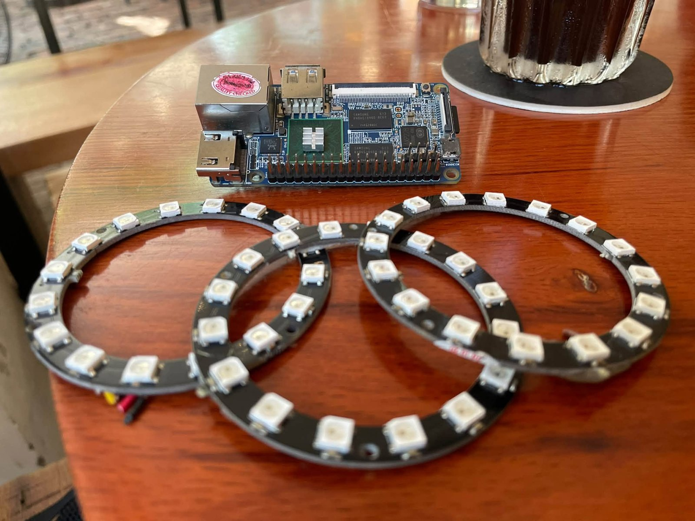
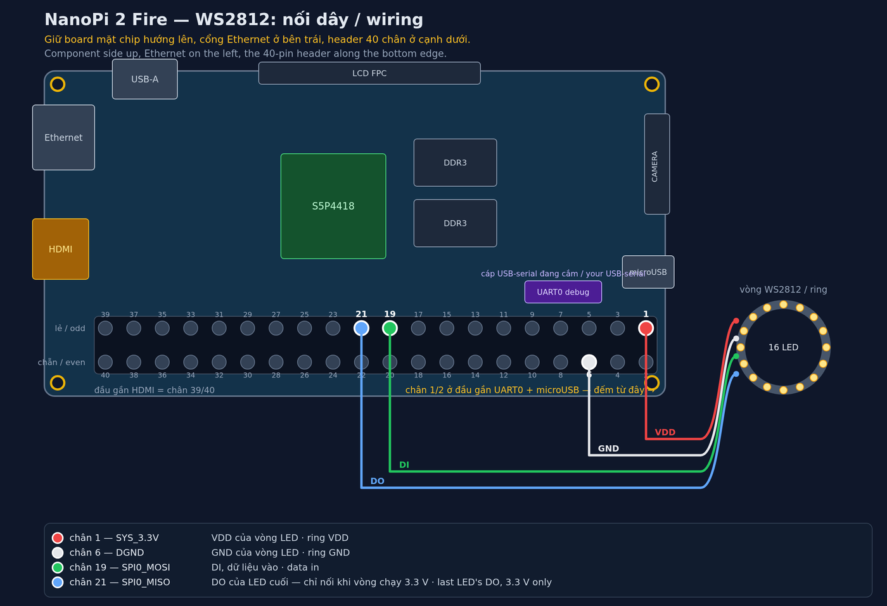
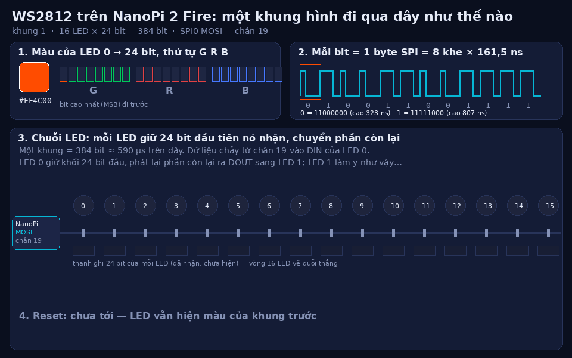
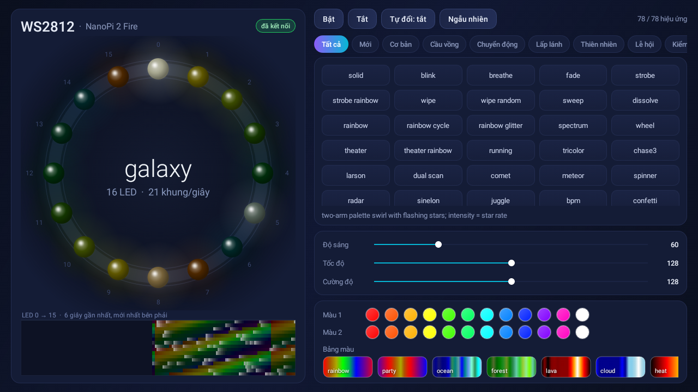

# A WS2812 ring from Android 7 over spidev, and why it flickered
{: .no_toc }

[Back to the NanoPi 2 Fire hub](/embedded/boards/nanopi2-fire/)

*16 LEDs running every effect smoothly from Android, 480 of 480 bytes read back clean, from a 33 KB app.*

1. TOC
{:toc}

## Situation

After two weeks of bare metal I wanted to see the board's own Android once, and I had a few 16-LED
WS2812 rings lying around. WS2812s need tight bit timing (a few hundred ns per pulse), Android gives a
normal app no access to hardware, and the S5P4418 has no LED peripheral. The usual trick is SPI: send
bytes whose bit patterns look like WS2812 pulses on MOSI.

*Where it started: the board and three 16-LED rings on a café table, nothing wired yet.*

## Task

Put Android on a microSD card and boot it. Drive the ring from Android through `/dev/spidev0.0`,
smoothly. And write a small app for the HDMI screen to pick effects, with the ring drawn live.

## Action

### Android 7.1.2 on a card

FriendlyELEC doesn't publish one Android `.img` any more, only parts plus a partition map, so I wrote
`android_sd.sh`: `fetch` clones their `sd-fuse_s5p4418`, downloads the current image (282 MB), checks
its sha256; `fuse` refuses to run without `CONFIRM=<device>` and won't touch a non-removable disk, then
runs their own `fusing.sh`. Writing the card took 4 min 33 s.

It booted: Android 7.1.2 (API 25), launcher at 1280×720, about 61 s from power to picture on the first
boot. One gotcha: `/data` was 4.44 GiB on an 11.82 GiB partition. `fusing.sh` runs `resize2fs` for
FriendlyCore and friends, but for `android7` it only does `echo ""`. Fix is an `e2fsck` + `resize2fs`
with the card in a PC.

### Wiring

*DI to pin 19 (SPI0 MOSI), VDD to pin 1, GND to pin 6, DO back to pin 21 (MISO), counted from the right end of the header.*

First attempt: nothing lit. The board side was right (GPIOC31 muxed to SPI0). I'm fairly sure I'd
counted pins from the wrong end of the header: from the HDMI end, "pin 1" is pin 39, a ground. I drew
this picture from the silkscreen on the board's underside, and after that all 16 LEDs came up red.

I also wired the last LED's DO back to MISO, so the program can read back what the ring passes on.

### Timing that didn't match the request

No requested SPI clock gave bit times inside the WS2812 windows. Instead of modelling it I measured:
each ioctl costs ~100 µs, and the rest scales with length at a fixed fraction of the requested rate:
0.835 with 8-bit words, 0.907 with 16-bit. Both fit one number: the controller leaves an idle gap of
**1.5 clocks after every word**. So I made one LED bit exactly one SPI word and checked the period with
the gap included.

*One frame on the wire, 13 s loop. In this drawing each LED bit is one SPI byte (8 slots × 161.5 ns), 384 bits for the ring, each LED keeps the first 24 and passes the rest on, then the line stays low past 280 µs and all 16 latch. (Vietnamese labels.)*

The readback said the ring wasn't a classic WS2812B: its 1s came back at 482 ns and 0s at 321 ns,
which is the WS2812B-V5's timing (with a longer reset). New threshold, driven reset: probe 16/16,
verify 480/480.

### The flicker

Colours were right, but the ring flickered. What I ruled out, with measurements:

| Suspect | Test | Verdict |
|---|---|---|
| current | 113 mA static, steady; every frame 75–76 mA | no |
| latch time | 300 µs and 2000 µs flicker the same | no |
| slow frames | render ≤ 28 µs per frame | no |
| line idle level between frames | hold MOSI low for the whole gap | **gone** |

My solid-colour tests could never have shown it: a frame that slid by a few bits is the same frame
when every pixel is equal. Twice I also tested while an old animation was still running, so two
processes interleaved frames on one device node. The port takes an exclusive `flock` now.

### The app

SELinux blocks an app from opening spidev even with mode 0666, and `su` only works for the shell. So
the native program became a root daemon on `127.0.0.1:5812` and the app is a client that sends text
commands. The on-screen ring is the real frame: the app asks for `px` about 21 times a second
(measured) and draws each LED.

*The app on the board's HDMI: the galaxy effect on the 16 LEDs, the on-screen ring redrawn about 21 times a second.*

No Android Studio, no Gradle: build-tools 30.0.3 and platform 25 downloaded into a folder in my home,
then `aapt2` → Eclipse's Java compiler (the `javac` on that PC was a broken wrapper) → `d8` (which also
desugars the lambdas API 25 doesn't have) → `zipalign` → `apksigner`. The APK is 33 KB. 78 effects,
eight of them written for this ring.

## Result

**The 16-LED WS2812B-V5 ring runs every effect smoothly from Android**, probe 16/16 and readback
480/480 bytes clean. Frames go out at ~190–208 Hz, and the default spidev buffer fits up to 170 RGB
LEDs per ioctl. The 33 KB app ran on the board, and a tap on the screen changed the real ring.

A week later the same green-flickering LED 0 came back in my bare-metal driver for the webcam
firmware. Same cause: the PL022 lets go of the TX line when it isn't sending, so it floated high
between frames and LED 0 read the first bit (the top bit of green) as a 1. Driving the line low over
the gap fixed it there too.

## What I'd do next

The board reset once right after installing the app, and I don't know why. My guess is the 5 V supply
(board, screen and ring on one adapter, during the heaviest load Android puts on it), but I didn't
measure it. The ring should get its own supply. The daemon also doesn't start at boot yet.
