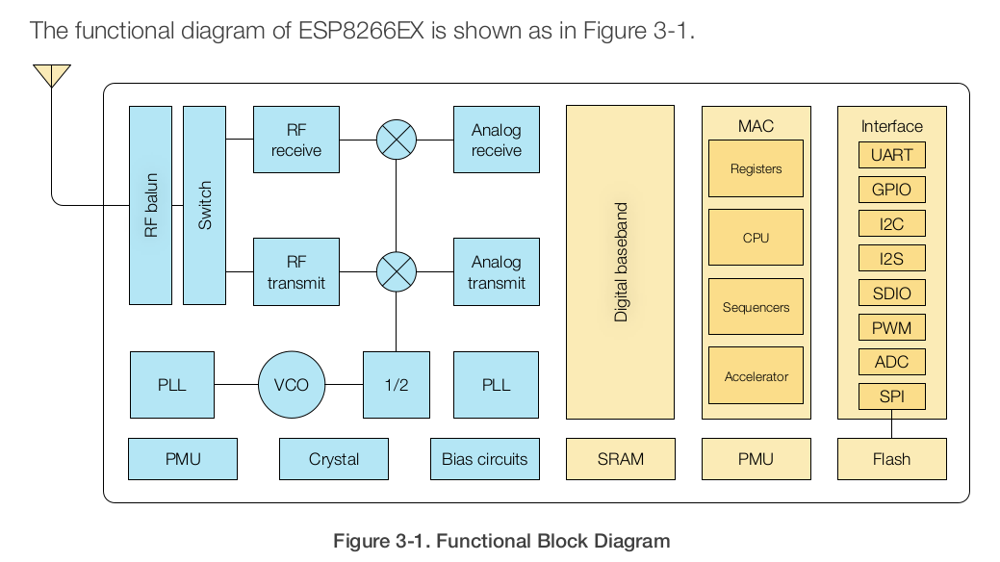

<!-- 2026-11-22: rewritten in STAR form (user «hãy viết lại tất cả các trang theo chuẩn STAR»).
     Same facts, tables and code as the 2026-11-22 English version; nothing added. -->

# ESP8266 Flash Map & Partition Table
{: .no_toc }


*The default two-OTA layout: a 3072-byte table at 0x8000, and two 960 KB app slots because of the 1 MB rule.*

## Table of contents
{: .no_toc }

1. TOC
{:toc}

---

## Situation

On a hobby board you flash `app.bin` and forget about the rest. Firmware that ships needs a lot
more on its flash than the app: data from the factory, data that is different on every chip (Wi-Fi
calibration), user settings that must survive an update, and a second app slot so an update can
happen at runtime. I had never looked at how any of that is laid out.

## Task

Work out how Espressif lays the flash out on the ESP8266EX, from address 0x0 up: what each region
is, who reads the partition table, and what the rules are when I write my own table. The ESP8266 is
small enough to read end to end, and the same ideas come back on the bigger chips. Part two, what
happens at power-on and who reads all this, is [Boot sequence on the ESP8266](/embedded/esp8266-boot-up).

## Action

### The chip, quickly

The ESP8266EX is a System on Chip from Espressif. I started with the block diagram and the memory
section, because the flash layout only makes sense once you know there is no internal flash at all.



#### CPU

A Tensilica L106, 32-bit RISC, up to 160 MHz. Espressif says RTOS + the Wi-Fi stack take about
20% of the CPU, so roughly 80% is left for the application.

The CPU talks to memory over three buses:
- **iBus**: instruction RAM/ROM interface to the memory controller; also how code runs from flash (through the cache)
- **dBus**: data RAM interface to the memory controller (a hardware bus, nothing to do with D-Bus on Linux)
- **AHB**: peripheral registers

#### Memory

Inside: a memory controller, SRAM and ROM.

- **ROM**: Espressif's boot code. You can't write it.
- **SRAM**: with Wi-Fi in station mode and connected to an AP, what's left for the application
  (heap + data) is **about 50 KB**. You feel that limit quickly.
- **No internal programmable flash**: the app lives on an external SPI flash chip.

<div class="warning">
<p>Because the flash is a separate chip on SPI, anyone with the board in their hands can read it, rewrite it, or swap it. If that matters for your device, plan for flash encryption and secure boot.</p>
</div>

#### External SPI flash

| | |
|---------|--------------|
| Maximum supported size | 16 MB (in theory) |
| Minimum without OTA | 512 KB |
| Minimum with OTA | 1 MB |

How that flash is split up is described by a **partition table**.

### The flash map

From address 0x0 up, with the SDK's default OTA layout:

```
┌──────────────────────────────────────────────────────────────┐
│  0x00000  │  Second-stage bootloader (bootloader.bin)         │
│           │  (loaded by ROM bootloader)                       │
├───────────┼──────────────────────────────────────────────────┤
│  0x08000  │  Partition Table (3072 bytes, up to 95 entries)   │
│           │  + MD5 checksum                                   │
├───────────┼──────────────────────────────────────────────────┤
│  0x09000  │  NVS (Non-Volatile Storage)                      │
│           │  Wi-Fi credentials, user config, PHY calibration │
├───────────┼──────────────────────────────────────────────────┤
│  0x0D000  │  OTA Data (which app slot to boot)               │
│           │  (only present in OTA-enabled firmware)           │
├───────────┼──────────────────────────────────────────────────┤
│  0x0F000  │  PHY Init Data (RF calibration parameters)       │
├───────────┼──────────────────────────────────────────────────┤
│  0x10000  │  Application Partition (ota_0 or factory)        │
│           │  Main firmware code                               │
│           │  ...                                              │
├───────────┼──────────────────────────────────────────────────┤
│  0x110000 │  Application Partition (ota_1)                   │
│  (OTA)    │  Second firmware slot for OTA updates            │
│           │  ...                                              │
├───────────┼──────────────────────────────────────────────────┤
│  End      │  (Optional: filesystem, custom data partitions)  │
└──────────────────────────────────────────────────────────────┘
```

### The partition table

One flash chip, several apps and several kinds of data (calibration, file systems, settings).
The table at offset **0x8000** says which is where; the bootloader and the app both read it.

| Property | Value |
|----------|-------|
| Location | flash offset 0x8000 |
| Length | 0xC00 (3072 bytes) |
| Entries | up to 95 |
| Integrity | MD5 checksum appended after the last entry |
| Entry size | 32 bytes |

Each 32-byte entry, as `gen_esp32part.py` packs it (yes, the ESP8266 SDK uses the tool with the ESP32 name):

| Field | Size | What |
|-------|------|------|
| Magic | 2 bytes | `AA 50` |
| Type | 1 byte | `app` (0x00), `data` (0x01), or your own (0x40–0xFE) |
| SubType | 1 byte | meaning depends on Type |
| Offset | 4 bytes | start address in flash |
| Size | 4 bytes | size in bytes |
| Name | 16 bytes | ASCII label |
| Flags | 4 bytes | bit 0 = `encrypted` |

#### The two built-in tables

When you build with Espressif's build system you pick OTA or non-OTA in menuconfig, and it
builds the matching default table for you.

**Non-OTA** ("Single factory app, no OTA"):

| Name | Type | SubType | Offset | Size |
|:-----|:-----|:--------|:-------|:-----|
| nvs | data | nvs | 0x9000 | 0x6000 (24 KB) |
| phy_init | data | phy | 0xF000 | 0x1000 (4 KB) |
| factory | app | factory | 0x10000 | 0xF0000 (960 KB) |

The bootloader runs whatever is at 0x10000, labelled `factory`. Everything else is data.

**OTA** ("Two OTA app"):

| Name | Type | SubType | Offset | Size |
|:-----|:-----|:--------|:-------|:-----|
| nvs | data | nvs | 0x9000 | 0x4000 (16 KB) |
| otadata | data | ota | 0xD000 | 0x2000 (8 KB) |
| phy_init | data | phy | 0xF000 | 0x1000 (4 KB) |
| ota_0 | app | ota_0 | 0x10000 | 0xF0000 (960 KB) |
| ota_1 | app | ota_1 | 0x110000 | 0xF0000 (960 KB) |

So the OTA table gives up 8 KB of NVS to make room for `otadata`, and the two app slots start at
0x10000 and 0x110000.

#### How the bootloader picks a slot

```
                     ┌──────────────┐
                     │  otadata     │
                     │  partition   │
                     └──────┬───────┘
                            │ "Which slot is active?"
                            │
              ┌─────────────┼─────────────┐
              │             │             │
       ┌──────▼──────┐           ┌──────▼──────┐
       │   ota_0     │           │   ota_1     │
       │ (current)   │           │ (new OTA)   │
       └─────────────┘           └─────────────┘
```

1. `otadata` empty: the bootloader boots `ota_0`.
2. The running app downloads the new image into the *other* slot (`ota_1`).
3. When the download is complete and checked, the app writes `otadata` to point at `ota_1`.
4. Reboot: the bootloader reads `otadata` and boots `ota_1`. Next update goes to `ota_0`.

### Type and SubType

**Type**: 0x00 `app`, 0x01 `data`. 0x00–0x3F are reserved for Espressif; for your own data use
0x40–0xFE. The bootloader ignores anything that isn't `app` or `data`, but your app can still
find those partitions through the partition API.

**App subtypes** (from `esp_partition.h` in the SDK):

| Value | Name | |
|-------|------|-------------|
| 0x00 | factory | the default app when there's no OTA |
| 0x10 | ota_0 | first OTA slot, booted when `otadata` is empty |
| 0x11 | ota_1 | second OTA slot |
| 0x12–0x1F | ota_2 … ota_15 | more slots, up to 16 in total |
| 0x20 | test | test app |

**Data subtypes**:

| Value | Name | |
|-------|------|-------------|
| 0x00 | ota | which OTA slot is selected. Make it 0x2000. |
| 0x01 | phy | PHY *init* data. Not used by default (the init data is compiled into the firmware), so you can drop it. To use it, enable `ESP_PHY_INIT_DATA_IN_PARTITION` in menuconfig, and then you flash the PHY data there yourself. |
| 0x02 | nvs | for the NVS API. Holds the per-device PHY *calibration* (not the same thing as `phy` above), Wi-Fi settings when you use `esp_wifi_set_storage(WIFI_STORAGE_FLASH)`, and whatever your app stores. At least 0x3000; 0x6000 if the app stores a lot. |
| 0x03 | coredump | core dump |
| 0x80 | esphttpd | |
| 0x81 | fat | FAT filesystem |
| 0x82 | spiffs | SPIFFS |

### Offset and size: the rule that bites

<div class="warning">
<p>An app partition has to sit entirely inside one 1 MB block of flash. The default app start, 0x10000, is fixed; to move it, change it in <code>menuconfig</code>. Offsets must also be aligned (the tool wants 4 KB for apps) or <code>gen_esp32part.py</code> refuses the table.</p>
</div>

Careful: it's not "a multiple of 1 MB", the SDK doc says it must *fall within one* 1 MB block. Look at the OTA table again: 0x10000
+ 0xF0000 ends exactly at 0x100000, and `ota_1` starts at 0x110000 and ends at 0x200000. That's why
the slots are 960 KB and not 1 MB.

### Writing my own table

Write a CSV:

```csv
# Name,    Type,  SubType,  Offset,    Size,     Flags
nvs,       data,  nvs,      0x9000,    0x6000,
otadata,   data,  ota,      0xf000,    0x2000,
phy_init,  data,  phy,      0x11000,   0x1000,
ota_0,     app,   ota_0,    0x20000,   0xE0000,
ota_1,     app,   ota_1,    0x120000,  0xE0000,
storage,   data,  spiffs,   0x200000,  0x100000,
mfg_data,  data,  0x40,     0x300000,  0x1000,
```

(`storage` is a SPIFFS filesystem; `mfg_data` uses a custom type for factory data like a serial
number. This one needs a 4 MB chip, and because the first app moved from 0x10000 to 0x20000 the
app offset in menuconfig has to move with it. Both slots still end exactly on a 1 MB line.) Then:

```bash
# CSV -> binary
python gen_esp32part.py partition_table.csv partition_table.bin

# or let the build do it: menuconfig -> "Custom partition table CSV", set the path, then
make partition_table          # build it and print it
make partition_table-flash    # flash only the table (esptool.py underneath)
make flash                    # everything
```

Reading the table back from a board and decoding it:

```bash
esptool.py --port /dev/ttyUSB0 read_flash 0x8000 0xC00 ptable.bin
python gen_esp32part.py ptable.bin       # binary in -> CSV out
```

### Using partitions from the app

These are the calls from the SDK headers (`esp_partition.h`, `esp_ota_ops.h`, `nvs.h`):

```c
#include "esp_partition.h"

// find by type / subtype / label
const esp_partition_t *mfg = esp_partition_find_first(
    ESP_PARTITION_TYPE_DATA, 0x40, "mfg_data");

char serial[32];
esp_partition_read(mfg, 0, serial, sizeof(serial));

// raw writes: erase the sector first
esp_partition_erase_range(mfg, 0, 4096);
esp_partition_write(mfg, 0, data, len);

// which slot am I running from?
const esp_partition_t *running = esp_ota_get_running_partition();
printf("Running from: %s at 0x%x\n", running->label, running->address);
```

NVS is the key-value store on top of the `nvs` partition; for settings it's much less work than
raw partition writes:

```c
#include "nvs_flash.h"
#include "nvs.h"

esp_err_t ret = nvs_flash_init();
if (ret == ESP_ERR_NVS_NO_FREE_PAGES) {   // partition full or from another layout
    nvs_flash_erase();
    nvs_flash_init();
}

nvs_handle_t handle;
nvs_open("app_config", NVS_READWRITE, &handle);
nvs_set_i32(handle, "boot_count", boot_count + 1);
nvs_commit(handle);
nvs_close(handle);
```

## Result

I now have the whole map in my head: bootloader at 0x0, the 3072-byte table at 0x8000, NVS from
0x9000, `otadata` at 0xD000 when OTA is on, PHY init data at 0xF000, and the app slots from 0x10000.
The one thing I'd have got wrong without reading the SDK is the 1 MB rule: an app partition must fall
inside one 1 MB block, which is why the default OTA slots are 960 KB and not 1 MB. Everything here
is from the SDK sources and docs; I haven't flashed a custom table on a board yet.

## What I'd do next

Actually build a custom table with a SPIFFS partition and flash it, with the real `make partition_table`
output, instead of only the CSV above. Then read the table back with `esptool.py read_flash` and check
that it decodes to what I wrote.

## References

- [ESP8266 RTOS SDK: Partition Tables](https://docs.espressif.com/projects/esp8266-rtos-sdk/en/latest/api-guides/partition-tables.html)
- [ESP8266_RTOS_SDK sources](https://github.com/espressif/ESP8266_RTOS_SDK) (`components/partition_table/gen_esp32part.py`, `components/spi_flash/include/esp_partition.h`)
- [ESP8266 Technical Reference Manual](https://www.espressif.com/sites/default/files/documentation/esp8266-technical_reference_en.pdf)
- [esptool.py documentation](https://docs.espressif.com/projects/esptool/en/latest/)
