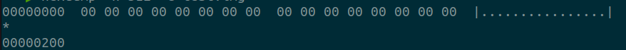
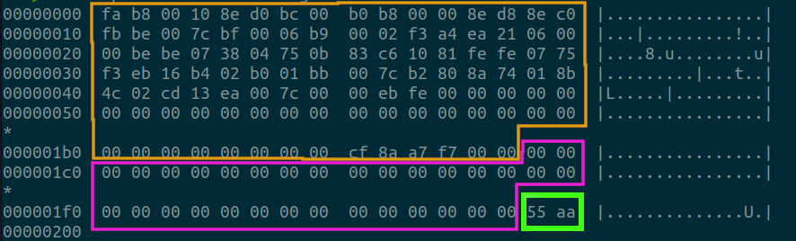
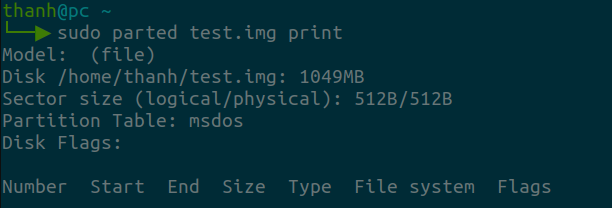
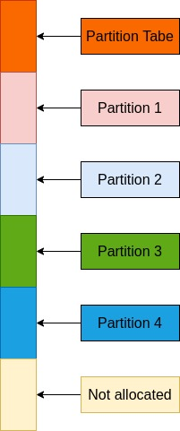
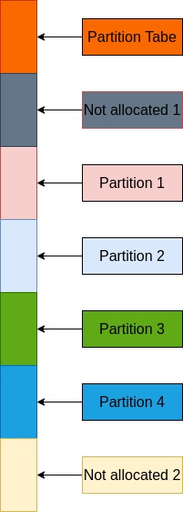

# Disk Partition Tables: MBR & GPT
{: .no_toc }

## Table of contents
{: .no_toc }

1. TOC
{:toc}

---

## Introduction

In [ESP8266 Flash Map & Partition Table](/embedded/esp8266-flash-map) I wrote about the partition
table on an MCU, but that one is Espressif's own format. PCs, and most Linux boards with an SD card
or eMMC, use one of the two standard ones instead. MBR comes first here because that's
what I kept running into on embedded Linux.

The two side by side:

| | MBR | GPT |
|---|-----|-----|
| **Full name** | Master Boot Record | GUID Partition Table |
| **Introduced** | 1983 (IBM PC XT) | ~2005 (UEFI specification) |
| **Max disk size** | 2 TiB (2^32 × 512 bytes) | 9.4 ZiB (2^64 × 512 bytes) |
| **Max partitions** | 4 primary (or 3 primary + extended) | 128 (default, unlimited by spec) |
| **Redundancy** | None (single copy in sector 0) | Primary + backup copy at end of disk |
| **Integrity** | 2-byte signature only | CRC32 checksums on header + table |
| **Boot firmware** | BIOS (legacy) | UEFI (or BIOS with protective MBR) |
| **Used on** | Legacy PCs, embedded Linux, microcontrollers | Modern PCs, servers, large disks |

## MBR (Master Boot Record)

### Structure Overview

The MBR occupies exactly the first 512 bytes (one sector) of the storage device:

```
Offset    Size     Content
────────────────────────────────────────────────
0x000     446      Bootstrap code (x86 boot loader)
0x1BE      16      Partition entry #1
0x1CE      16      Partition entry #2
0x1DE      16      Partition entry #3
0x1EE      16      Partition entry #4
0x1FE       2      Boot signature (0x55, 0xAA)
────────────────────────────────────────────────
Total:    512 bytes
```

| Offset (hex) | Size (bytes) | Content |
|:-------------|:-------------|:--------|
| 0x000–0x1BD | 446 | Bootstrap code (x86/x64 machine code, the first-stage bootloader) |
| 0x1BE–0x1FD | 64 | Partition table (4 entries × 16 bytes) |
| 0x1FE–0x1FF | 2 | Magic signature: `0x55 0xAA` |

Those last 2 bytes at 0x1FE are the quick check: read them, and you know whether the device has an MBR at all.

### Looking at the bytes myself

I didn't want to trust the table above blindly, so: an empty image file, an MBR written into it, and a hex view before and after.

```bash
# Create a 1 GiB sparse image
dd if=/dev/zero of=test.img bs=1M count=0 seek=1000

# Write an MBR partition table
parted -s test.img mklabel msdos
```

**Before `mklabel`**, block 0 is all zeros:



**After `mklabel msdos`:**
- <span style="color:#e39c09">**0x000–0x1BD (446 bytes)**</span>: Bootstrap code
- <span style="color:#ed1bd7">**0x1BE–0x1FD (64 bytes)**</span>: Partition table entries
- <span style="color:#41fd16">**0x1FE–0x1FF (2 bytes)**</span>: Magic signature `55 AA`



`parted` agrees: there is a partition table now, but nothing in it.



### Partition Entry Format (16 bytes each)

Each of the 4 partition entries has this structure:

| Offset | Size | Field | Description |
|:-------|:-----|:------|:------------|
| 0x00 | 1 | Boot indicator | `0x80` = active/bootable, `0x00` = inactive |
| 0x01 | 3 | CHS start | Starting head/sector/cylinder (legacy, ignored on modern systems) |
| 0x04 | 1 | Partition type ID | Identifies filesystem/purpose (see table below) |
| 0x05 | 3 | CHS end | Ending head/sector/cylinder (legacy) |
| 0x08 | 4 | LBA start | First sector of partition (little-endian) |
| 0x0C | 4 | Sector count | Total sectors in partition (little-endian) |

In practice only the LBA start and the sector count matter; CHS is there for old BIOSes.

### Common Partition Type IDs

| ID (hex) | Type |
|----------|------|
| 0x01 | FAT12 |
| 0x04 | FAT16 (< 32 MiB) |
| 0x05 | Extended partition |
| 0x06 | FAT16 (≥ 32 MiB) |
| 0x07 | NTFS / exFAT |
| 0x0B | FAT32 (CHS) |
| 0x0C | FAT32 (LBA) |
| 0x0F | Extended partition (LBA) |
| 0x82 | Linux swap |
| 0x83 | Linux native (ext2/ext3/ext4/xfs/btrfs) |
| 0x8E | Linux LVM |
| 0xEE | GPT protective MBR |
| 0xFD | Linux RAID |

### The 4-Partition Limit and Extended Partitions

Since the partition table is only 64 bytes (4 × 16), MBR supports a maximum of **4 primary partitions**. To work around this, one primary slot can be an **extended partition**: a container holding a linked list of **logical partitions**.

```
┌──────────────────────────────────────────────────────────────────┐
│  Sector 0 (MBR)                                                   │
│  ┌─────────┬─────────┬─────────────────────────┬───────────────┐ │
│  │ Part 1  │ Part 2  │ Part 3 (Extended)        │ Part 4       │ │
│  │ Primary │ Primary │ Container for logicals   │ Primary      │ │
│  └─────────┴─────────┴────────────┬────────────┴───────────────┘ │
│                                    │                              │
│                    ┌───────────────▼────────────────────┐        │
│                    │ Extended Boot Record (EBR) chain    │        │
│                    │ ┌──────────┬──────────┬──────────┐ │        │
│                    │ │Logical 5 │Logical 6 │Logical 7 │ │        │
│                    │ └──────────┴──────────┴──────────┘ │        │
│                    └────────────────────────────────────┘        │
└──────────────────────────────────────────────────────────────────┘
```

Each Extended Boot Record (EBR) is a 512-byte structure with the same format as an MBR, but only uses 2 of the 4 entry slots: one for the current logical partition and one pointing to the next EBR.

### MBR on embedded Linux

This is where MBR clicked for me. In
[Tiny210: SD/MMC/eSSD Device Boot Block Assignment](/embedded/tiny210-information) block 0 of the
SD card is reserved and BL1 is flashed from block 1. Block 0 is kept free so it can hold the MBR,
and then the same card can be split into partitions for the kernel, the rootfs and so on. The space
between the MBR and the first partition stays unallocated: that's where the bootloaders live.

|Common partition layout|Embedded Linux partition layout|
|:---|:---|
|No reserved space for bootloader<br>|Unallocated space before first partition stores BL1/U-Boot<br>|

### Making the partitions

```bash
# Create a 1 GiB image
dd if=/dev/zero of=test.img bs=1M count=0 seek=1000

# Write MBR partition table
parted -s test.img mklabel msdos

# Create boot partition (FAT32, starts at sector 32768 to leave room for bootloader)
parted -s test.img unit s mkpart primary fat32 32768 1081343
parted -s test.img set 1 boot on

# Create rootfs partition (ext4, uses remaining space)
parted -s test.img -- unit s mkpart primary ext2 1081344 -1s
```

Checking it with `parted` (the output I saved in 2023):

```
Disk /home/thanh/build/thanhle/ws/learns/mkfs_mmd_mcopy/test.img: 1049MB
Sector size (logical/physical): 512B/512B
Partition Table: msdos
Disk Flags:

Number  Start   End     Size   Type     File system  Flags
 1      16,8MB  554MB   537MB  primary               boot, lba
 2      554MB   1049MB  495MB  primary

```

and with `gdisk`:

```
Disk test.img: 2048000 sectors, 1000.0 MiB
Sector size (logical): 512 bytes
Disk identifier (GUID): 08995E99-D816-4B73-B670-53E4147A7E83
Partition table holds up to 128 entries
Main partition table begins at sector 2 and ends at sector 33
First usable sector is 34, last usable sector is 2047966
Partitions will be aligned on 2048-sector boundaries
Total free space is 32734 sectors (16.0 MiB)

Number  Start (sector)    End (sector)  Size       Code  Name
   1           32768         1081343   512.0 MiB   0700  Microsoft basic data
   2         1081344         2047999   472.0 MiB   8300  Linux filesystem
```

(`gdisk` shows a GUID and "128 entries" because it converts the MBR to GPT in memory when it
opens it. Nothing is written unless you press `w`.)

The 16 MiB gap before sector 32768 is the unallocated space for the bootloaders from the
Tiny210 section.

## GPT (GUID Partition Table)

GPT is part of the UEFI spec. Disks over 2 TiB, 128 partitions by default, CRC32 on the header and the entries, and a second copy at the end of the disk.

### Structure Overview

```
┌────────────────────────────────────────────────────────────────┐
│  LBA 0     │ Protective MBR (for legacy BIOS compatibility)    │
├────────────┼───────────────────────────────────────────────────┤
│  LBA 1     │ Primary GPT Header                                │
├────────────┼───────────────────────────────────────────────────┤
│  LBA 2–33  │ Primary Partition Entry Array (128 entries)       │
├────────────┼───────────────────────────────────────────────────┤
│  LBA 34+   │ ┌────────────────────────────────────────────┐   │
│            │ │            Partition Data                    │   │
│            │ │   (actual filesystem/data sectors)           │   │
│            │ └────────────────────────────────────────────┘   │
├────────────┼───────────────────────────────────────────────────┤
│  LBA -33   │ Backup Partition Entry Array                      │
├────────────┼───────────────────────────────────────────────────┤
│  LBA -1    │ Backup GPT Header                                 │
└────────────┴───────────────────────────────────────────────────┘
```

### Protective MBR (LBA 0)

LBA 0 holds a "protective MBR": a legacy MBR with one partition entry of type `0xEE` spanning the entire disk. So an MBR-only tool sees a full disk instead of an empty one and leaves the GPT alone.

### GPT Header (LBA 1)

| Offset | Size | Field |
|--------|------|-------|
| 0x00 | 8 | Signature: `"EFI PART"` (45 46 49 20 50 41 52 54) |
| 0x08 | 4 | Revision (usually 1.0 = `00 00 01 00`) |
| 0x0C | 4 | Header size (usually 92 bytes) |
| 0x10 | 4 | CRC32 of header (with this field zeroed during computation) |
| 0x14 | 4 | Reserved (zero) |
| 0x18 | 8 | This header's LBA (usually 1) |
| 0x20 | 8 | Backup header's LBA (last sector) |
| 0x28 | 8 | First usable LBA for partitions |
| 0x30 | 8 | Last usable LBA for partitions |
| 0x38 | 16 | Disk GUID (unique identifier for this disk) |
| 0x48 | 8 | Starting LBA of partition entry array |
| 0x50 | 4 | Number of partition entries (usually 128) |
| 0x54 | 4 | Size of each partition entry (usually 128 bytes) |
| 0x58 | 4 | CRC32 of partition entry array |
| 0x5C | * | Reserved (zero, rest of sector) |

### Partition Entry Format (128 bytes each)

| Offset | Size | Field |
|--------|------|-------|
| 0x00 | 16 | Partition type GUID |
| 0x10 | 16 | Unique partition GUID |
| 0x20 | 8 | First LBA (little-endian) |
| 0x28 | 8 | Last LBA (inclusive, little-endian) |
| 0x30 | 8 | Attribute flags |
| 0x38 | 72 | Partition name (UTF-16LE, up to 36 characters) |

### Common Partition Type GUIDs

| GUID | Type |
|------|------|
| `C12A7328-F81F-11D2-BA4B-00A0C93EC93B` | EFI System Partition (ESP) |
| `0FC63DAF-8483-4772-8E79-3D69D8477DE4` | Linux filesystem |
| `0657FD6D-A4AB-43C4-84E5-0933C84B4F4F` | Linux swap |
| `E6D6D379-F507-44C2-A23C-238F2A3DF928` | Linux LVM |
| `A19D880F-05FC-4D3B-A006-743F0F84911E` | Linux RAID |
| `EBD0A0A2-B9E5-4433-87C0-68B6B72699C7` | Microsoft basic data (NTFS/FAT) |
| `21686148-6449-6E6F-744E-656564454649` | BIOS boot partition |

### Advantages Over MBR

| Feature | MBR | GPT |
|---------|-----|-----|
| Max partitions | 4 primary | 128 (configurable) |
| Max partition size | 2 TiB | 9.4 ZiB |
| Max disk size | 2 TiB | 9.4 ZiB |
| Addressing | 32-bit LBA | 64-bit LBA |
| Redundancy | None | Header + table duplicated at end of disk |
| Integrity check | 2-byte magic only | CRC32 on header and entries |
| Partition names | None | 36-char UTF-16 name per partition |
| Boot firmware | BIOS | UEFI (or BIOS with `bios_grub` partition) |

### GPT Backup and Recovery

GPT stores a complete backup at the end of the disk:
- Backup partition entries at LBA -33 to LBA -2
- Backup header at the last LBA (LBA -1)

If the primary header gets corrupted, the backup brings it back:

```bash
# Recover GPT from backup
gdisk /dev/sda
# Command: r (recovery)
# Command: c (load backup GPT)
# Command: w (write)

# Or with sgdisk
sgdisk --backup=gpt-backup.bin /dev/sda
sgdisk --load-backup=gpt-backup.bin /dev/sda
```

## Tools for Managing Partition Tables

### fdisk (MBR and GPT)

```bash
# Interactive partitioning
sudo fdisk /dev/sda

# List partitions on all disks
sudo fdisk -l

# List partitions on a specific disk
sudo fdisk -l /dev/sda

# Non-interactive: create GPT table with partitions via scripting
echo -e "g\nn\n1\n2048\n+512M\nt\n1\nn\n2\n\n\nw" | sudo fdisk /dev/sda
```

### parted (MBR and GPT)

```bash
# Interactive
sudo parted /dev/sda

# Non-interactive: GPT with EFI + root
sudo parted -s /dev/sda mklabel gpt
sudo parted -s /dev/sda mkpart "EFI" fat32 1MiB 513MiB
sudo parted -s /dev/sda set 1 esp on
sudo parted -s /dev/sda mkpart "root" ext4 513MiB 100%

# Non-interactive: MBR with boot + rootfs
sudo parted -s /dev/sda mklabel msdos
sudo parted -s /dev/sda mkpart primary fat32 1MiB 513MiB
sudo parted -s /dev/sda set 1 boot on
sudo parted -s /dev/sda -- mkpart primary ext4 513MiB -1s

# Print partition table
sudo parted -s /dev/sda print
```

### gdisk / sgdisk (GPT only)

```bash
# Interactive GPT partitioning
sudo gdisk /dev/sda

# Non-interactive with sgdisk
# Create EFI System Partition (512 MiB)
sudo sgdisk -n 1:0:+512M -t 1:ef00 -c 1:"EFI" /dev/sda

# Create Linux root partition (remaining space)
sudo sgdisk -n 2:0:0 -t 2:8300 -c 2:"Linux" /dev/sda

# Print partition table
sudo sgdisk -p /dev/sda

# Convert MBR to GPT (non-destructive)
sudo sgdisk -g /dev/sda

# Backup and restore GPT
sudo sgdisk --backup=table.bak /dev/sda
sudo sgdisk --load-backup=table.bak /dev/sda

# Zap (destroy) all partition data
sudo sgdisk --zap-all /dev/sda
```

### sfdisk (scripting-friendly)

```bash
# Dump partition table (for backup/cloning)
sudo sfdisk -d /dev/sda > partitions.dump

# Restore partition table
sudo sfdisk /dev/sda < partitions.dump

# Clone partition table to another disk
sudo sfdisk -d /dev/sda | sudo sfdisk /dev/sdb

# Scripted MBR creation
sudo sfdisk /dev/sda << EOF
label: dos

# Boot partition: 512 MiB, FAT32, bootable
start=2048, size=1048576, type=0c, bootable

# Root partition: rest of disk, Linux
start=1050624, type=83
EOF

# Scripted GPT creation
sudo sfdisk /dev/sda << EOF
label: gpt

# EFI System Partition
start=2048, size=1048576, type=C12A7328-F81F-11D2-BA4B-00A0C93EC93B, name="EFI"

# Linux root
start=1050624, type=0FC63DAF-8483-4772-8E79-3D69D8477DE4, name="root"
EOF
```

### lsblk and blkid

```bash
lsblk -f /dev/sda        # tree of partitions with FSTYPE, LABEL, UUID, mount point
sudo blkid /dev/sda*     # UUID, TYPE, PARTLABEL, PARTUUID per partition
```

`blkid` is also where the UUID for an `/etc/fstab` line comes from (see my
[Linux tips](/linux_general/linux-tips)).

## Reading Partition Tables Programmatically

### Reading MBR with hexdump

```bash
# Read the MBR (first 512 bytes)
sudo hexdump -C -n 512 /dev/sda

# Read just the partition table (64 bytes at offset 446)
sudo dd if=/dev/sda bs=1 skip=446 count=64 2>/dev/null | hexdump -C

# Check for MBR signature
sudo dd if=/dev/sda bs=1 skip=510 count=2 2>/dev/null | hexdump -C
# Should show: 55 aa
```

### Reading GPT with hexdump

```bash
# Read GPT header (LBA 1, 512 bytes)
sudo dd if=/dev/sda bs=512 skip=1 count=1 2>/dev/null | hexdump -C
# First 8 bytes should be: 45 46 49 20 50 41 52 54 ("EFI PART")

# Read partition entries (LBA 2-33)
sudo dd if=/dev/sda bs=512 skip=2 count=32 2>/dev/null | hexdump -C
```

### Python Example

```python
import struct

def read_mbr_partitions(device_path):
    with open(device_path, 'rb') as f:
        mbr = f.read(512)

    # Check signature
    if mbr[510:512] != b'\x55\xaa':
        print("No valid MBR signature")
        return

    # Parse 4 partition entries
    for i in range(4):
        offset = 446 + (i * 16)
        entry = mbr[offset:offset+16]

        boot_flag = entry[0]
        part_type = entry[4]
        lba_start = struct.unpack('<I', entry[8:12])[0]
        num_sectors = struct.unpack('<I', entry[12:16])[0]

        if part_type == 0:
            continue  # Empty entry

        size_mib = (num_sectors * 512) / (1024 * 1024)
        print(f"Partition {i+1}: type=0x{part_type:02x}, "
              f"start=LBA {lba_start}, "
              f"sectors={num_sectors}, "
              f"size={size_mib:.1f} MiB, "
              f"bootable={'yes' if boot_flag == 0x80 else 'no'}")

read_mbr_partitions('/dev/sda')
```

Run on the same `test.img` as above (2026-11-22, parted 3.4; last line changed to `'test.img'`):

```
Partition 1: type=0x0c, start=LBA 32768, sectors=1048576, size=512.0 MiB, bootable=yes
Partition 2: type=0x83, start=LBA 1081344, sectors=966656, size=472.0 MiB, bootable=no
```

and the raw 64 bytes it parsed, plus the signature:

```
$ dd if=test.img bs=1 skip=446 count=64 2>/dev/null | hexdump -C
00000000  80 00 41 00 0c 03 e0 ff  00 80 00 00 00 00 10 00  |..A.............|
00000010  00 03 e0 ff 83 03 e0 ff  00 80 10 00 00 c0 0e 00  |................|
00000020  00 00 00 00 00 00 00 00  00 00 00 00 00 00 00 00  |................|
*
00000040
$ dd if=test.img bs=1 skip=510 count=2 2>/dev/null | hexdump -C
00000000  55 aa                                             |U.|
00000002
```

Entry 1: `80` = bootable, type `0c` = FAT32 (LBA), start `00 80 00 00` = 0x8000 = 32768,
count `00 00 10 00` = 0x100000 = 1048576 sectors. Little-endian, as promised. Type `0c` is
FAT32 with LBA addressing, which matches the `lba` flag in the `parted` output.

## BIOS Boot vs UEFI Boot

### BIOS + MBR (Legacy)

```
Power On → BIOS POST → Read MBR (sector 0) → Execute bootstrap code (446 bytes)
  → Bootstrap loads second-stage bootloader (GRUB stage 1.5/2) from disk
  → GRUB loads kernel from boot partition
```

### UEFI + GPT (Modern)

```
Power On → UEFI firmware → Read GPT → Find EFI System Partition (ESP)
  → Load EFI bootloader (e.g., /EFI/BOOT/BOOTX64.EFI or /EFI/ubuntu/grubx64.efi)
  → Bootloader loads kernel
```

The **EFI System Partition** (ESP) is a FAT32 partition (type GUID `C12A7328-...`) with the bootloader executables in it. UEFI firmware can read FAT32 by itself, so the 446 bytes of bootstrap code aren't needed.

### BIOS + GPT (Hybrid)

GPT works with a legacy BIOS too, but GRUB then needs a small **BIOS Boot Partition** (type GUID `21686148-...`, typically 1 MiB) where GRUB embeds its core image:

```bash
# Create BIOS boot partition for GRUB on a GPT disk
sudo sgdisk -n 1:2048:+1M -t 1:ef02 -c 1:"BIOS boot" /dev/sda
sudo sgdisk -n 2:0:+512M -t 2:8300 -c 2:"boot" /dev/sda
sudo sgdisk -n 3:0:0 -t 3:8300 -c 3:"root" /dev/sda

# Install GRUB for BIOS+GPT
sudo grub-install --target=i386-pc /dev/sda
```

## Common Partition Layouts

### Desktop Linux (UEFI)

```bash
# /dev/sda1: EFI System Partition (512 MiB, FAT32)
# /dev/sda2: / root (remaining, ext4 or btrfs)
# /dev/sda3: swap (equal to RAM for hibernation)

sudo parted -s /dev/sda mklabel gpt
sudo parted -s /dev/sda mkpart "EFI" fat32 1MiB 513MiB
sudo parted -s /dev/sda set 1 esp on
sudo parted -s /dev/sda mkpart "root" ext4 513MiB 90%
sudo parted -s /dev/sda mkpart "swap" linux-swap 90% 100%
```

### Server (UEFI, separate /boot and LVM)

```bash
# /dev/sda1: EFI (512 MiB)
# /dev/sda2: /boot (1 GiB, ext4)
# /dev/sda3: LVM PV (rest)
#   └─ VG: vg0
#      ├─ lv-root (/)
#      ├─ lv-var (/var)
#      └─ lv-swap (swap)

sudo parted -s /dev/sda mklabel gpt
sudo parted -s /dev/sda mkpart "EFI" fat32 1MiB 513MiB
sudo parted -s /dev/sda set 1 esp on
sudo parted -s /dev/sda mkpart "boot" ext4 513MiB 1537MiB
sudo parted -s /dev/sda mkpart "lvm" 1537MiB 100%
sudo parted -s /dev/sda set 3 lvm on
```

### Embedded Linux (MBR, ARM)

```bash
# Sectors 1–32767: unallocated (BL1 + U-Boot)
# /dev/mmcblk0p1: boot (FAT32, kernel + DTB)
# /dev/mmcblk0p2: rootfs (ext4)

sudo parted -s /dev/mmcblk0 mklabel msdos
sudo parted -s /dev/mmcblk0 unit s mkpart primary fat32 32768 1081343
sudo parted -s /dev/mmcblk0 set 1 boot on
sudo parted -s /dev/mmcblk0 -- unit s mkpart primary ext4 1081344 -1s
```

### Raspberry Pi (MBR)

```bash
# /dev/mmcblk0p1: boot (FAT32, 256 MiB: firmware + kernel)
# /dev/mmcblk0p2: rootfs (ext4, rest)

sudo parted -s /dev/mmcblk0 mklabel msdos
sudo parted -s /dev/mmcblk0 mkpart primary fat32 4MiB 260MiB
sudo parted -s /dev/mmcblk0 set 1 boot on
sudo parted -s /dev/mmcblk0 -- mkpart primary ext4 260MiB -1s
```

## MBR or GPT?

| Scenario | Recommendation |
|----------|---------------|
| Modern PC/server with UEFI | GPT |
| Disk larger than 2 TiB | GPT (required) |
| Need more than 4 partitions | GPT |
| Legacy BIOS system | MBR (or GPT with BIOS boot partition) |
| Embedded Linux (ARM SoC) | MBR (simpler, bootloader compatibility) |
| Raspberry Pi | MBR |
| Dual-boot with old Windows (< Win 8) | MBR |
| Maximum compatibility with ancient tools | MBR |

## Next

I haven't done the GPT version of the experiment above yet (`mklabel gpt` on the same image and a
hex dump of LBA 1 and the last LBA). That's the next thing for this page.

## References

- [UEFI Specification (GPT)](https://uefi.org/specifications)
- [Wikipedia: GUID Partition Table](https://en.wikipedia.org/wiki/GUID_Partition_Table)
- [Wikipedia: Master Boot Record](https://en.wikipedia.org/wiki/Master_boot_record)
- [Arch Wiki: Partitioning](https://wiki.archlinux.org/title/Partitioning)
- [gdisk documentation](https://www.rodsbooks.com/gdisk/)
- [parted manual](https://www.gnu.org/software/parted/manual/)
