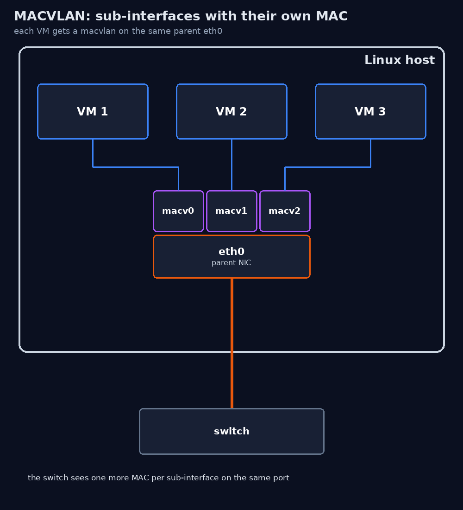

# Linux MacVLAN interface
{: .no_toc }

## Table of contents
{: .no_toc }

1. TOC
{:toc}

---

## Revision history

| Revision | Date        | Remark                  |
| :------- | :---------- | :---------------------- |
| 0.1      | Jan-12-2023 | Initial document: definition, modes, one disadvantage |
| 0.2      | Nov-22-2026 | Rewritten; how it works inside, commands, the host workaround |

## What it is

<div class="row">
    <div class="column">
        
    </div>
    <div class="column">
    <p>Macvlan is a virtual L2 interface that you hang off a physical one. Each sub-interface gets its own MAC address, so to the switch it looks like one more machine plugged into the same port.<br><br>
    When I first wrote this page (January 2023) it was the definition, the four modes with a diagram each, and a single "disadvantage": a VM on a macvlan can't talk to its own host. That disadvantage is the part that needs the most explaining, so this version explains why it happens and adds the commands and the workaround.</p>
  </div>
</div>

The short version of how it behaves:

- It's a sub-interface of a parent (`eth0`), not a bridge. There's no MAC learning, no STP, no ageing timer.
- The kernel looks at the destination MAC of each frame the parent receives and hands it to the sub-interface that owns that MAC.
- Sub-interfaces can be moved into other network namespaces, which is how containers use it.
- The parent has to accept frames for MACs other than its own. In the first version I wrote "the physical interface needs to support promiscuous mode"; that's roughly right, the details are below.

## What happens inside

When you create a macvlan, the kernel:

1. Gives it a MAC (random unless you set one).
2. Adds that MAC to the parent NIC's unicast address filter. Most NICs can hold a handful of extra addresses; when the filter is full, the kernel switches the parent to promiscuous mode instead. That's where the "needs promiscuous mode" rule comes from.
3. Hooks the parent's receive path. For each incoming frame it looks up the destination MAC in a hash table of its sub-interfaces and delivers it there (or to the parent if nothing matches).
4. On transmit, the sub-interface sends with its own MAC as source and the parent puts it on the wire. What happens when the destination is another sub-interface on the same parent depends on the mode.

```
              External Network (switch/router)
                         │
                         │ All frames (multiple MACs)
                         ▼
              ┌─────────────────────┐
              │   eth0 (parent)     │  unicast filter / promisc
              │   MAC: AA:AA:AA:..  │
              └──────────┬──────────┘
                         │
              Kernel MAC demux (hash table lookup)
                         │
         ┌───────────────┼───────────────┐
         │               │               │
  ┌──────▼──────┐ ┌──────▼──────┐ ┌─────▼───────┐
  │  macvlan0   │ │  macvlan1   │ │  macvlan2   │
  │ MAC: BB:..  │ │ MAC: CC:..  │ │ MAC: DD:..  │
  │ ns: default │ │ ns: container1│ │ ns: container2│
  │ 192.168.1.10│ │ 192.168.1.11│ │ 192.168.1.12│
  └─────────────┘ └─────────────┘ └─────────────┘
```

This is also why macvlan over Wi-Fi doesn't work. The NIC side is fine; the access point only accepts frames from MACs that have associated with it, and your extra macvlan MACs never did. Use ipvlan there (see [Virtual Interfaces in Linux]({{ site.baseurl }})).

## Operating modes

The mode only decides one thing: what happens to a frame from one sub-interface to another sub-interface on the same parent.

### Private

<div class="row">
  <div class="column">
    
  </div>
  <div class="column">
    <p>- Sub-interfaces can't talk to each other at all. The kernel doesn't switch between them.<br>
- Everything goes out of the parent. Even if an external switch reflects a frame back (hairpin), the kernel drops it when it comes from a sibling.<br>
- Use it when containers or tenants must never see each other locally, and all their traffic should go through an external router or firewall.</p>
  </div>
</div>

```bash
ip link add macvlan0 link eth0 type macvlan mode private
```

### VEPA

<div class="row">
  <div class="column">
    
  </div>
  <div class="column">
    <p>- VEPA = Virtual Ethernet Port Aggregator. A frame for a sibling isn't switched in the kernel; it's sent out to the external switch.<br>
- Only a switch that supports hairpin / reflective relay (IEEE 802.1Qbg) will send it back down the same port, and only then do the siblings reach each other.<br>
- The point is that the external switch sees and polices all traffic, including VM-to-VM traffic on the same host.</p>
  </div>
</div>

```bash
ip link add macvlan0 link eth0 type macvlan mode vepa
```

### Bridge

<div class="row">
  <div class="column">
    
  </div>
   <div class="column">
    <p>- Frames between sub-interfaces are delivered inside the kernel and never touch the wire.<br>
- Broadcast and multicast go to every sub-interface and out of the parent.<br>
- It's not a real bridge: the kernel just checks "is this destination MAC one of my sub-interfaces?". Nothing is learned.<br>
- This is the mode almost everyone uses (Docker's macvlan driver defaults to it).</p>
  </div>
</div>

```bash
ip link add macvlan0 link eth0 type macvlan mode bridge
```

### Passthrough

<div class="row">
    <div class="column">
    
  </div>
  <div class="column">
    <p>- Only one sub-interface per parent, and it takes the parent over.<br>
- The guest can change the MAC and other interface settings, and the change lands on the real NIC without touching the host's own view of the parent.<br>
- Meant for handing a whole NIC to one VM (macvtap in passthru mode) or to a container that wants raw NIC access.</p>
  </div>
</div>

```bash
ip link add macvlan0 link eth0 type macvlan mode passthru
```

### The four side by side

| | Private | VEPA | Bridge | Passthrough |
|---|---------|------|--------|-------------|
| Siblings reach each other | no | only via a hairpin switch | yes, inside the kernel | n/a, only one |
| External switch sees sibling traffic | n/a | yes | no | n/a |
| Needs a special switch | no | yes (802.1Qbg) | no | no |
| Sub-interfaces per parent | many | many | many | 1 |

## Creating them

```bash
# Bridge mode is the usual choice
ip link add macvlan0 link eth0 type macvlan mode bridge

# MAC is random; set one if you need it stable (e.g. for a DHCP reservation)
ip link set macvlan0 address 02:42:ac:11:00:02

ip link set macvlan0 up
ip addr add 192.168.1.50/24 dev macvlan0

# Shows mode and parent
ip -d link show macvlan0
```

Moving it into a namespace is what makes it useful for containers:

```bash
ip netns add container1

ip link add macvlan0 link eth0 type macvlan mode bridge
ip link set macvlan0 netns container1

ip netns exec container1 ip link set macvlan0 up
ip netns exec container1 ip addr add 192.168.1.50/24 dev macvlan0
ip netns exec container1 ip route add default via 192.168.1.1

ip netns exec container1 ping 192.168.1.1
```

A few at once (the namespaces `ns1`..`ns5` have to exist already):

```bash
for i in $(seq 1 5); do
    ip link add macvlan${i} link eth0 type macvlan mode bridge
    ip link set macvlan${i} netns "ns${i}"
    ip netns exec "ns${i}" ip link set macvlan${i} up
    ip netns exec "ns${i}" ip addr add "192.168.1.$((50+i))/24" dev macvlan${i}
    ip netns exec "ns${i}" ip route add default via 192.168.1.1
done
```

The parent can itself be a VLAN interface, so macvlans can live on a tagged network:

```bash
ip link add link eth0 name eth0.100 type vlan id 100
ip link set eth0.100 up

ip link add macvlan0 link eth0.100 type macvlan mode bridge
ip link set macvlan0 up
ip addr add 10.0.100.50/24 dev macvlan0
```

Remove one with `ip link delete macvlan0`.

## Why the host can't reach its own macvlans

This is the "disadvantage" from the first version. In 2023 I wrote it as: the VM sends to the host's MAC, the kernel pushes the frame out of the parent to the switch, and the switch won't send a frame back out of the port it came in on. So VM and host can't talk.

That's the right picture. The detail that explains it: the macvlan code sits on the parent's **receive** path and on the sub-interfaces' **transmit** path. Look at both directions:

- **Host → container.** The host's IP stack sends on `eth0` itself. That frame goes straight to the NIC driver and out. It never passes the macvlan lookup, so the kernel never notices that the destination MAC belongs to a local sub-interface.
- **Container → host.** In bridge mode the sub-interface checks whether the destination MAC belongs to a *sibling*. The parent isn't a sibling, so the frame goes to the wire.

Either way it lands on the switch, and a normal switch doesn't hairpin. The frame is gone.

The fix follows from that: don't let the host talk as the parent. Give the host a macvlan of its own, so it becomes a sibling of the containers and bridge mode delivers between them in the kernel.

```bash
HOST_IP="192.168.1.1/24"
GATEWAY="192.168.1.254"

ip link add macvlan-host link eth0 type macvlan mode bridge
ip addr add ${HOST_IP} dev macvlan-host
ip link set macvlan-host up
ip route add default via ${GATEWAY} dev macvlan-host

# eth0 keeps no address; it only carries the macvlans
ip addr flush dev eth0
```

Careful doing that over SSH on `eth0`: the moment you flush the address you're connected through, you're out. Do it from a console, or as one script.

If you don't want to move the host's main address, a small "shim" macvlan with host routes to the container IPs does the same for just those IPs (that's the one in the [Docker post]({{ site.baseurl }})).

Other ways out:

| Option | What it means |
|--------|---------------|
| host macvlan / shim (above) | host becomes a sibling of the containers |
| a Linux bridge instead | put the host IP on the bridge; host and guests are all ports, no problem |
| go round via the router | traffic leaves on one MAC and comes back on another; works if the router allows it, costs a hop |

Switching to ipvlan doesn't help with this one, by the way. Ipvlan has the same parent/child blind spot.

## Macvlan or something else?

**vs. a Linux bridge**

| | Macvlan | Bridge |
|---|---------|--------|
| MAC handling | fixed list of its own sub-interfaces | learns MACs (FDB) |
| STP, VLAN filtering | no | yes |
| Host ↔ guest | needs the workaround | works |
| Setup | one command per interface | bridge + ports + moving the host IP |

**vs. ipvlan**

| | Macvlan | Ipvlan |
|---|---------|--------|
| MAC address | one per sub-interface | all share the parent's |
| Parent must accept extra MACs | yes | no |
| Works on Wi-Fi | no | yes |
| Cloud VMs / ports with MAC limits | may be blocked | fine |
| DHCP | normal, each one has a MAC | same MAC for all, needs distinct client IDs |
| iptables on guest traffic | yes | only in `l3s` mode |

**vs. veth + bridge** (what Docker does by default)

| | Macvlan | veth + bridge |
|---|---------|---------------|
| Pieces | one sub-interface | veth pair + bridge (+ NAT usually) |
| Guest appears on the LAN | yes, with its own MAC | no, behind NAT unless you bridge a physical port |
| Host ↔ guest | needs the workaround | works |

On speed: I haven't measured macvlan against a bridge or veth myself. The usual argument is that macvlan does less work per frame (one hash lookup, no learning, one interface instead of a pair). If it matters to you, `iperf3` between two namespaces will tell you more than any table.

## Docker and Kubernetes

Docker has a macvlan driver (`docker network create -d macvlan -o parent=eth0 ...`), including VLAN parents like `eth0.100` and the host shim. All of that is in the [Docker networking post]({{ site.baseurl }}), so I won't repeat it here.

In Kubernetes, macvlan usually comes in through [Multus](https://github.com/k8snetworkplumbingwg/multus-cni) as a second interface on the pod, next to the normal cluster network:

```yaml
# NetworkAttachmentDefinition for MACVLAN
apiVersion: "k8s.cni.cncf.io/v1"
kind: NetworkAttachmentDefinition
metadata:
  name: macvlan-conf
spec:
  config: '{
    "cniVersion": "0.3.1",
    "type": "macvlan",
    "master": "eth0",
    "mode": "bridge",
    "ipam": {
      "type": "host-local",
      "subnet": "192.168.1.0/24",
      "rangeStart": "192.168.1.200",
      "rangeEnd": "192.168.1.250",
      "gateway": "192.168.1.1"
    }
  }'
```

```yaml
# Pod with MACVLAN secondary interface
apiVersion: v1
kind: Pod
metadata:
  name: my-pod
  annotations:
    k8s.v1.cni.cncf.io/networks: macvlan-conf
spec:
  containers:
  - name: app
    image: alpine
```

## When it doesn't work

| Symptom | Likely cause | What to do |
|---------|-------------|----------|
| Host can't ping the macvlan (or the other way) | parent/child limitation | host macvlan or shim, above |
| Nothing works on `wlan0` as parent | AP drops frames from MACs that never associated | use ipvlan |
| Sub-interface gets no traffic at all | parent down, or NIC filter/promisc not applied | `ip -d link show eth0`, look for PROMISC or check the driver |
| No DHCP lease | switch port security / MAC limit on the port | allow the MAC on the switch, or use static IPs |
| Siblings can't reach each other | mode is private or VEPA | `ip -d link show macvlan0` shows the mode |
| Works untagged, not on the VLAN | VLAN parent missing or wrong ID | check `eth0.100` exists and the switch port is a trunk |

```bash
ip -d link show macvlan0          # mode, parent, flags
ip link show type macvlan         # all macvlans
ip link show eth0 | grep -i promisc
tcpdump -i eth0 -e -nn            # -e prints MACs: you should see the sub-interface MACs
tcpdump -i macvlan0 -e -nn
ip netns exec ns1 ping <ns2-IP>   # sibling test in bridge mode
```

Not covered yet: macvtap (the macvlan variant QEMU/libvirt use for VMs), which deserves its own post with a VM attached.

## References

- [ip-link(8): macvlan options](https://man7.org/linux/man-pages/man8/ip-link.8.html)
- [drivers/net/macvlan.c (Bootlin)](https://elixir.bootlin.com/linux/latest/source/drivers/net/macvlan.c)
- [IPVLAN driver HOWTO (kernel docs)](https://www.kernel.org/doc/html/latest/networking/ipvlan.html)
- [Docker macvlan driver](https://docs.docker.com/network/drivers/macvlan/)
- [Multus CNI](https://github.com/k8snetworkplumbingwg/multus-cni)
- [Linux Virtual Interfaces]({{ site.baseurl }})
