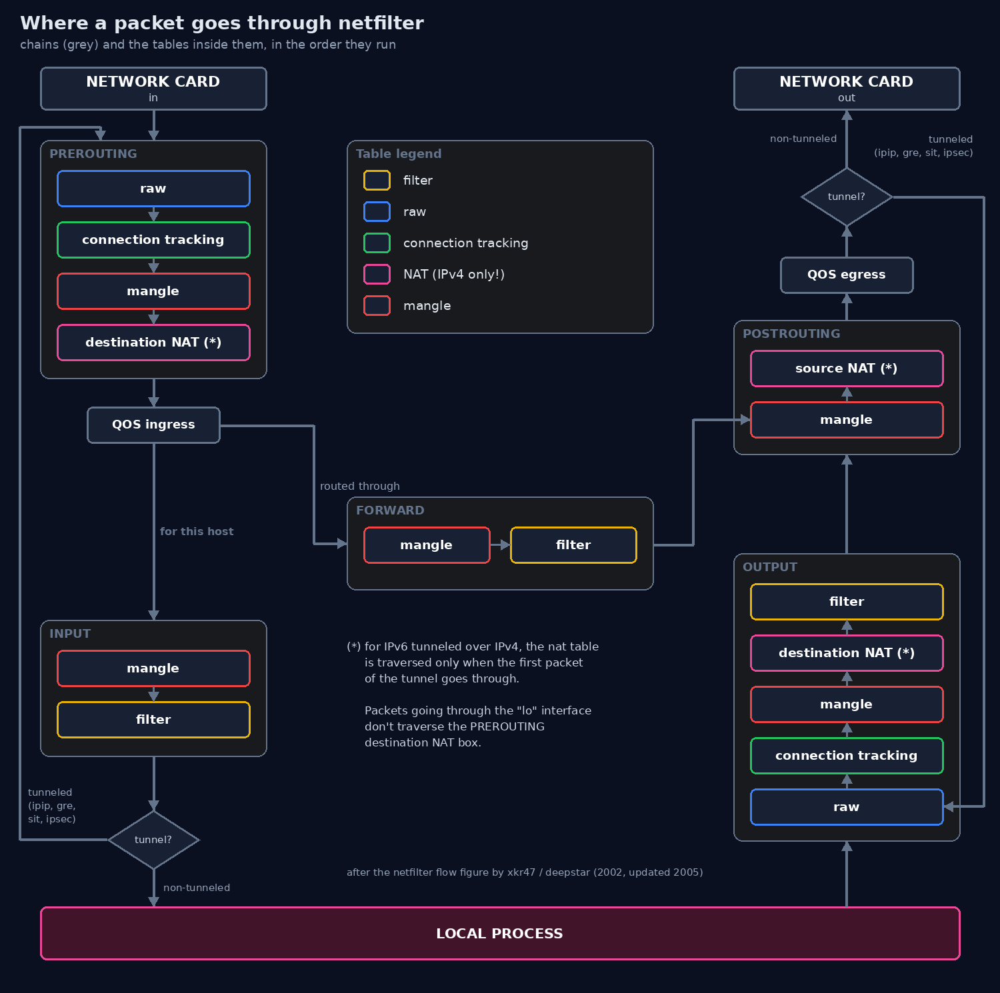
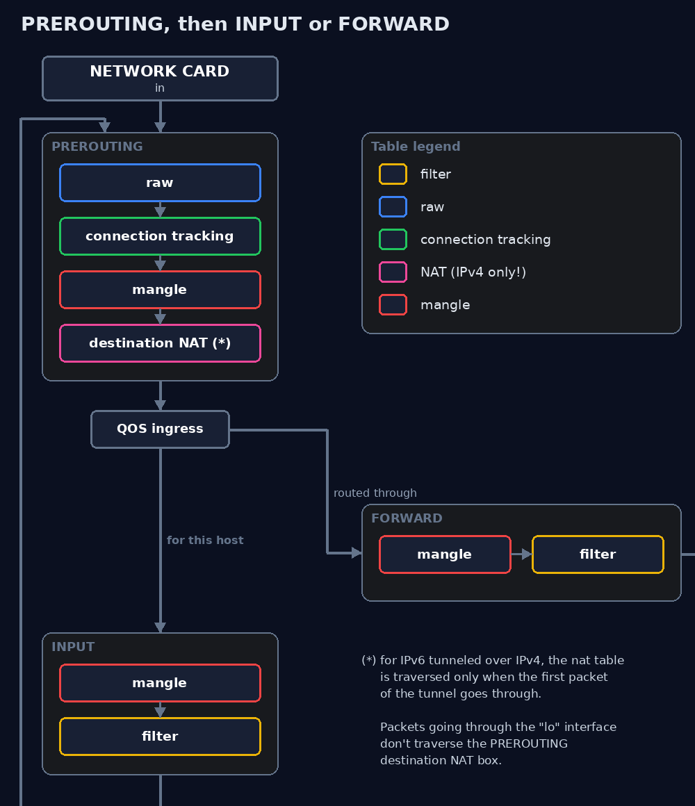
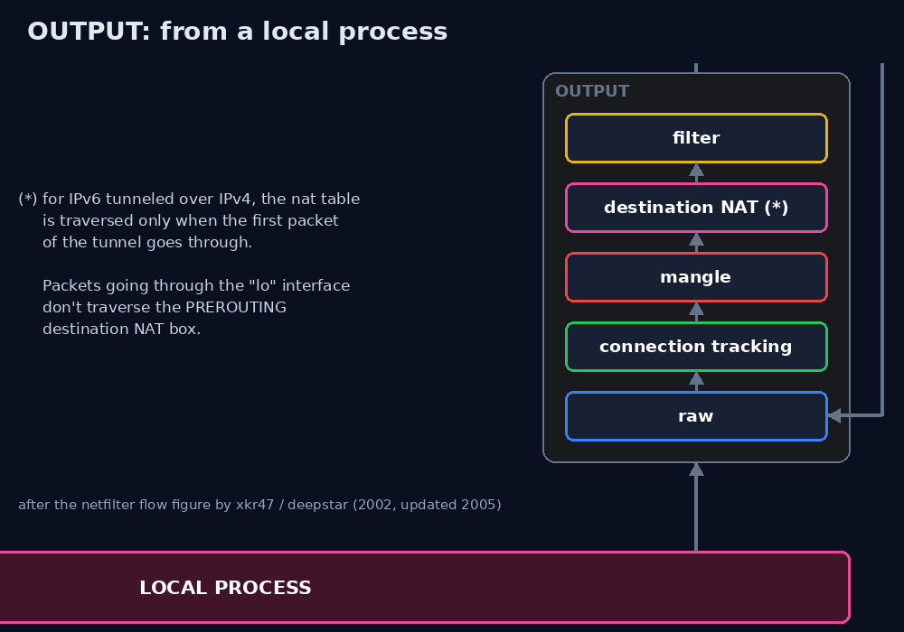
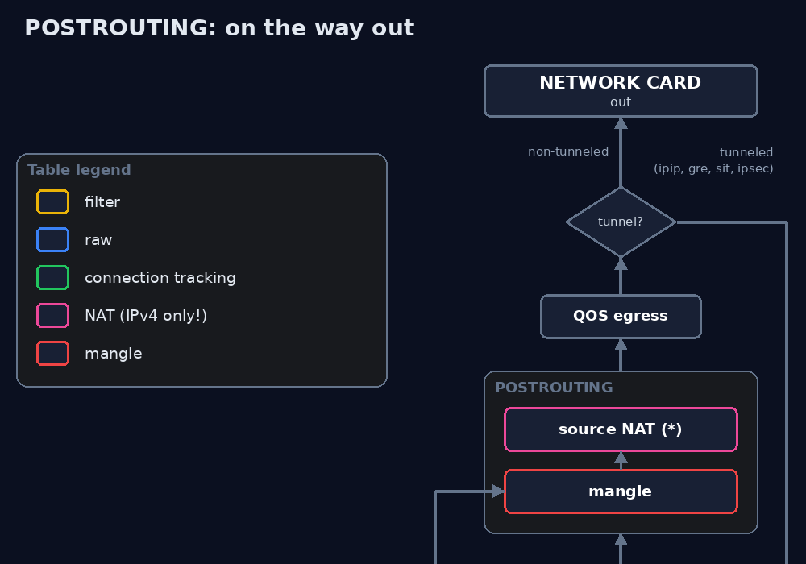

# Linux Packet Filtering
{: .no_toc }

## Table of contents
{: .no_toc }

1. TOC
{:toc}

---

## Situation

If you want a Linux box to do anything clever with traffic (be a firewall, a router, filter DNS), you need a map of the packet's path: from the moment the NIC hands it to the kernel until an application reads it from a socket, and the other way, from `send()` down to the driver. The first edition of this page was mostly one diagram of that path (it's still below). It showed the boxes, but not why a port forward needs DNAT in PREROUTING, or why the FORWARD rule after it matches the *new* port.

## Task

Draw the path once, then go through it chain by chain and table by table, with conntrack, the iptables and nftables spellings, and examples I'd actually type: a server firewall, a NAT router, a transparent proxy, what Docker writes.

## Action

### Chains and tables

The kernel part is called **Netfilter**. It puts hooks at fixed points in the network stack, and tools like `iptables` and `nftables` hang rules on those hooks. Two words to keep apart:

- a **chain** is *where* in the path a rule runs (one per hook);
- a **table** is *what kind* of rule it is (filtering, NAT, mangling...). One chain can hold rules from several tables.

### The path, in one picture

```
                                    ┌─────────────────────────────┐
                                    │        User Space            │
                                    │   (applications, sockets)    │
                                    └──────────┬──────────────────-┘
                                               │ ▲
                                               │ │
                                    ┌──────────▼─┴─────────────────┐
                                    │      Transport Layer          │
                                    │       (TCP/UDP/ICMP)          │
                                    └──────────┬──────────────────-─┘
                                               │ ▲
                           ┌───────────────────▼─┴───────────────────────┐
                           │              Network Layer (IP)              │
                           │                                             │
  ┌──────────┐     ┌──────▼──────┐    ┌──────────┐    ┌─────────┐     ┌▼──────────┐
  │ NIC (in) │────►│ PREROUTING  │───►│ ROUTING   │───►│ FORWARD │────►│POSTROUTING│───► NIC (out)
  └──────────┘     └─────────────┘    │ DECISION  │    └─────────┘     └───────────┘
                                      └─────┬─────┘                          ▲
                                            │                                │
                                      ┌─────▼─────┐                   ┌─────┴─────┐
                                      │   INPUT   │                   │  OUTPUT   │
                                      └─────┬─────┘                   └─────┬─────┘
                                            │                                ▲
                                            ▼                                │
                                    ┌───────────────────────────────────────-┘
                                    │            Local Process
                                    └────────────────────────────────────────┘
```

And the diagram from the first edition of this page, redrawn (same chains and tables):



### The five chains

Which chains a packet passes depends on where it comes from and where it's going. There are five built-in chains, one per Netfilter hook:

| Chain | Kernel hook | When it runs |
|-------|-----------|------|
| `PREROUTING` | `NF_INET_PRE_ROUTING` | right after the packet arrives, before the routing decision |
| `INPUT` | `NF_INET_LOCAL_IN` | after routing, if the packet is for this host |
| `FORWARD` | `NF_INET_FORWARD` | after routing, if the packet is for someone else |
| `OUTPUT` | `NF_INET_LOCAL_OUT` | when a local program sends a packet |
| `POSTROUTING` | `NF_INET_POST_ROUTING` | just before the packet leaves through an interface |

Rules in a chain can let the packet through, drop it, change it, or mark it so a later chain can recognise it.

#### PREROUTING

<div class="row">
    <div class="column">
    <p>- This is an <span style="color:red">important</span> chain: it's the first one every incoming packet meets.<br>
- Connection tracking sees the packet here for the first time, DNAT (port forwarding) happens here, and mangle rules can set marks, TTL or DSCP.<br>
- Right after it, the kernel makes the routing decision. Destination is one of the host's own IPs: the packet goes to INPUT and on to a local application through the port it registered. Anything else: FORWARD (if forwarding is on).<br>
- Tables here, in order: <code>raw</code>, <code>mangle</code>, <code>nat</code>.</p>
<div class="warning">
  <p><strong>Warning!</strong> Rules in a chain only ever see packets the kernel has already sent to that chain. So if you want to decide whether a packet ends up in INPUT or FORWARD, you have to do it one step earlier, in PREROUTING.</p>
</div>
<br>
<strong>Example: a local DNS filter.</strong> Say I run a DNS server in user space that checks every query from the LAN and refuses malicious domains.<br><br>
Only queries addressed to the host itself reach INPUT and then the server. A client that asks <code>8.8.8.8</code> directly has its query routed to FORWARD and out, and my server never sees it.<br><br>
The fix is to rewrite the destination in PREROUTING, before the routing decision, so the packet is "for this host" and goes to INPUT instead:<br><br>
<code>iptables -t nat -A PREROUTING -i eth1 -p udp --dport 53 -j REDIRECT --to-port 5353</code><br><br>
(<code>eth1</code> = the LAN side, so the WAN isn't redirected.) REDIRECT rewrites the destination to the incoming interface's own IP. That's why it's nicer than DNAT to <code>127.0.0.1</code>, which only works from a non-loopback interface if you also turn on <code>route_localnet</code>.
  </div>
  <div class="column">
        
    </div>
</div>

#### INPUT

- Packets in INPUT came in on an interface and are addressed to one of the host's IPs (WAN, LAN or loopback).
- What leaves this chain goes to the local application's socket.
- Tables: `mangle`, `filter`, `security`, and `nat` (only for SNAT on incoming connections, rarely used).
- This is where the host's own firewall lives: which ports are open, from where, how fast.

```bash
# SSH only from the LAN
iptables -A INPUT -p tcp --dport 22 -s 192.168.1.0/24 -j ACCEPT
iptables -A INPUT -p tcp --dport 22 -j DROP
```

#### FORWARD

- Packets in FORWARD came in on an interface and are addressed to an IP the host doesn't have: the host is acting as a router.
- What leaves this chain goes to POSTROUTING.
- Tables: `mangle`, `filter`, `security`.
- Nothing reaches it unless `net.ipv4.ip_forward = 1`.
- Docker puts a lot of its rules here (container traffic is forwarded traffic, see [Docker Networking]({{ site.baseurl }})).

```bash
# LAN (eth1) may go out to WAN (eth0); only replies come back
iptables -A FORWARD -i eth1 -o eth0 -j ACCEPT
iptables -A FORWARD -i eth0 -o eth1 -m conntrack --ctstate RELATED,ESTABLISHED -j ACCEPT
iptables -A FORWARD -j DROP
```

#### OUTPUT

<div class="row">
    <div class="column">
    <p>- Packets in OUTPUT were created by local applications, going anywhere.<br>
- What leaves this chain goes to POSTROUTING.<br>
- Tables: <code>raw</code>, <code>mangle</code>, <code>nat</code> (DNAT for local traffic), <code>filter</code>, <code>security</code>.<br>
- Used to restrict what the host itself may send, to redirect its own traffic (a local transparent proxy), or to mark packets for policy routing.</p>
<br>
Redirect the host's own outgoing HTTP to a proxy on port 3128:<br>
<code>iptables -t nat -A OUTPUT -p tcp --dport 80 -j REDIRECT --to-port 3128</code>
  </div>
  <div class="column">
        
    </div>
</div>

#### POSTROUTING

<div class="row">
    <div class="column">
    <p>- The last stop before the kernel hands the packet to the driver. Important, and the most commonly used chain.<br>
- In the diagram it's fed by two chains: OUTPUT and FORWARD.<br>
- On a client, almost everything comes from OUTPUT: local applications talking to the outside.<br>
- On a router, it gets both: OUTPUT (the router's own programs) and FORWARD (the router's clients).<br>
- Tables: <code>mangle</code> and <code>nat</code>. The <code>nat</code> part is SNAT/MASQUERADE: replacing the private source address with the router's address. On a router that's the step that touches every forwarded connection, so it's where CPU goes.</p>
<br>
Internet sharing in one line:<br>
<code>iptables -t nat -A POSTROUTING -o eth0 -j MASQUERADE</code>
  </div>
  <div class="column">
        
    </div>
</div>

### The tables

Inside each chain, tables run in a fixed order:

```
raw → mangle → nat (DNAT) → filter → security → nat (SNAT)
```

Not every table exists in every chain:

| Table | PREROUTING | INPUT | FORWARD | OUTPUT | POSTROUTING |
|-------|:---:|:---:|:---:|:---:|:---:|
| `raw` | ✓ | | | ✓ | |
| `mangle` | ✓ | ✓ | ✓ | ✓ | ✓ |
| `nat` | ✓ (DNAT) | ✓ (SNAT) | | ✓ (DNAT) | ✓ (SNAT) |
| `filter` | | ✓ | ✓ | ✓ | |
| `security` | | ✓ | ✓ | ✓ | |

#### raw

Runs before connection tracking. Its main job is to say "don't track this" with `CT --notrack`, for heavy traffic that doesn't need stateful rules (a busy DNS server, for example). Only in PREROUTING and OUTPUT.

```bash
iptables -t raw -A PREROUTING -p udp --dport 53 -j CT --notrack

# older spelling, still accepted:
# iptables -t raw -A PREROUTING -p udp --dport 53 -j NOTRACK
```

#### mangle

Changes headers and metadata: TOS/DSCP, TTL, TCP MSS, and marks. A mark (`--set-mark`) never goes on the wire; it's a number attached to the packet inside the kernel that policy routing (`ip rule fwmark`), `tc` and later rules can match on. Exists in all five chains.

```bash
# Mark traffic from one subnet, e.g. to route it via another uplink
iptables -t mangle -A PREROUTING -s 192.168.2.0/24 -j MARK --set-mark 2

# Classic PPPoE fix: clamp MSS so big TCP packets fit the smaller MTU
iptables -t mangle -A FORWARD -p tcp --tcp-flags SYN,RST SYN -j TCPMSS --clamp-mss-to-pmtu
```

#### nat

Address translation.

- **DNAT** changes the destination. PREROUTING for incoming traffic, OUTPUT for the host's own.
- **SNAT** changes the source. POSTROUTING.
- **MASQUERADE** is SNAT to "whatever address the outgoing interface has right now", which is what you want with a dynamic IP from the ISP.

Worth knowing: only the first packet of a connection goes through the `nat` table. Conntrack remembers the translation and applies it to every following packet (and reverses it for replies). So a NAT rule you add doesn't affect connections that already exist.

```bash
# Port forward: WAN port 8080 → 192.168.1.100:80
iptables -t nat -A PREROUTING -p tcp --dport 8080 -j DNAT --to-destination 192.168.1.100:80

# SNAT to a fixed public IP
iptables -t nat -A POSTROUTING -o eth0 -j SNAT --to-source 203.0.113.1
```

#### filter

The default table, used when you don't give `-t`. Accept, drop or reject. INPUT, FORWARD and OUTPUT only. With conntrack it can match on connection state: `NEW`, `ESTABLISHED`, `RELATED`, `INVALID`.

```bash
# Stateful baseline
iptables -A INPUT -m conntrack --ctstate ESTABLISHED,RELATED -j ACCEPT
iptables -A INPUT -m conntrack --ctstate INVALID -j DROP
iptables -A INPUT -p tcp --dport 22 -m conntrack --ctstate NEW -j ACCEPT
iptables -A INPUT -j DROP
```

#### security

For SELinux and other mandatory access control systems: it puts security labels on packets. INPUT, FORWARD, OUTPUT. Rarely set by hand outside SELinux systems.

### Connection tracking

`nf_conntrack` is what makes stateful rules possible. It follows every connection and gives each packet a state:

| State | Meaning |
|-------|---------|
| `NEW` | first packet of a connection |
| `ESTABLISHED` | part of a connection that has seen traffic both ways |
| `RELATED` | a new connection that belongs to an existing one (FTP data, an ICMP error) |
| `INVALID` | matches nothing known |
| `UNTRACKED` | excluded in the `raw` table |

```bash
conntrack -L        # all tracked connections
conntrack -S        # statistics
conntrack -E        # live events

cat /proc/sys/net/netfilter/nf_conntrack_max     # table size
cat /proc/sys/net/netfilter/nf_conntrack_count   # in use now
```

The table has a fixed size. When it's full, new connections get dropped and the kernel logs `nf_conntrack: table full, dropping packet`. On a busy router two knobs help:

```bash
# Bigger table (the default depends on RAM)
echo 262144 > /proc/sys/net/netfilter/nf_conntrack_max

# Forget idle established TCP connections after 1 day instead of the default 5 days (432000 s)
echo 86400 > /proc/sys/net/netfilter/nf_conntrack_tcp_timeout_established
```

### The full path, table by table

**Incoming, for this host**

```
Wire → NIC → Driver → raw/PREROUTING → mangle/PREROUTING → nat/PREROUTING (DNAT)
  → Routing Decision (local!) → mangle/INPUT → filter/INPUT → security/INPUT
  → nat/INPUT → Local Socket (application)
```

**Incoming, forwarded**

```
Wire → NIC → Driver → raw/PREROUTING → mangle/PREROUTING → nat/PREROUTING (DNAT)
  → Routing Decision (forward!) → mangle/FORWARD → filter/FORWARD → security/FORWARD
  → mangle/POSTROUTING → nat/POSTROUTING (SNAT/MASQUERADE) → Driver → NIC → Wire
```

**Sent by a local program**

```
Application → Local Socket → raw/OUTPUT → mangle/OUTPUT → nat/OUTPUT (DNAT)
  → filter/OUTPUT → security/OUTPUT → Routing Decision
  → mangle/POSTROUTING → nat/POSTROUTING (SNAT/MASQUERADE) → Driver → NIC → Wire
```

(For local traffic the route is actually looked up before OUTPUT and checked again after it, in case a rule changed the destination or mark.)

### Tools

#### iptables

The well-known `iptables` talks to the kernel to create these rules:

```
iptables [-t table] COMMAND chain [match] [target]
```

Listing rules, chain by chain:

| Explanation | Command         |
|:---------|:------------- |
|**Chain OUTPUT**| |
| List current rules on `nat table`, chain `OUTPUT`      | `iptables -nvL OUTPUT -t nat`  |
| List current rules on `mangle table`, chain `OUTPUT`      | `iptables -nvL OUTPUT -t mangle`  |
| List current rules on `filter table`, chain `OUTPUT`      | `iptables -nvL OUTPUT` or `iptables -nvL OUTPUT -t filter`  |
|**Chain FORWARD**| |
| List current rules on `mangle table`, chain `FORWARD`      | `iptables -nvL FORWARD -t mangle`  |
| List current rules on `filter table`, chain `FORWARD`      | `iptables -nvL FORWARD` or `iptables -nvL FORWARD -t filter`  |
| List current rules on `nat table`, chain `FORWARD`      | `iptables -nvL FORWARD -t nat`: back then I added "if the above article is wrong". It isn't: `nat` has no FORWARD chain, and iptables answers with an error  |
|**All chains**| |
| List current rules on `mangle table`      | `iptables -nvL -t mangle`  |
| List current rules on `filter table`      | `iptables -nvL` or `iptables -nvL -t filter`   |
| List current rules on `nat table`      | `iptables -nvL -t nat`   |

The rest of the commands:

| Command | What it does |
|---------|-------------|
| `-A chain` | append a rule |
| `-I chain [num]` | insert at a position (default: first) |
| `-D chain num\|spec` | delete a rule |
| `-R chain num` | replace a rule |
| `-F [chain]` | flush |
| `-L [chain]` | list |
| `-P chain target` | default policy |
| `-N chain` / `-X chain` | create / delete your own chain |
| `-S` | print rules as commands (handy as a backup) |
| `--line-numbers` | number the rules, for `-D`/`-I` |

Matches worth knowing:

```bash
-m conntrack --ctstate NEW,ESTABLISHED          # (older: -m state --state ...)
-m connlimit --connlimit-above 50               # connections per source
-m time --timestart 09:00 --timestop 17:00 --days Mon,Tue,Wed,Thu,Fri
-m limit --limit 25/minute --limit-burst 100    # rate limit
-m multiport --sports 1024:65535
-m string --algo bm --string "malware-signature"
-m cpu --cpu 0                                  # which CPU handles the packet
```

Targets:

| Target | What it does |
|--------|-------------|
| `ACCEPT` | let it through |
| `DROP` | discard silently |
| `REJECT` | discard and answer (ICMP error or TCP RST) |
| `LOG` | write to the kernel log, then keep going |
| `DNAT --to-destination` | new destination (`nat`) |
| `SNAT --to-source` | new source (`nat`) |
| `MASQUERADE` | SNAT to the interface's current address (`nat`) |
| `REDIRECT --to-port` | to a local port |
| `MARK --set-mark` | set a mark (`mangle`) |
| `RETURN` | back to the calling chain |

#### nftables

`nftables` replaces `iptables`, `ip6tables`, `arptables` and `ebtables` with one tool, `nft`. Most distributions have defaulted to it since around 2019. The differences that matter in practice:

- There are no built-in tables or chains. You create them and choose the hook and priority yourself.
- One `inet` family covers IPv4 and IPv6 together.
- A whole ruleset can be loaded atomically from a file.
- Sets and maps are built in, so "these 500 addresses" is one rule, not 500.

```bash
nft list ruleset
nft add table inet my_filter
nft add chain inet my_filter input { type filter hook input priority 0 \; policy drop \; }
nft add rule inet my_filter input tcp dport 22 accept
nft add rule inet my_filter input tcp dport 80 meter http_limit { ip saddr limit rate 100/second } accept
nft delete table inet my_filter
nft -f /etc/nftables.conf
```

A small host firewall plus NAT, as a file:

```bash
# /etc/nftables.conf
table inet firewall {
    chain input {
        type filter hook input priority 0; policy drop;

        ct state established,related accept
        ct state invalid drop
        iif "lo" accept

        meta l4proto icmp accept
        meta l4proto ipv6-icmp accept

        tcp dport 22 accept
        tcp dport { 80, 443 } accept

        log prefix "INPUT_DROP: " drop
    }

    chain forward {
        type filter hook forward priority 0; policy drop;
        ct state established,related accept
        iifname "eth1" oifname "eth0" accept
    }

    chain output {
        type filter hook output priority 0; policy accept;
    }
}

table inet nat {
    chain postrouting {
        type nat hook postrouting priority 100;
        oifname "eth0" masquerade
    }
}
```

Most distributions now ship `iptables-nft`: the `iptables` command, but writing into nftables underneath. `iptables -V` tells you which one you have:

```bash
iptables -V
# iptables v1.8.x (nf_tables)   ← nftables backend
# iptables v1.8.x (legacy)       ← legacy backend
```

Mixing the two backends on one machine is a good way to get rules that are "there" in one tool and invisible in the other.

| | iptables (legacy) | nftables |
|---|---------|----------|
| Status | maintenance only | active |
| Syntax | fixed, verbose | flexible, shorter |
| Matching many addresses | one rule each (or ipset) | sets/maps |
| Updating | rule by rule | whole ruleset atomically |
| IPv4 + IPv6 | two tools | one `inet` table |

### Examples

#### A web server's own firewall

```bash
iptables -F
iptables -X

iptables -P INPUT DROP
iptables -P FORWARD DROP
iptables -P OUTPUT ACCEPT

iptables -A INPUT -i lo -j ACCEPT
iptables -A INPUT -m conntrack --ctstate ESTABLISHED,RELATED -j ACCEPT

# SSH, rate limited
iptables -A INPUT -p tcp --dport 22 -m limit --limit 3/min --limit-burst 5 -j ACCEPT

iptables -A INPUT -p tcp -m multiport --dports 80,443 -j ACCEPT
iptables -A INPUT -p icmp --icmp-type echo-request -m limit --limit 1/s -j ACCEPT

iptables -A INPUT -j LOG --log-prefix "DROPPED: " --log-level 4
iptables -A INPUT -j DROP
```

Order matters: the ESTABLISHED,RELATED rule near the top means almost every packet is accepted by the second rule and never walks the rest of the list. Also, don't run `-P INPUT DROP` over SSH before the SSH rule exists.

#### A NAT router with one port forward

LAN on `eth1`, WAN on `eth0`:

```bash
echo 1 > /proc/sys/net/ipv4/ip_forward

iptables -t nat -A POSTROUTING -o eth0 -j MASQUERADE

iptables -A FORWARD -i eth1 -o eth0 -j ACCEPT
iptables -A FORWARD -i eth0 -o eth1 -m conntrack --ctstate RELATED,ESTABLISHED -j ACCEPT

# WAN port 8080 → web server at 192.168.1.100:80
iptables -t nat -A PREROUTING -i eth0 -p tcp --dport 8080 -j DNAT --to-destination 192.168.1.100:80
iptables -A FORWARD -i eth0 -p tcp --dport 80 -d 192.168.1.100 -j ACCEPT
```

Notice the FORWARD rule matches port **80**, not 8080: by the time the packet reaches FORWARD, PREROUTING has already rewritten it.

#### Transparent proxy with TPROXY

```bash
iptables -t mangle -A PREROUTING -p tcp --dport 80 -j TPROXY \
    --tproxy-mark 0x1/0x1 --on-port 8080 --on-ip 127.0.0.1

# marked packets are delivered locally
ip rule add fwmark 1 lookup 100
ip route add local 0.0.0.0/0 dev lo table 100
```

Unlike REDIRECT, TPROXY doesn't rewrite the destination, so the proxy still sees where the client wanted to go (the proxy socket needs `IP_TRANSPARENT`).

#### What Docker adds

```bash
-A POSTROUTING -s 172.17.0.0/16 ! -o docker0 -j MASQUERADE
-A FORWARD -i docker0 -o docker0 -j ACCEPT
-A FORWARD -i docker0 ! -o docker0 -j ACCEPT
-A FORWARD -o docker0 -m conntrack --ctstate RELATED,ESTABLISHED -j ACCEPT
-A DOCKER -d 172.17.0.2/32 ! -i docker0 -o docker0 -p tcp --dport 80 -j ACCEPT
-A DOCKER ! -i docker0 -p tcp --dport 8080 -j DNAT --to-destination 172.17.0.2:80
```

Every one of the chains and tables above shows up in those six lines, which makes it a good exercise to read. Explained in [Docker Networking]({{ site.baseurl }}).

#### Dropping junk and floods

```bash
iptables -A INPUT -m conntrack --ctstate INVALID -j DROP

# "new" TCP that isn't a SYN
iptables -A INPUT -p tcp ! --syn -m conntrack --ctstate NEW -j DROP

# SYN with an MSS no real stack sends
iptables -A INPUT -p tcp -m conntrack --ctstate NEW -m tcpmss ! --mss 536:65535 -j DROP

# fragments
iptables -A INPUT -f -j DROP

iptables -A INPUT -p icmp -m limit --limit 1/s --limit-burst 4 -j ACCEPT
iptables -A INPUT -p icmp -j DROP

# SYN rate (tune for your own traffic)
iptables -A INPUT -p tcp --syn -m limit --limit 100/s --limit-burst 200 -j ACCEPT

# connections per source IP
iptables -A INPUT -p tcp --dport 80 -m connlimit --connlimit-above 50 -j REJECT
```

#### Lots of addresses: ipset

Hundreds of `-s x.x.x.x -j DROP` rules are checked one by one. An ipset is a hash, checked in one step:

```bash
ipset create blocklist hash:ip maxelem 100000
ipset add blocklist 203.0.113.5
ipset add blocklist 198.51.100.0/24     # needs hash:net to store a range as one entry
iptables -A INPUT -m set --match-set blocklist src -j DROP
```

(With `hash:ip`, adding a `/24` stores all 256 addresses. Use `hash:net` for ranges.)

### Debugging

**Which rules does a packet hit?** The `TRACE` target logs every rule a packet passes:

```bash
iptables -t raw -A PREROUTING -p tcp --dport 80 -j TRACE
iptables -t raw -A OUTPUT -p tcp --dport 80 -j TRACE

# legacy backend: kernel log
dmesg | grep TRACE
# nft backend (iptables-nft): xtables-monitor --trace  (or nft monitor trace)
```

**Is my rule matching at all?** Look at the counters:

```bash
iptables -nvL --line-numbers
iptables -Z           # reset all counters
iptables -Z INPUT
```

**Keeping rules across reboots:**

```bash
iptables-save > /etc/iptables/rules.v4
ip6tables-save > /etc/iptables/rules.v6
iptables-restore < /etc/iptables/rules.v4

# Debian/Ubuntu
apt install iptables-persistent
netfilter-persistent save
```

## Result

I now have the map I wanted. A packet for this host goes PREROUTING → INPUT, a forwarded one PREROUTING → FORWARD → POSTROUTING, a local one OUTPUT → POSTROUTING, and inside each chain the tables run in a fixed order (raw, mangle, nat for DNAT, filter, security, nat for SNAT). With that in your head the examples read themselves: DNAT has to happen before the routing decision, so the FORWARD rule sees the rewritten port; one ESTABLISHED,RELATED rule near the top carries most of the traffic; and Docker's six rules touch every chain on the page. The status stays "In progress" because the routing example below has no real run yet.

## What I'd do next

The example still on the list from 2023: using a low-speed WAN connection to route mail requests. Two uplinks, mail traffic marked in `mangle` and sent over the slow one with policy routing, everything else over the fast one. The pieces are all on this page (MARK, `ip rule fwmark`, MASQUERADE per interface); the write-up with a real run isn't done yet.

## References

- [Linuxtopia: Linux Firewall iptables](https://www.linuxtopia.org/Linux_Firewall_iptables/c951.html)
- [Netfilter documentation](https://www.netfilter.org/documentation/)
- [iptables tutorial, Oskar Andreasson](https://www.frozentux.net/iptables-tutorial/iptables-tutorial.html)
- [nftables wiki](https://wiki.nftables.org/)
- [iptables processing flowchart, Phil Hagen](https://stuffphilwrites.com/2014/09/iptables-processing-flowchart/)
- [conntrack-tools](https://conntrack-tools.netfilter.org/)
