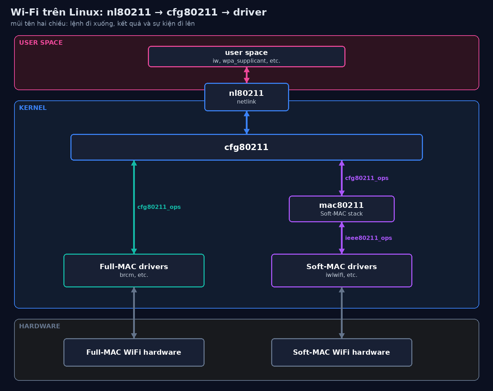

# Linux Wi-Fi Driver có gì đặc biệt?
{: .no_toc }

## Table of contents
{: .no_toc }

1. TOC
{:toc}

-----------------------------------
## Revision history

| Revision | Date          | Remark      |
|:---------|:------------- |:------------|
| 0.1      | Jan-12-2023   | Cập nhật Control Path |
| 0.2      | Jan-16-2023   | Cập nhật Control path ngày nay và Flow hoạt động của driver đời mới |
| 0.3      | Nov-22-2026   | Sửa lệnh và tên hàm bị sai, thêm data path chi tiết, luồng kết nối, công cụ và cách debug |

## Introduction

Wi-Fi driver là một network driver, nhiệm vụ đầu tiên nó cần làm là đăng ký với Kernel để tạo ra net device.

Net device này tương tự như ethernet interface mà Kernel đã hỗ trợ từ lâu. Sau khi khởi tạo thành công thì interface được tạo ra hoạt động giống hệt như một ethernet interface, kernel đối xử với nó như một ethernet interface. Bằng chứng là lệnh `ifconfig` show ra chúng không có gì khác nhau ngoài cái tên:


```shell
eth0: flags=4163<UP,BROADCAST,RUNNING,MULTICAST>  mtu 1500
        inet 192.168.1.100  netmask 255.255.255.0  broadcast 192.168.1.255
        inet6 fe80::3e7c:3fff:fe28:a7d1  prefixlen 64  scopeid 0x20<link>
        ether 3c:7c:3f:28:a7:d1  txqueuelen 1000  (Ethernet)
        RX packets 5095768  bytes 5407146907 (5.4 GB)
        RX errors 0  dropped 1  overruns 0  frame 0
        TX packets 2931637  bytes 1322759143 (1.3 GB)
        TX errors 0  dropped 0 overruns 0  carrier 0  collisions 0
        device interrupt 16  memory 0xa1100000-a1120000

wlan0: flags=4099<UP,BROADCAST,MULTICAST>  mtu 1500
        ether ac:12:03:d9:ca:e7  txqueuelen 1000  (Ethernet)
        RX packets 199840  bytes 19071504 (19.0 MB)
        RX errors 0  dropped 0  overruns 0  frame 0
        TX packets 33979  bytes 3645765 (3.6 MB)
        TX errors 0  dropped 0 overruns 0  carrier 0  collisions 0
```

Để ý dòng `(Ethernet)` ở cả hai: với kernel, `wlan0` cũng là Ethernet.

Và tên này thì chúng ta cũng có thể đổi được, không những đổi được tên mà còn tên tiếng Việt nữa cơ:

```shell
sudo ifconfig wlan0 down
sudo ip link set wlan0 name "cu-tèo"
sudo ifconfig "cu-tèo" up
```

(Bản đầu của bài mình ghi lệnh đổi tên là `ip set name ...`, sai cú pháp. Lệnh đúng là `ip link set <tên cũ> name <tên mới>`. Tên interface tối đa 15 byte, "cu-tèo" là 7 byte vì chữ "è" chiếm 2 byte UTF-8.)

Kết quả nó như thế này:

```shell
└──▶ ifconfig
cu-tèo: flags=4099<UP,BROADCAST,MULTICAST>  mtu 1500
        ether ac:12:03:d9:ca:e7  txqueuelen 1000  (Ethernet)
        RX packets 199840  bytes 19071504 (19.0 MB)
        RX errors 0  dropped 0  overruns 0  frame 0
        TX packets 33979  bytes 3645765 (3.6 MB)
        TX errors 0  dropped 0 overruns 0  carrier 0  collisions 0

```

Để tăng tính thuyết phục nó là một net device thông thường, mình set thêm địa chỉ IP cho nó (lệnh đúng không có chữ `set`, bản đầu mình ghi thừa):

```shell
sudo ifconfig "cu-tèo" 20.10.20.10 netmask 255.255.255.0
```

Xem kết quả nào:

```shell
thanh@pc ~
└──▶ ifconfig
cu-tèo: flags=4099<UP,BROADCAST,MULTICAST>  mtu 1500
        inet 20.10.20.10  netmask 255.255.255.0  broadcast 20.10.20.255
        ether ac:12:03:d9:ca:e7  txqueuelen 1000  (Ethernet)
        RX packets 199840  bytes 19071504 (19.0 MB)
        RX errors 0  dropped 0  overruns 0  frame 0
        TX packets 33979  bytes 3645765 (3.6 MB)
        TX errors 0  dropped 0 overruns 0  carrier 0  collisions 0
```

Gán IP được, cho vào bridge được, trỏ route vào được: đầy đủ như một net device. Tiếp theo ta sẽ tìm hiểu xem cách thức truyền nhận dữ liệu của nó như thế nào.

## Data path

Kernel sẽ cho driver đăng ký callback để khi có data đến interface hoặc kernel muốn gửi data đến interface thì thông qua callback này. Đường giao tiếp này được gọi là Data path.

### Chiều nhận: từ không gian vào application

```
Sóng radio → firmware của Wi-Fi module → DMA vào RAM của host
  → interrupt của driver → netif_rx() / napi_gro_receive()
  → net core → TCP/IP stack → socket → application
```

Khi Wi-Fi module nhận được dữ liệu từ không gian, nó chép frame vào RAM (DMA) rồi báo cho driver bằng interrupt. Driver chuyển dữ liệu đến netdev core qua hàm `netif_rx()` (driver mới thì dùng NAPI: `napi_gro_receive()`, kernel chủ động poll thay vì mỗi gói một interrupt). Từ đây net core chuyển nó đến TCP/IP stack để phân phối đến các application ở user space thông qua các socket.

Có một bước mà Ethernet không có: frame ngoài không gian là frame 802.11, header khác hẳn 802.3. Trước khi lên net core nó phải được đổi thành frame Ethernet. Ai làm việc đó thì tuỳ loại chip: firmware làm (Full-MAC), hoặc mac80211 trong kernel làm (Soft-MAC). Hai loại này nói ở phần [mac80211](#mac80211).

### Chiều gửi: từ application ra không gian

```
Application → socket → TCP/IP stack → routing/netfilter
  → net_device_ops.ndo_start_xmit() → hàng đợi TX của driver
  → DMA sang Wi-Fi module → firmware → phát ra không gian
```

Ở đường dữ liệu ngược lại, application từ user space thông qua socket chuyển dữ liệu đến net core, sau khi đi qua một loạt các routing rule, filter rules (xem [Linux Packet Filtering]({{ site.baseurl }})), chèn header ở mỗi layer của TCP/IP stack, gói tin được Kernel (net-core) chuyển đến interface thông qua callback `ndo_start_xmit()`. Đây là các API của driver, được đăng ký với Kernel ở giai đoạn đăng ký interface thông qua struct `net_device_ops`:

```c
static const struct net_device_ops my_wifi_netdev_ops = {
    .ndo_open            = my_wifi_open,
    .ndo_stop            = my_wifi_stop,
    .ndo_start_xmit      = my_wifi_xmit,
    .ndo_set_mac_address = my_wifi_set_mac,
    .ndo_get_stats64     = my_wifi_get_stats,
    .ndo_select_queue    = my_wifi_select_queue,
};
```

(Tên hàm `my_wifi_*` là mình đặt cho dễ đọc. Struct thì y hệt driver Ethernet nào cũng có.)

Việc còn lại của driver là chuyển nó đến Wi-Fi module qua PCIe/USB/SDIO. Data này sau đó sẽ được Wi-Fi firmware truyền đi vào không gian (gắn header 802.11, mã hoá, phát lại nếu mất).

Nghe có vẻ đơn giản nhỉ, thế nhưng phần còn lại phía sau đây mới làm chúng ta choáng ngợp.

Coi lại cái wireless interface xem nào:

```shell
thanh@pc ~
└──▶ ifconfig
cu-tèo: flags=4099<UP,BROADCAST,MULTICAST>  mtu 1500
        inet 20.10.20.10  netmask 255.255.255.0  broadcast 20.10.20.255
        ether ac:12:03:d9:ca:e7  txqueuelen 1000  (Ethernet)
        RX packets 199840  bytes 19071504 (19.0 MB)
        RX errors 0  dropped 0  overruns 0  frame 0
        TX packets 33979  bytes 3645765 (3.6 MB)
        TX errors 0  dropped 0 overruns 0  carrier 0  collisions 0
```
Cài đặt Layer 3 sẵn sàng rồi, kiểm tra Layer 2 xem đã có Link connection chưa nào.

```shell
ip link l

2: eth0: <BROADCAST,MULTICAST,UP,LOWER_UP> mtu 1500 qdisc fq_codel state UP ....
3: cu-tèo: <NO-CARRIER,BROADCAST,MULTICAST,UP> mtu 1500 qdisc noqueue state DOWN ...
```
`state DOWN ...` Thôi toang, quên mất nếu là ethernet thì cắm sợi dây vô switch hoặc router đang hoạt động thì có kết nối ngay (link connection), còn cái "cu-tèo" interface kia thì làm sao?

Bể khổ bắt đầu từ đây, thế là Wi-Fi driver phải nghĩ ra cách để tạo được Link connection đến thiết bị khác. Với Wi-Fi, "cắm dây" gồm cả một chuỗi việc: quét tìm mạng, xác thực (open, WPA2, WPA3, 802.1X), associate với AP, trao đổi khoá (4-way handshake), rồi còn chọn kênh, tiết kiệm pin, roaming...

Thời Wi-Fi "tiền sử", không có tiêu chuẩn gì cả (chưa có khái niệm STA, AP, WPA ...), driver làm gì cũng được miễn là tạo được link connection với một thiết bị khác, vậy nên mỗi hãng tự viết các tiêu chuẩn riêng.

Để tạo được kết nối, Wi-Fi driver tạo ra một đường giao tiếp giữa module Wi-Fi và người dùng, và đường giao tiếp này gọi là Control Path, dùng để cấu hình cho thiết bị và lấy thông tin từ thiết bị.

## Control path

Để 2 module kết nối với nhau cả hai cần những thiết lập như Channel, SSID/Password (này mình lấy cho dễ hiểu, SSID mới xuất hiện sau này thôi).

Control path đã qua ba thời kỳ:

| Thời kỳ | Công nghệ | Khoảng | Bây giờ |
|-----|-----------|--------|--------|
| Đồ đá | mỗi hãng một kiểu | trước 1996 | hết |
| Đồ sắt | Wireless Extensions (WEXT) | 1996 đến khoảng 2007 | deprecated, chỉ còn lớp tương thích |
| Ngày nay | nl80211 / cfg80211 / mac80211 | từ 2007 (kernel 2.6.22) | tiêu chuẩn hiện tại |

### Control path thời kì đồ đá

Như tiêu đề, giai đoạn này mỗi hãng tự viết tiêu chuẩn riêng để cấu hình cho module Wi-Fi của mình. Một ví dụ điển hình là các USB hoặc module 3/4/5G hiện nay:

- Một đường truyền tốc độ cao để làm Data Path (USB/PCI)
- Một đường truyền tốc độ chậm để làm Control Path (UART/I2C)

Các hãng sẽ viết các phần mềm để giao tiếp với thiết bị qua control path, các module đời cũ thì dùng qua tập lệnh AT, cao cấp hơn thì qua web socket ...

### Control path thời kì đồ sắt

Nhận thấy sự phân mảnh của các driver cũng như phần mềm cấu hình cho module Wi-Fi, năm 1996 ông [Jean Tourrilhes](https://www.hpl.hp.com/personal/Jean_Tourrilhes/) giới thiệu bộ công cụ [Wireless Extensions for Linux](https://www.hpl.hp.com/personal/Jean_Tourrilhes/Linux/Tools.html), bộ công cụ này gồm ba phần:

- Phần 1: Ứng dụng để giao tiếp giữa user và extension (`iwconfig`, `iwlist`, `iwpriv`)
- Phần 2: Modify ở Kernel để tạo đường giao tiếp giữa kernel và driver (các ioctl mới)
- Phần 3: Modify driver/firmware trên Wi-Fi module để hiểu được extension

Khó khăn nhất là ở phần 3 vì các hãng luôn muốn độc quyền sản phẩm của mình hơn là đi theo tiêu chuẩn. Đầu tiên thì cần phải có vài hãng tiên phong, sau đó nếu doanh thu bị ảnh hưởng thì các hãng lớn buộc phải hỗ trợ.

#### Giao tiếp giữa user và extension
##### /proc/net/wireless
- Để lấy thông tin về tình trạng hoạt động của Wi-Fi module, [Jean Tourrilhes](https://www.hpl.hp.com/personal/Jean_Tourrilhes/) đã tạo một nhân bản từ file `/proc/net/dev`, nó là `/proc/net/wireless`, file này chỉ chứa các thông tin liên quan đến Wi-Fi Link mà device ethernet tiêu chuẩn không có.

- Như đã đề cập, Wi-Fi driver là một network driver cho nên interface mà nó tạo ra có đầy đủ thuộc tính của một net device:

```shell
 cat /proc/net/dev
Inter-|   Receive                                                |  Transmit
 face |bytes    packets errs drop fifo frame compressed multicast|bytes    packets errs drop fifo colls carrier compressed
    lo: 5390764   56790    0    0    0     0          0         0  5390764   56790    0    0    0     0       0          0
  eth0:       0       0    0    0    0     0          0         0        0       0    0    0    0     0       0          0
 wlan0:  169874  716173    0   59    0     0          0         0    14152    1103    0    0    0     0       0          0
 wlan1:    1610      10    0    0    0     0          0         0    13537      95    0    1    0     0       0          0
 wlan2:       0       0    0    0    0     0          0         0        0       0    0    0    0     0       0          0
 wlan3:   16106     207    0    0    0     0          0         0     1722      11    0    0    0     0       0          0
 wlan4:       0       0    0    0    0     0          0         0        0       0    0    0    0     0       0          0
docker0:      0       0    0    0    0     0          0         0        0       0    0    0    0     0       0          0
```

##### iwconfig

- Đây là công cụ được clone ra từ công cụ `ifconfig` nổi tiếng toàn cầu (rất tiếc sắp bị đàn em là công cụ `ip` thay thế). `iwconfig` gửi các thông tin cấu hình thiết bị đến Kernel như: Channel muốn hoạt động, network ID, tên của protocol muốn dùng, kiểu mã hóa, và vô vàn các thông số khác nữa.

- Vì `Wireless Extension` chưa từng có trước đó nên [Jean Tourrilhes](https://www.hpl.hp.com/personal/Jean_Tourrilhes/) phải patch Kernel để nó hiểu được các thông tin phụ này cho wireless interface. Sau đó Kernel cũng đã merge luôn patch này để làm tính năng mặc định của Kernel luôn.

- `iwconfig` hỗ trợ những lệnh sau:

```shell
thanh@dell ~
└──▶ iwconfig  --help
Usage: iwconfig [interface]
                interface essid {NNN|any|on|off}
                interface mode {managed|ad-hoc|master|...}
                interface freq N.NNN[k|M|G]
                interface channel N
                interface bit {N[k|M|G]|auto|fixed}
                interface rate {N[k|M|G]|auto|fixed}
                interface enc {NNNN-NNNN|off}
                interface key {NNNN-NNNN|off}
                interface power {period N|timeout N|saving N|off}
                interface nickname NNN
                interface nwid {NN|on|off}
                interface ap {N|off|auto}
                interface txpower {NmW|NdBm|off|auto}
                interface sens N
                interface retry {limit N|lifetime N}
                interface rts {N|auto|fixed|off}
                interface frag {N|auto|fixed|off}
                interface modulation {11g|11a|CCK|OFDMg|...}
                interface commit
       Check man pages for more details.
```
- Lấy thông tin:

```shell
└──▶ iwconfig wlan0
wlan0     IEEE 802.11  ESSID:"home_ssid"
          Mode:Managed  Frequency:5.18 GHz  Access Point: xx:xx:xx:xx:xx:xx
          Bit Rate=866.7 Mb/s   Tx-Power=22 dBm
          Retry short limit:7   RTS thr:off   Fragment thr:off
          Power Management:on
          Link Quality=54/70  Signal level=-56 dBm
          Rx invalid nwid:0  Rx invalid crypt:0  Rx invalid frag:0
          Tx excessive retries:0  Invalid misc:597   Missed beacon:0
```
- Ngày nay (2023) thì lệnh `iwconfig` vẫn còn được dùng, tuy nhiên nó là "Bình cũ, rượu mới" rồi, dùng để chiều lòng các anh em hoài cổ thôi, phần giao tiếp bên dưới đã được thay đổi bằng siêu anh hùng `nl80211` rồi (kernel giữ một lớp tương thích dịch ioctl WEXT sang cfg80211).

> <span style="color:blue">Linux quản lý network stack bằng cách dùng một cấu trúc (device structure) để kiểm soát mỗi net device trong hệ thống. Phần đầu tiên của structure này là tiêu chuẩn và chứa các thông số như địa chỉ base I/O của thiết bị, địa chỉ IP..., các callback (start device, gửi-nhận packets...)</span>

[Jean Tourrilhes](https://www.hpl.hp.com/personal/Jean_Tourrilhes/) đã thêm một callback khác `get_wireless_stats` để lấy các thông số wireless cho file `/proc/net/wireless`. Khi đọc file này, kernel sẽ gọi callback này trên tất cả các net device đang hiện diện trong hệ thống. Nếu một device không đăng ký callback này thì sẽ được bỏ qua (không ảnh hưởng đến hoạt động của các ethernet device).

Khi được gọi, driver có nhiệm vụ giao tiếp với firmware trên Wi-Fi module để lấy thông tin và trả về cho Kernel thông tin thông qua struct `iw_statistics`:

```c++
/* ------------------------ WIRELESS STATS ------------------------ */
/*
 * Wireless statistics (used for /proc/net/wireless)
 */
struct iw_statistics {
	__u16		status;		/* Status
					 * - device dependent for now */

	struct iw_quality	qual;		/* Quality of the link
						 * (instant/mean/max) */
	struct iw_discarded	discard;	/* Packet discarded counts */
	struct iw_missed	miss;		/* Packet missed counts */
};
```

Example on Ubuntu Desktop 22.04:

```shell
cat /proc/net/wireless
Inter- | sta-|   Quality        |   Discarded packets               | Missed | WE
 face  | tus | link level noise |  nwid  crypt   frag  retry   misc | beacon | 22
 wlan0: 0000   76.  -61.   -256.       0      0      0      0      0        0
 wlan1: 0000    0.  -256.  -256.       0      0      0      0      0        0
 wlan2: 0000    0.  -256.  -256.       0      0      0      0      0        0
 wlan3: 0000    1.  -99.   -256.       0      0      0      0      0        0
```

##### iwpriv

Trong khi `iwconfig` yêu cầu các driver cần phải hỗ trợ để làm việc được với nhau thì `iwpriv` giúp mỗi hãng có cách để cấu hình riêng cho driver của mình (chỉnh antenna, debug firmware...) mà có thể không xuất hiện trên các driver của hãng khác hoặc dòng chip khác.

##### ioctl

`ioctl` là cách thông dụng để user-space nói chuyện với Kernel qua một file descriptor, và nó dùng được cả với network socket. Công cụ `ifconfig` dùng đúng cách này.

Ví dụ, để đổi địa chỉ IP của interface eth2, `ifconfig` tạo một ioctl với các tham số:

```
"eth2", SIOCSIFADDR, new address
```

Cấu trúc dữ liệu cho lời gọi trên nằm ở `/usr/include/linux/if.h`. Các option cho các chức năng khác: vlan, routing, arp, bonding, bridge nằm trong file `/usr/include/linux/sockios.h`:


```c++
/* Routing table calls. */
/* Socket configuration         controls. */
/* ARP cache control calls. */
/* RARP cache control calls. */
/* Driver configuration calls */
/* DLCI configuration calls */
/* bonding calls */
/* bridge calls */
```

[Jean Tourrilhes](https://www.hpl.hp.com/personal/Jean_Tourrilhes/) đã thêm các IOCTL sau (`/usr/include/linux/wireless.h`):

```c++
/* -------------------------- IOCTL LIST -------------------------- */

/* Wireless Identification */
/* Basic operations */
/* Informative stuff */
/* Spy support (statistics per MAC address - used for Mobile IP support) */
/* Access Point manipulation */
/* 802.11 specific support */
/* Other parameters useful in 802.11 and some other devices */
/* Encoding stuff (scrambling, hardware security, WEP...) */
/* Power saving stuff (power management, unicast and multicast) */
/* WPA : IEEE 802.11 MLME requests */
/* WPA : Authentication mode parameters */
/* WPA : Extended version of encoding configuration */
/* WPA2 : PMKSA cache management */
```

### Control path ngày nay

Nhu cầu sử dụng Wi-Fi là cực kì lớn, hầu như xuất hiện ở mỗi gia đình, mỗi thiết bị. Kéo theo nó là nhiều công nghệ, nhiều tiêu chuẩn được sinh ra. Điều này cũng tạo ra áp lực cho các nhà phát triển phần mềm, với số lượng tính năng ngày càng nhiều, nhiều doanh nghiệp sử dụng. Họ cần đảm bảo ít lỗi nhất trong các bản release.

Nhìn vào prototype chung của giao tiếp ioctl:

```c++
    int ioctl(int fd, unsigned long cmd, ...);
```
Đặc điểm của hàm này làm người review sẽ không biết hàm đó làm gì, không biết rõ có bao nhiêu tham số, kiểu dữ liệu của mỗi tham số. Điều này gây khó khăn cho việc kiểm lỗi quá trình biên dịch và tạo document.

Ngoài chuyện khó hiểu, WEXT còn mấy cái hạn chế nữa:

- Không có cơ chế báo sự kiện tử tế. Kết quả scan xong, bị AP đá ra, roaming... user space phải tự hỏi lại, và không có chuyện nhiều ứng dụng cùng nghe một sự kiện.
- Dữ liệu kích thước cố định, trong khi 802.11n/ac nhét thêm rất nhiều information element.
- Thêm tính năng nào cũng phải thêm số ioctl mới và patch kernel.

Các kỹ sư đã cho ra đời 1 thiết kế mới `nl80211`, đọc là netlink 80211:




Vẽ gọn lại theo kiểu từ trên xuống:

```
┌─────────────────────────────────────────────────────────────────────────┐
│                          User Space                                      │
│                                                                         │
│   ┌──────────┐  ┌────────────┐  ┌───────────────┐  ┌───────────────┐  │
│   │    iw    │  │wpa_suppl.  │  │   hostapd     │  │ NetworkManager│  │
│   └────┬─────┘  └─────┬──────┘  └───────┬───────┘  └───────┬───────┘  │
│        │               │                 │                   │          │
│        └───────────────┴─────────┬───────┴───────────────────┘          │
│                                  │ nl80211 (netlink)                     │
├──────────────────────────────────┼──────────────────────────────────────┤
│                          Kernel Space                                    │
│                                  │                                       │
│                         ┌────────▼────────┐                             │
│                         │    cfg80211      │  (configuration API)        │
│                         └────────┬────────┘                             │
│                                  │                                       │
│              ┌───────────────────┴───────────────────┐                  │
│              │                                       │                   │
│     ┌────────▼────────┐                      ┌──────▼──────┐           │
│     │    mac80211     │                      │  Full-MAC    │           │
│     │  (soft-MAC)     │                      │   driver     │           │
│     └────────┬────────┘                      │ (brcmfmac)   │           │
│              │                               └──────┬──────┘           │
│     ┌────────▼────────┐                             │                    │
│     │  HW driver      │                             │                    │
│     │ (iwlwifi, ath9k)│                             │                    │
│     └────────┬────────┘                             │                    │
├──────────────┼──────────────────────────────────────┼───────────────────┤
│              │     Hardware                          │                    │
│     ┌────────▼────────┐                      ┌──────▼──────┐           │
│     │  Intel Wi-Fi    │                      │  Broadcom   │           │
│     │    module       │                      │   module    │           │
│     └─────────────────┘                      └─────────────┘           │
└─────────────────────────────────────────────────────────────────────────┘
```

### nl80211

Đặt ra các tiêu chuẩn để giao tiếp giữa user-space và kernel (thay thế cách dùng ioctl của wireless-extension), dựa trên netlink socket. Các "khách hàng" nổi tiếng đang sử dụng tiêu chuẩn nl80211 có thể kể tên như: **iw, hostapd, wpa_supplicant, Network Manager, iwd...**

So với ioctl, cái hay của nó:

- Mỗi tham số là một attribute có kiểu rõ ràng (u32, string, nested...). Toàn bộ lệnh và attribute nằm trong `include/uapi/linux/nl80211.h`, đọc file đó là biết kernel hỗ trợ gì.
- Có multicast group: scan xong, kết nối, mất kết nối... kernel bắn sự kiện, ứng dụng nào đăng ký cũng nhận được, nhiều ứng dụng cùng lúc.
- Thêm lệnh hay attribute mới không làm hỏng chương trình cũ.

### cfg80211

Thiết kế mới của driver theo chuẩn của nl80211, chứa các API phục vụ cho việc config Linux 802.11, cfg80211 thay thế các Wireless extension. Nó nhận message nl80211 rồi gọi xuống driver, giữ trạng thái (đang scan, đã kết nối...), áp luật tần số theo quốc gia (regulatory domain), và lo phần xử lý kết quả scan/BSS dùng chung cho mọi driver.
<a target="_blank" href="https://elixir.bootlin.com/linux/v6.0/source/include/net/cfg80211.h">cfg80211.h</a>


### cfg80211_ops

Là các operation struct dùng cho việc giao tiếp giữa cfg80211 và tầng bên dưới (mac80211 hoặc Full-MAC driver). <a target="_blank" href="https://elixir.bootlin.com/linux/v6.0.19/source/include/net/cfg80211.h#L4271">cfg80211_ops</a>. Rút gọn vài callback (chữ ký đầy đủ thay đổi theo version kernel, xem link):

```c
// include/net/cfg80211.h (rút gọn)
struct cfg80211_ops {
    int (*scan)(struct wiphy *wiphy, struct cfg80211_scan_request *request);
    int (*connect)(struct wiphy *wiphy, struct net_device *dev,
                   struct cfg80211_connect_params *sme);
    int (*disconnect)(struct wiphy *wiphy, struct net_device *dev, u16 reason_code);
    int (*add_key)(struct wiphy *wiphy, struct net_device *dev, ...);
    int (*start_ap)(struct wiphy *wiphy, struct net_device *dev,
                    struct cfg80211_ap_settings *settings);
    int (*stop_ap)(struct wiphy *wiphy, struct net_device *dev, ...);
    /* ... còn hơn trăm callback nữa */
};
```

### mac80211

Các module Wi-Fi hiện nay có 2 loại hardware:
* Full-MAC: lớp Media Access Control (L2) được implement trực tiếp trên firmware của module. Scan, xác thực, associate, mã hoá, tiết kiệm pin, roaming đều do firmware làm; driver chỉ là đường chuyển lệnh giữa firmware và cfg80211. Loại này ít tốn tài nguyên của CPU chính và thường thấy trên các Wi-Fi chipset của Broadcom (`brcmfmac`), Marvell (`mwifiex`).
* Soft-MAC: lớp MAC của hardware loại này được implement trong kernel (mac80211), thường thấy trên driver của Intel Wi-Fi chipset (`iwlwifi`), Atheros/Qualcomm (`ath9k`, `ath10k`), MediaTek (`mt76`), Realtek (`rtw88`).

mac80211 là một Kernel module hỗ trợ cho các Wi-Fi module không tự làm được lớp MAC: bất kì dữ liệu gì nó nhận được đều chuyển đến kernel để bóc tách, filter ... Cụ thể mac80211 lo: xếp hàng TX/RX, chọn tốc độ (rate control), gộp frame (A-MPDU/A-MSDU), power save, đổi kênh, mã hoá bằng phần mềm khi chip không làm, và máy trạng thái scan/kết nối. Driver chỉ còn lo phần riêng của phần cứng.

| | Lớp MAC nằm ở | Driver đăng ký với |
|------|-------------------|---------------|
| Full-MAC | firmware trên module | cfg80211 trực tiếp (`struct cfg80211_ops`) |
| Soft-MAC | mac80211 trong kernel | mac80211 (`struct ieee80211_ops`) |

mac80211 thực hiện đăng ký nó với cfg80211 thông qua `struct cfg80211_ops`:

```
mac80211 đăng ký với cfg80211 qua struct cfg80211_ops
    └── driver Soft-MAC đăng ký với mac80211 qua struct ieee80211_ops

driver Full-MAC đăng ký thẳng với cfg80211 qua struct cfg80211_ops
```

> <span style="color:blue">Example of HW driver registering with mac80211: `drivers/net/wireless/intel/iwlwifi/mvm/mac80211.c` (bản 2023 mình ghi đường dẫn cũ `drivers/net/wireless/iwlwifi/...`, thư mục đã chuyển vào `intel/`)</span>

Driver đăng ký sử dụng mac80211 thông qua struct <a target="_blank" href="https://elixir.bootlin.com/linux/v6.0.19/source/include/net/mac80211.h#L4117">ieee80211_ops</a>:

```c
// include/net/mac80211.h (rút gọn)
struct ieee80211_ops {
    void (*tx)(struct ieee80211_hw *hw, struct ieee80211_tx_control *control,
               struct sk_buff *skb);
    int (*start)(struct ieee80211_hw *hw);
    void (*stop)(struct ieee80211_hw *hw, ...);
    int (*add_interface)(struct ieee80211_hw *hw, struct ieee80211_vif *vif);
    int (*config)(struct ieee80211_hw *hw, ...);
    void (*configure_filter)(struct ieee80211_hw *hw, ...);
    int (*set_key)(struct ieee80211_hw *hw, ...);
    /* ... */
};
```

## Flow hoạt động của driver đời mới

Bản 2023 bảng này có 3 bước và ghi sai tên hàm (`ieee80211_allow_hw()`, `cfg80211_wiphy_new()`, không có hai hàm này). Bản sửa:

|Bước     | Giải thích|
|:---------|:----------|
|1. Probing the HW| Bus (PCI/USB/SDIO) phát hiện thiết bị theo ID và load driver phù hợp |
|2. Load firmware| Driver nạp firmware vào module (`request_firmware()`) |
|3. Khởi tạo wiphy + mac80211| Soft-MAC: driver gọi `ieee80211_alloc_hw()` (bên trong tạo luôn `wiphy`), khai báo khả năng, rồi `ieee80211_register_hw()`. Full-MAC: driver tự gọi `wiphy_new()` rồi `wiphy_register()` |
|4. Tạo interface| Interface mặc định (`wlan0`, mode managed) được tạo |
|5. Khai báo khả năng| Băng tần, kênh, mode, tổ hợp interface, tính năng; user space đọc qua nl80211 |

Với tiêu chuẩn nl80211 mới này, các thông tin, mode hỗ trợ, băng tần ... driver cần phải hỗ trợ để cung cấp thông tin đầy đủ để user-space application thực hiện cấu hình.

Example:

```shell
thanhle@thanhle ~
└──▶ iw phy0 info
Wiphy phy0
        ...
        Supported interface modes:
                 * IBSS
                 * managed
                 * AP
                 * AP/VLAN
                 * monitor
                 * P2P-client
                 * P2P-GO
                 * P2P-device
        ...
        Supported commands:
                 * new_interface
                 * set_interface
                 * new_key
                 * start_ap
                 * new_station
                 * new_mpath
                 * set_mesh_config
                 * set_bss
                 * authenticate
                 * associate
                 * deauthenticate
                 * disassociate
                 * join_ibss
                 * join_mesh
                 * remain_on_channel
                 * set_tx_bitrate_mask
                 * frame
                 * frame_wait_cancel
                 * set_wiphy_netns
                 * set_channel
                 * start_sched_scan
                 * probe_client
                 * set_noack_map
                 * register_beacons
                 * start_p2p_device
                 * set_mcast_rate
                 * connect
                 * disconnect
                 * channel_switch
                 * set_qos_map
                 * add_tx_ts
                 * set_multicast_to_unicast
       ...
        valid interface combinations:
                 * #{ managed } <= 1, #{ AP, P2P-client, P2P-GO } <= 1, #{ P2P-device } <= 1,
                   total <= 3, #channels <= 2
        HT Capability overrides:
                 * MCS: ff ff ff ff ff ff ff ff ff ff
                 * maximum A-MSDU length
                 * supported channel width
                 * short GI for 40 MHz
                 * max A-MPDU length exponent
                 * min MPDU start spacing
```

Dòng `valid interface combinations` đáng đọc kỹ: card này chạy cùng lúc tối đa 1 managed + 1 AP/P2P + 1 P2P-device, tổng 3 interface, trên tối đa 2 kênh. Muốn vừa kết nối Wi-Fi nhà vừa phát AP thì phải nằm trong giới hạn đó.

## Từ lúc gõ lệnh đến lúc "state UP"

Quay lại cái "cu-tèo" đang `state DOWN`. Với chip Soft-MAC và `wpa_supplicant` dùng nl80211, chuỗi việc để có link như sau (tên lệnh lấy từ `nl80211.h`):

| # | wpa_supplicant gửi / nhận | Kernel làm gì |
|---|---------------------------|---------------|
| 1 | gửi `NL80211_CMD_TRIGGER_SCAN` | cfg80211 → mac80211 → driver `hw_scan` (hoặc mac80211 tự scan từng kênh) |
| 2 | nhận sự kiện `NL80211_CMD_NEW_SCAN_RESULTS`, đọc danh sách BSS | cfg80211 giữ danh sách BSS tìm được |
| 3 | gửi `NL80211_CMD_AUTHENTICATE` | mac80211 dựng frame Authentication 802.11, gửi qua driver, chờ AP trả lời |
| 4 | gửi `NL80211_CMD_ASSOCIATE`, nhận lại sự kiện cùng tên | mac80211 gửi Association Request, nhận Response |
| 5 | 4-way handshake (frame EAPOL) | EAPOL đi qua data path như gói thường, tới socket của wpa_supplicant |
| 6 | gửi `NL80211_CMD_NEW_KEY` (PTK, GTK) | cfg80211 → mac80211 → driver `set_key`, cài khoá vào phần cứng |
| 7 | gửi `NL80211_CMD_SET_STATION` (authorized) | mở cổng cho data thường, carrier lên: `state UP` |

Chip Full-MAC thì bước 3 tới 4 gộp lại thành một lệnh `NL80211_CMD_CONNECT`, firmware tự lo phần còn lại và báo về sự kiện `NL80211_CMD_CONNECT`.

Sau bước 7 thì `ip link` mới hết `NO-CARRIER`, và cái IP 20.10.20.10 gán từ đầu mới bắt đầu có ý nghĩa.

## Một card, nhiều interface

Một card vật lý (phy) có thể có nhiều interface ảo, mỗi cái một mode, miễn nằm trong `valid interface combinations` ở trên:

| Mode | Là gì |
|------|-------------|
| managed (station) | client kết nối vào AP, như laptop |
| AP (master) | làm access point (hostapd) |
| monitor | nghe lén mọi frame trên một kênh |
| IBSS (ad-hoc) | nối thẳng máy với máy, không AP |
| mesh (802.11s) | mạng mesh tự hình thành |
| P2P-GO / P2P-client | Wi-Fi Direct |

```bash
iw phy phy0 interface add mon0 type monitor
iw phy phy0 interface add wlan1 type managed
iw phy phy0 interface add ap0 type __ap
iw dev mon0 del
iw dev            # liệt kê interface của mọi phy
```

## Công cụ ngày nay

### iw

`iw` là thay thế cho `iwconfig`, nói chuyện thẳng bằng nl80211:

```bash
iw dev                          # các interface wireless
iw phy phy0 info                # khả năng của card
iw dev wlan0 scan
iw dev wlan0 connect "NetworkName"   # chỉ mạng open; WPA thì cần wpa_supplicant
iw dev wlan0 link               # đang nối với AP nào, tín hiệu
iw dev wlan0 station dump       # thống kê chi tiết
iw dev mon0 set channel 36 HT40+
iw dev wlan0 set txpower fixed 2000   # đơn vị mBm: 2000 = 20 dBm
iw reg get                      # regulatory domain
iw reg set VN
```

### wpa_supplicant

Lo phần xác thực WPA/WPA2/WPA3 ở mode station:

```bash
wpa_supplicant -i wlan0 -c /etc/wpa_supplicant/wpa_supplicant.conf -B

# /etc/wpa_supplicant/wpa_supplicant.conf
ctrl_interface=/run/wpa_supplicant
network={
    ssid="MyNetwork"
    psk="password123"
    key_mgmt=WPA-PSK       # WPA2-Personal
    # key_mgmt=SAE          # WPA3-Personal
    # key_mgmt=WPA-EAP      # WPA2-Enterprise
}

wpa_cli -i wlan0 status
wpa_cli -i wlan0 scan
wpa_cli -i wlan0 scan_results
wpa_cli -i wlan0 list_networks
wpa_cli -i wlan0 disconnect
wpa_cli -i wlan0 reconnect
```

### hostapd

Biến card thành access point:

```bash
# /etc/hostapd/hostapd.conf
interface=wlan0
driver=nl80211
ssid=MyAccessPoint
hw_mode=a           # 5 GHz
channel=36
ieee80211n=1        # 802.11n (HT)
ieee80211ac=1       # 802.11ac (VHT)
ieee80211ax=1       # 802.11ax (HE / Wi-Fi 6)

wpa=2
wpa_passphrase=secretpassword
wpa_key_mgmt=WPA-PSK SAE    # WPA2 + WPA3
rsn_pairwise=CCMP

# chạy
hostapd /etc/hostapd/hostapd.conf
```

### iwd

`iwd` (iNet Wireless Daemon, của Intel) là thay thế cho `wpa_supplicant`, gọn hơn và tự làm luôn DHCP nếu bật:

```bash
iwctl
[iwd]# station wlan0 scan
[iwd]# station wlan0 get-networks
[iwd]# station wlan0 connect "NetworkName"
[iwd]# station wlan0 show
[iwd]# known-networks list
```

## Debug

```bash
# Bật dynamic debug cho driver và mac80211 (cần debugfs)
echo "module iwlwifi +p" > /sys/kernel/debug/dynamic_debug/control
echo "module mac80211 +p" > /sys/kernel/debug/dynamic_debug/control
dmesg -w | grep -i "wifi\|wlan\|iwl\|ath\|80211"

# Bắt frame 802.11 thật bằng monitor mode
iw phy phy0 interface add mon0 type monitor
ip link set mon0 up
tcpdump -i mon0 -w capture.pcap
# filter trong Wireshark:
#   wlan.fc.type_subtype == 0x08   beacon
#   wlan.fc.type_subtype == 0x04   probe request
#   eapol                          4-way handshake

# Thông tin hay dùng
cat /sys/class/net/wlan0/device/uevent   # driver nào, bus nào
ethtool -i wlan0                          # driver + version firmware
iw dev wlan0 get power_save
iw phy phy0 channels                      # kênh được phép theo regulatory
```

## File kernel nên đọc

| File | Chứa gì |
|------|---------|
| `include/uapi/linux/nl80211.h` | toàn bộ lệnh và attribute nl80211 |
| `include/net/cfg80211.h` | API cfg80211, `struct cfg80211_ops` |
| `include/net/mac80211.h` | API mac80211, `struct ieee80211_ops` |
| `net/wireless/nl80211.c` | xử lý message nl80211 |
| `net/wireless/core.c` | lõi cfg80211 |
| `net/wireless/scan.c` | quản lý kết quả scan/BSS |
| `net/mac80211/main.c` | lõi mac80211 |
| `net/mac80211/tx.c`, `rx.c` | đường gửi/nhận của mac80211 |
| `net/mac80211/mlme.c` | máy trạng thái kết nối của station |
| `drivers/net/wireless/intel/iwlwifi/` | driver Intel (Soft-MAC) |
| `drivers/net/wireless/ath/ath9k/` | Atheros ath9k (Soft-MAC) |
| `drivers/net/wireless/broadcom/brcm80211/brcmfmac/` | Broadcom (Full-MAC) |

Chưa có trong bài: theo dấu một frame thật từ `ndo_start_xmit()` xuống `iwlwifi` bằng ftrace. Phần trên vẫn là đọc code và tài liệu, chưa trace trên máy.

## References

- [Linux Wireless documentation](https://wireless.docs.kernel.org/)
- [cfg80211 (kernel driver-api docs)](https://www.kernel.org/doc/html/latest/driver-api/80211/cfg80211.html)
- [mac80211 (kernel driver-api docs)](https://www.kernel.org/doc/html/latest/driver-api/80211/mac80211.html)
- [nl80211.h on Bootlin](https://elixir.bootlin.com/linux/latest/source/include/uapi/linux/nl80211.h)
- [Wireless Extensions for Linux, Jean Tourrilhes](https://www.hpl.hp.com/personal/Jean_Tourrilhes/Linux/Tools.html)
- [hostapd / wpa_supplicant](https://w1.fi/)
- [iwd](https://iwd.wiki.kernel.org/)
