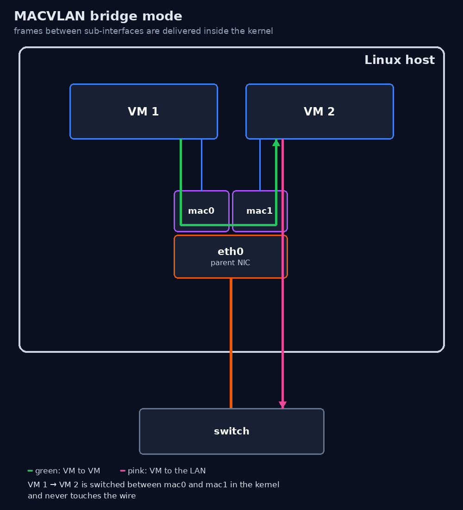
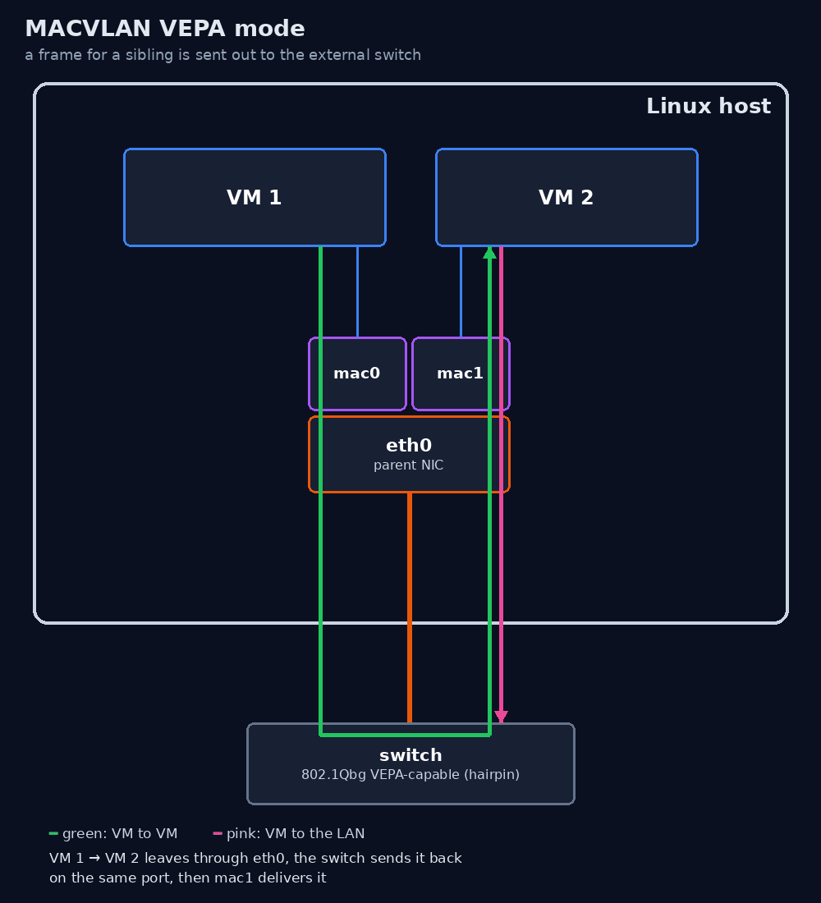
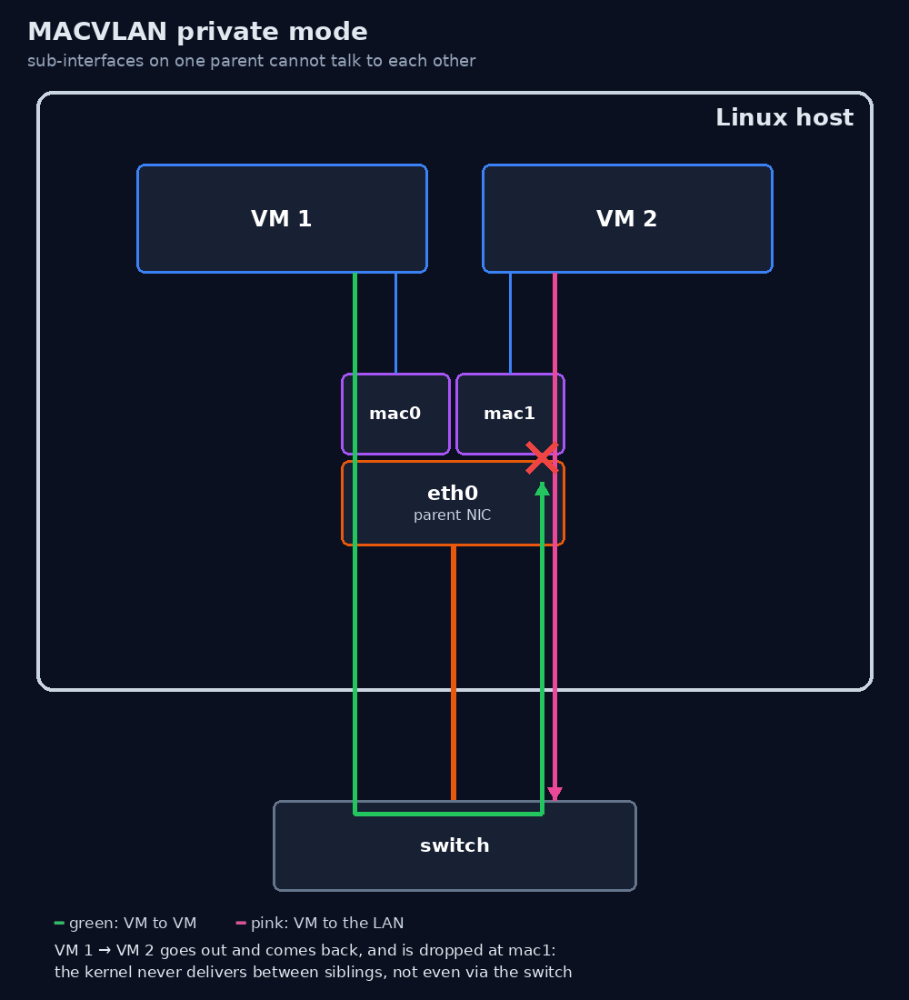
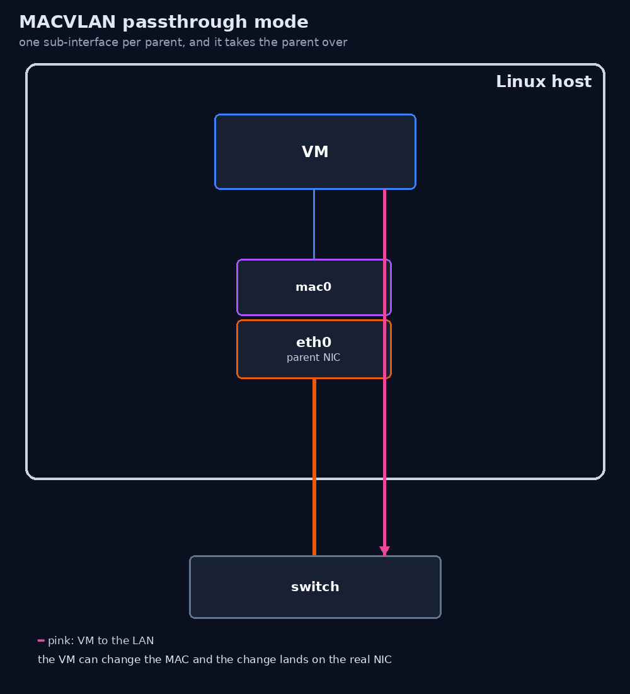

# Virtual Interfaces in Linux
{: .no_toc }

## Table of contents
{: .no_toc }

1. TOC
{:toc}

---

## Revision history

| Revision | Date          | Remark      |
|:---------|:------------- |:------------|
| 0.1      | Feb-02-2023   | Add Document |
| 0.2      | Feb-02-2023   | Add description of Docker using VETH |
| 0.3      | Feb-04-2023   | Add tunnel interface |
| 0.34     | Feb-06-2023   | Add ipvlan interface |
| 0.4      | Nov-22-2026   | Rewritten; one section per type, added VXLAN, WireGuard, dummy, bond, namespaces |

## Why I keep this page

In February 2023 this page was one big HTML table: type, how to create it, what it means. Revisions 0.1 to 0.34 happened over four days: the table first, then veth for Docker, then tunnels, then ipvlan.

The table got too narrow for the explanations, so now each type has its own section. The thing all of them have in common: to the kernel they're normal network interfaces. They have a name, usually a MAC, they take IP addresses, show up in routing, and you can `tcpdump` them. Almost all of them are created with `ip link` from iproute2.

| Type | Layer | Used for |
|------|-------|-------------|
| Bridge | L2 | a software switch between interfaces |
| VLAN (802.1Q) | L2 | several networks on one cable |
| MACVLAN | L2 | a container/VM with its own MAC on the LAN |
| IPVLAN | L2/L3 | like macvlan but one shared MAC |
| VETH | L2 | a virtual cable between two namespaces |
| TUN | L3 | userspace VPNs that deal in IP packets |
| TAP | L2 | VM network backends that deal in Ethernet frames |
| Tunnel (IPIP/GRE/SIT/VTI) | L3 | packets inside packets between two sites |
| VXLAN | L2 over UDP | L2 overlays across routed networks |
| WireGuard | L3 | encrypted point-to-point VPN |
| Dummy | L3 | an address that's always up |
| Bond | L2 | several NICs as one |

## Bridge

A software L2 switch. It learns which MAC sits behind which port and forwards frames accordingly; unknown destinations get flooded to all ports, exactly like a cheap hardware switch.

```
┌─────────────────────────────────────────┐
│              Bridge (br0)                │
│         MAC learning table              │
│                                         │
│   port1     port2     port3     port4   │
│    │          │         │         │     │
└────┼──────────┼─────────┼─────────┼─────┘
     │          │         │         │
   eth0       eth1      veth0     tap0
 (physical) (physical) (container) (VM)
```

You can put an IP on the bridge itself; then the host is one more member of the bridged network. STP is there if you build loops.

```bash
ip link add name br0 type bridge
ip link set br0 up

ip link set eth0 master br0        # add a port
ip link set eth1 master br0
ip link set eth0 nomaster          # remove a port

ip addr add 192.168.1.1/24 dev br0 # host joins the bridged network

ip link set br0 type bridge stp_state 1
ip link set br0 type bridge ageing_time 300   # seconds (0 = never forget)

bridge link show                   # ports
bridge fdb show dev br0            # learned MACs

ip link set br0 down
ip link delete br0
```

The old bridge-utils commands still work on many systems, and they still show up in a lot of scripts:

```bash
brctl addbr br0          # create
brctl delbr br0          # delete
brctl addif br0 eth1     # add port
brctl delif br0 eth1     # remove port
brctl show
brctl showmacs br0
```

Bridges are everywhere once you look: KVM/QEMU bridges TAP devices with a physical NIC so VMs get LAN addresses; Docker's `docker0` is a bridge with one veth per container; LXC/LXD do the same.

## 802.1Q VLAN

A VLAN interface adds a VLAN tag on the way out and takes tagged frames with its ID on the way in. The parent becomes a trunk carrying all of them.

```
           ┌──────────────┐
           │    eth0      │  (trunk - carries all VLANs)
           └──────┬───────┘
                  │
    ┌─────────────┼─────────────┐
    │             │             │
┌───▼───┐   ┌────▼────┐   ┌───▼───┐
│eth0.10│   │eth0.20  │   │eth0.30│
│VLAN 10│   │VLAN 20  │   │VLAN 30│
└───────┘   └─────────┘   └───────┘
```

Each `eth0.N` is an independent interface with its own address. IDs go from 1 to 4094. The kernel needs the `8021q` module.

```bash
modinfo 8021q            # is it built?
modprobe 8021q

ip link add link eth0 name eth0.100 type vlan id 100
ip link set eth0.100 up
ip addr add 10.0.100.1/24 dev eth0.100

ip link add link eth0 name eth0.200 type vlan id 200
ip link set eth0.200 up
ip addr add 10.0.200.1/24 dev eth0.200

cat /proc/net/vlan/config
ip -d link show eth0.100

ip link delete eth0.100

# Old way, from the vlan package:
# vconfig add eth0 100
# vconfig rem eth0.100
```

The classic use is router-on-a-stick: one cable to a managed switch, one VLAN per subnet, the Linux box routes between them. The switch port has to be configured as a trunk for that VLAN, otherwise the tagged frames just disappear.

## MACVLAN

Sub-interfaces of a physical interface, each with its own MAC. To the switch, each one is another machine on the port.

```
      ┌────────────────────────────────────────────┐
      │            Physical Network                  │
      └────────────────────┬───────────────────────┘
                           │
                    ┌──────▼──────┐
                    │    eth0     │  (parent)
                    │ MAC: AA:..  │
                    └──────┬──────┘
                           │
         ┌─────────────────┼─────────────────┐
         │                 │                 │
  ┌──────▼──────┐  ┌──────▼──────┐  ┌──────▼──────┐
  │  macvlan0   │  │  macvlan1   │  │  macvlan2   │
  │ MAC: BB:..  │  │ MAC: CC:..  │  │ MAC: DD:..  │
  └─────────────┘  └─────────────┘  └─────────────┘
```

Because each one has a real MAC, DHCP and ARP just work. The parent has to accept frames for those extra MACs (address filter, or promiscuous mode when the filter runs out), and that's also why it doesn't work over Wi-Fi.

| Mode | Siblings can talk? | When |
|------|-------------------|------|
| `bridge` | yes, inside the kernel | the normal choice |
| `vepa` | only through a hairpin-capable switch | the switch should see everything |
| `private` | no | strict isolation |
| `passthru` | n/a, one sub-interface only | give one VM the whole NIC |









```bash
ip link add macvlan0 link eth0 type macvlan mode bridge
ip link add macvlan1 link eth0 type macvlan mode private
ip link add macvlan2 link eth0 type macvlan mode vepa
ip link add macvlan3 link eth0 type macvlan mode passthru   # only one per parent

ip link set macvlan0 netns container1     # hand it to a container
ip link set macvlan0 up
ip addr add 192.168.1.50/24 dev macvlan0
```

The catch: the host can't talk to its own macvlans through the parent. The workaround is to give the host a macvlan too:

```bash
ip link add macvlan-host link eth0 type macvlan mode bridge
ip addr add 192.168.1.1/24 dev macvlan-host
ip link set macvlan-host up
```

Why that works, and everything else about the modes, is in [Linux MacVLAN]({{ site.baseurl }}).

## IPVLAN

Like macvlan, but all sub-interfaces use the parent's MAC, and the kernel tells them apart by IP. So it works where extra MACs aren't welcome: Wi-Fi, cloud VMs, switch ports with a MAC limit.

| Mode | Behaves like | Notes |
|------|-------|-------------|
| `l2` | a bridge | ARP per sub-interface, same subnet as the parent |
| `l3` | a router | parent routes between sub-interfaces, no ARP/broadcast, other subnets fine |
| `l3s` | `l3` + netfilter | conntrack and iptables see the traffic |

```
IPVLAN L2:                              IPVLAN L3:
┌────────────────────────┐              ┌────────────────────────┐
│   Same broadcast domain │              │ Separate routing domains│
│   ARP works normally    │              │ No ARP between peers   │
│   Same subnet as parent │              │ Different subnets OK   │
└────────────────────────┘              └────────────────────────┘
```

```bash
ip link add ipvlan0 link eth0 type ipvlan mode l2    # l2 is the default
ip link add ipvlan1 link eth0 type ipvlan mode l3
ip link add ipvlan2 link eth0 type ipvlan mode l3s

ip link set ipvlan0 netns ns1
ip netns exec ns1 ip link set ipvlan0 up
ip netns exec ns1 ip addr add 192.168.1.50/24 dev ipvlan0
```

| | MACVLAN | IPVLAN |
|---|---------|--------|
| MAC address | one per sub-interface | parent's, shared |
| Parent must accept extra MACs | yes | no |
| Wi-Fi parent | no | yes |
| Cloud VM | may be blocked | fine |
| DHCP | normal | `l2`: works but all share one MAC (use client IDs); `l3`: static or your own setup |
| iptables on the traffic | yes | `l3s` only |
| Host reaches sub-interfaces via parent | no | no |

## VETH

Always a pair: a virtual Ethernet cable with two ends. What goes in one end comes out the other. This is the standard way to connect a network namespace to anything.

```
┌──────────────────────┐         ┌──────────────────────┐
│   Namespace A        │         │   Namespace B        │
│                      │         │                      │
│  ┌────────────────┐  │  veth   │  ┌────────────────┐  │
│  │    veth-a      │◄─┼─────────┼─►│    veth-b      │  │
│  │ 10.0.0.1/24    │  │  pair   │  │ 10.0.0.2/24    │  │
│  └────────────────┘  │         │  └────────────────┘  │
└──────────────────────┘         └──────────────────────┘
```

```bash
ip link add veth0 type veth peer name veth1

ip netns add ns1
ip link set veth1 netns ns1

ip addr add 10.0.0.1/24 dev veth0
ip link set veth0 up

ip netns exec ns1 ip addr add 10.0.0.2/24 dev veth1
ip netns exec ns1 ip link set veth1 up

ping 10.0.0.2
```

This was the row I added for Docker back in 2023. Docker's default bridge network is exactly this, repeated: for each container one veth pair, one end renamed `eth0` inside the container's namespace, the other end a port of `docker0`, and an address from the bridge subnet.

```
┌────────────────────────────────────────────────────────┐
│                        Host                             │
│                                                        │
│  ┌──────────────────────────────┐                     │
│  │         docker0 (bridge)      │                     │
│  │    172.17.0.1/16              │                     │
│  └────┬──────────────┬──────────┘                     │
│       │              │                                 │
│    veth-host1     veth-host2                           │
│       │              │                                 │
│  ─ ─ ─│─ ─ ─ ─  ─ ─ ─│─ ─ ─ ─                        │
│       │              │                                 │
│  ┌────▼────┐    ┌────▼────┐                           │
│  │Container│    │Container│                           │
│  │   A     │    │   B     │                           │
│  │eth0     │    │eth0     │                           │
│  │172.17.  │    │172.17.  │                           │
│  │ 0.2/16  │    │ 0.3/16  │                           │
│  └─────────┘    └─────────┘                           │
└────────────────────────────────────────────────────────┘
```

More on that in [Docker Networking]({{ site.baseurl }}).

## TUN

A L3 device with a program behind it. The program opens `/dev/net/tun`, and from then on every IP packet the kernel routes to `tun0` can be `read()` by the program, and every packet it `write()`s appears as received on `tun0`. No Ethernet header anywhere.

```
┌───────────────────────┐
│    Userspace App       │
│    (VPN client)        │
│         │              │
│    read()/write()      │
│    on /dev/net/tun     │
└─────────┬─────────────┘
          │ IP packets
┌─────────▼─────────────┐
│     tun0 interface     │
│     10.8.0.1/24        │
└─────────┬─────────────┘
          │
┌─────────▼─────────────┐
│    Kernel routing      │
└───────────────────────┘
```

Since there's no L2, a TUN can't join a bridge and has no broadcast.

```bash
ip tuntap add name tun0 mode tun
# owned by a user, so the program doesn't need root
ip tuntap add name tun0 mode tun user $(id -u) group $(id -g)

ip link set tun0 up
ip addr add 10.8.0.1/24 dev tun0
ip route add 10.8.0.0/24 dev tun0

ip tuntap del name tun0 mode tun
```

OpenVPN in its usual routed setup is the classic TUN user. So is `wireguard-go`, the userspace WireGuard; the in-kernel WireGuard is its own interface type (below).

## TAP

Same as TUN, but one layer down: the program reads and writes whole Ethernet frames, MAC header included. So a TAP has a MAC, does broadcast, and can be a bridge port.

```
┌───────────────────────┐
│    Userspace App       │
│  (QEMU/KVM, OpenVPN)  │
│         │              │
│    read()/write()      │
│    on /dev/net/tun     │
└─────────┬─────────────┘
          │ Ethernet frames
┌─────────▼─────────────┐
│     tap0 interface     │
│   MAC: fe:xx:xx:xx    │
└─────────┬─────────────┘
          │
┌─────────▼─────────────┐
│   Bridge (br0)         │
│   or standalone        │
└───────────────────────┘
```

```bash
ip tuntap add name tap0 mode tap
ip tuntap add name tap0 mode tap user libvirt-qemu   # owned by the QEMU user

ip link set tap0 up
ip link set tap0 master br0     # the usual VM setup

ip tuntap del name tap0 mode tap
```

That's the usual VM setup: QEMU holds the TAP, the TAP is a port of `br0`, `br0` also holds the physical NIC, and the VM is on the LAN. OpenVPN with `--dev tap` gives you an L2 VPN the same way.

| | TUN | TAP |
|---|-----|-----|
| Carries | IP packets | Ethernet frames |
| MAC address | no | yes |
| Can be a bridge port | no | yes |
| Broadcast/multicast | no | yes |
| Typical user | routed VPN | VMs, bridged VPN |

## Tunnels (IPIP, GRE, SIT, VTI)

Packets inside packets, so two sites can exchange traffic the network in between wouldn't route by itself. In 2023 my only example was a 6in4 (`sit`) tunnel with variables:

```bash
ip tunnel add tunnel0 mode sit ttl $TUNTTL remote $ISPBRIP local $WAN4IP
ip tunnel del tunnel0
```

`ip tunnel` knows these modes: `ipip | gre | sit | isatap | vti | ip6ip6 | ipip6 | ip6gre | vti6 | any`. The common ones:

| Mode | What's inside what | Why |
|------|--------------|----------|
| `ipip` | IPv4 in IPv4 | simplest, smallest overhead |
| `gre` | anything L3 in GRE | multicast works, so OSPF and friends can run over it |
| `sit` | IPv6 in IPv4 (6in4) | IPv6 over an IPv4-only link |
| `ip6tnl` | IPv6/IPv4 in IPv6 | tunnelling over IPv6 |
| `gretap` | Ethernet in GRE | L2 tunnel, can be a bridge port |
| `vti` | IPsec, as an interface | route-based IPsec VPN |

The examples below use two made-up sites: A is `203.0.113.1` with `10.0.1.0/24` behind it, B is `198.51.100.1` with `10.0.2.0/24`. The tunnel itself gets a tiny `/30` from `10.255.0.0`.

**IPIP**

```bash
# Site A
ip tunnel add tun-ab mode ipip remote 198.51.100.1 local 203.0.113.1 ttl 255
ip link set tun-ab up
ip addr add 10.255.0.1/30 dev tun-ab
ip route add 10.0.2.0/24 dev tun-ab

# Site B
ip tunnel add tun-ba mode ipip remote 203.0.113.1 local 198.51.100.1 ttl 255
ip link set tun-ba up
ip addr add 10.255.0.2/30 dev tun-ba
ip route add 10.0.1.0/24 dev tun-ba
```

**GRE** (same layout; a `key` lets you run several tunnels between the same two endpoints)

```bash
ip tunnel add gre-ab mode gre remote 198.51.100.1 local 203.0.113.1 ttl 255
ip link set gre-ab up
ip addr add 10.255.0.1/30 dev gre-ab
ip route add 10.0.2.0/24 dev gre-ab

ip tunnel add gre-1 mode gre remote 198.51.100.1 local 203.0.113.1 key 100
ip tunnel add gre-2 mode gre remote 198.51.100.1 local 203.0.113.1 key 200
```

**GRETAP** (L2 across sites; bridge it with a local port and both sides share one Ethernet)

```bash
ip link add gretap0 type gretap remote 198.51.100.1 local 203.0.113.1
ip link set gretap0 up
ip link set gretap0 master br0
```

**SIT** (6in4, the case from my original example, with real-looking values)

```bash
ip tunnel add sit1 mode sit remote 198.51.100.1 local 203.0.113.1 ttl 255
ip link set sit1 up
ip -6 addr add 2001:db8::1/64 dev sit1
ip -6 route add 2001:db8:1::/48 dev sit1
```

**VTI** (the interface is the route; strongSwan or Libreswan does the IPsec part and matches on the key/mark)

```bash
ip tunnel add vti0 mode vti remote 198.51.100.1 local 203.0.113.1 key 100
ip link set vti0 up
ip addr add 10.255.0.1/30 dev vti0
ip route add 10.0.2.0/24 dev vti0
```

Deleting: `ip tunnel del tun-ab`, or `ip link delete gretap0` for the `ip link` kinds.

## VXLAN

Ethernet frames in UDP (port 4789), so two hosts on a routed network can share one L2 segment. The segment ID (VNI) is 24 bits, so about 16 million of them, against 4094 VLANs.

```
Host A (10.0.0.1)                           Host B (10.0.0.2)
┌──────────────────┐                        ┌──────────────────┐
│  Container       │                        │  Container       │
│  172.16.0.10     │                        │  172.16.0.20     │
│       │          │                        │       │          │
│  ┌────▼────┐     │     UDP:4789           │  ┌────▼────┐     │
│  │ vxlan0  │     │◄──────────────────────►│  │ vxlan0  │     │
│  │ VNI:100 │     │  VXLAN encapsulated    │  │ VNI:100 │     │
│  └────┬────┘     │                        │  └────┬────┘     │
│       │          │                        │       │          │
│    eth0          │                        │    eth0          │
│  10.0.0.1        │                        │  10.0.0.2        │
└──────────────────┘                        └──────────────────┘
```

On the wire it's: outer IP, UDP, VXLAN header, then the original frame. That's 50 bytes of extra headers on IPv4, so the MTU inside has to shrink.

```bash
# Point to point
ip link add vxlan100 type vxlan id 100 remote 10.0.0.2 local 10.0.0.1 dstport 4789 dev eth0
ip link set vxlan100 up
ip addr add 172.16.0.1/24 dev vxlan100

# Peers found through multicast
ip link add vxlan100 type vxlan id 100 group 239.1.1.1 dstport 4789 dev eth0
ip link set vxlan100 up

# Several peers listed by hand, VXLAN as a bridge port
ip link add vxlan100 type vxlan id 100 dstport 4789 local 10.0.0.1 nolearning
ip link set vxlan100 master br0
ip link set vxlan100 up
bridge fdb append 00:00:00:00:00:00 dev vxlan100 dst 10.0.0.2
bridge fdb append 00:00:00:00:00:00 dev vxlan100 dst 10.0.0.3

ip -d link show vxlan100
bridge fdb show dev vxlan100
```

The all-zero MAC entries mean "send broadcast/unknown traffic to this peer", one entry per peer. This is the layer under Docker's overlay network, Flannel's VXLAN backend in Kubernetes, and a lot of data-center fabrics.

## WireGuard

An in-kernel VPN that appears as an interface (`wg0`) and carries IP packets. Keys are short, config is a handful of lines, and `wg` is the only extra tool.

```bash
ip link add wg0 type wireguard

wg genkey | tee privatekey | wg pubkey > publickey

wg set wg0 listen-port 51820 private-key ./privatekey \
    peer <peer-public-key> allowed-ips 10.0.0.2/32 endpoint 203.0.113.1:51820

ip addr add 10.0.0.1/24 dev wg0
ip link set wg0 up

wg show
wg show wg0

wg set wg0 peer <public-key> allowed-ips 10.0.0.3/32 endpoint 198.51.100.1:51820
wg set wg0 peer <public-key> remove
```

`allowed-ips` does double duty: on the way out it picks which peer a packet goes to, on the way in it's the list of source addresses accepted from that peer. Getting it wrong is the usual reason "the handshake works but no traffic passes".

## Dummy

An interface that's always up and drops whatever is sent to it. It's useful as a place to hang an address that shouldn't depend on any cable: a router ID for OSPF/BGP, a service IP, or a black hole for testing.

```bash
ip link add dummy0 type dummy
ip link set dummy0 up
ip addr add 10.255.255.1/32 dev dummy0
```

## Bond

Several physical NICs as one logical interface, for failover, more bandwidth, or both.

| Mode | Name | What it does |
|------|------|-------------|
| 0 | balance-rr | round-robin over all links; switch ports must be grouped (static EtherChannel) |
| 1 | active-backup | one link active, the next takes over when it fails; no switch config |
| 2 | balance-xor | link chosen by a hash of addresses |
| 3 | broadcast | everything on every link |
| 4 | 802.3ad | LACP; the switch has to speak LACP |
| 5 | balance-tlb | adaptive transmit balancing, no switch support needed |
| 6 | balance-alb | tlb plus receive balancing (ARP tricks), no switch support needed |

```bash
ip link add bond0 type bond mode 802.3ad
ip link set bond0 type bond miimon 100 lacp_rate fast

# members must be down before they can be enslaved
ip link set eth0 down
ip link set eth1 down
ip link set eth0 master bond0
ip link set eth1 master bond0

ip link set bond0 up
ip addr add 192.168.1.1/24 dev bond0

cat /proc/net/bonding/bond0

# active-backup with a preferred link
ip link add bond0 type bond mode active-backup
ip link set bond0 type bond primary eth0 miimon 100
```

## Putting it together: two namespaces on a bridge

This is a container network without the containers: two namespaces, a veth pair each, a bridge in the middle. If this works, you understand what Docker's bridge driver does.

```bash
ip netns add red
ip netns add blue

ip link add br0 type bridge
ip link set br0 up
ip addr add 10.0.0.1/24 dev br0

ip link add veth-red type veth peer name veth-red-br
ip link add veth-blue type veth peer name veth-blue-br

ip link set veth-red netns red
ip link set veth-blue netns blue

ip link set veth-red-br master br0
ip link set veth-red-br up
ip link set veth-blue-br master br0
ip link set veth-blue-br up

ip netns exec red ip link set veth-red up
ip netns exec red ip addr add 10.0.0.2/24 dev veth-red
ip netns exec red ip route add default via 10.0.0.1

ip netns exec blue ip link set veth-blue up
ip netns exec blue ip addr add 10.0.0.3/24 dev veth-blue
ip netns exec blue ip route add default via 10.0.0.1

ip netns exec red ping 10.0.0.3
```

To get them to the internet as well, add IP forwarding and a MASQUERADE rule on the host. That part is in [Linux Packet Filtering]({{ site.baseurl }}).

```bash
ip netns list
ip netns exec red ip addr show
ip netns identify <pid>     # which named netns a process is in
ip netns monitor            # netns add/delete events
ip netns del red
```

## Looking at them

```bash
ip -d link show              # -d shows the type and its options
ip -s link show eth0         # counters
ip monitor link              # interfaces appearing, going up/down
tcpdump -i veth0 -nn
bridge fdb show
bridge fdb show dev vxlan100
perf trace -e 'net:*' -- ping -c1 10.0.0.2   # kernel net tracepoints for one ping
```

Not covered yet: macvtap/ipvtap (the TAP-like versions of macvlan/ipvlan that libvirt uses), `veth` with XDP, and VRF devices.

## References

- [ip-link(8) man page](https://man7.org/linux/man-pages/man8/ip-link.8.html)
- [Linux kernel networking documentation](https://www.kernel.org/doc/html/latest/networking/index.html)
- [IPVLAN driver HOWTO](https://www.kernel.org/doc/html/latest/networking/ipvlan.html)
- [VXLAN (kernel docs)](https://www.kernel.org/doc/html/latest/networking/vxlan.html)
- [WireGuard](https://www.wireguard.com/)
- [Docker networking](https://docs.docker.com/network/)
- [Linux MacVLAN]({{ site.baseurl }})
