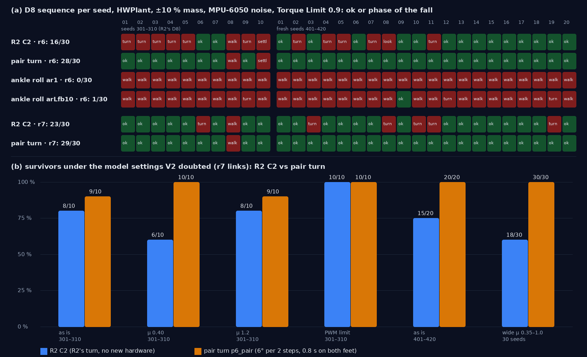

# An ankle roll servo made it worse
{: .no_toc }

[Back to the Dino robot hub](/robotics/dino-robot/)

*With the ankle roll 0 of 30 robots finish; the pair turn, with no new servo, gets 28 of 30.*

1. TOC
{:toc}

## Situation

The walk in MuJoCo rocks about 10° sideways every step, and the robot can't stand on one leg at all.
Without an ankle roll, with both soles flat, the centre of mass moves at most 5.93 mm sideways, while the
inner edge of the sole is 21.5 mm from the midline. By the numbers it would need an ankle roll of at
least 9.3°. And I had 3 AX-12A doing nothing.

Adding a joint felt like the obvious fix. It also means a new CAD revision, a taller leg and a boxy lump
at the ankle of a design I already liked.

## Task

Find out in simulation, before touching the CAD, whether an ankle roll per leg actually helps the full
sequence (walk 1 m, turn 90°, look, roar) on 30 perturbed robots.

## Action

In the model the AX-12A hangs under the ankle-pitch MX-28 in a printed U-bracket, horn pointing forward,
and the foot bolts to its horn. That puts the foot 40 mm lower and adds 139.6 g. I tried two controller
versions: one where the IK uses the roll, one where the IK keeps it locked and only the balance feedback
moves it. Same 30 seeds as the robot without it.

While that ran I also tried a fix with no new hardware: the pair turn (6° per two steps, 0.8 s on both
feet in between).

*MuJoCo, 30 seeds. Top: one box per robot, green = finished, red = the phase it fell in. Bottom: the pair turn (orange) against the old turn (blue) when I change friction or the torque-limit model.*

## Result

| Robot | Full sequence survived |
|---|---|
| no ankle roll, old turn | 16 / 30 |
| ankle roll, used by the IK | 0 / 30 |
| ankle roll, locked in the IK, feedback only | 1 / 30 |
| no ankle roll, pair turn | 28 / 30 |

The ankle roll made it worse, and it fell while walking, not turning. Two reasons showed up. The 40 mm
taller leg alone breaks the walk: with the roll locked, 0 of 6 walk at a 40 mm drop against 4 of 6 at
0 mm. And a free roll on the soft AX-12A lets the stance leg lean out until hip roll stops at 9.9°,
ankle roll at 16.6°, and the centre of mass leaves the sole.

So the CAD stays as it is and the pair turn became the default (see the
[MuJoCo story](/robotics/dino-robot/walking-in-mujoco)). Still no one-leg stand: the free foot comes off
the ground for 0.02 s at most.

## What I'd do next

If I ever draw an ankle roll, the servo has to sink into the foot so the leg grows by 10 mm at most,
because the drop is what kills the walk. A stiffer servo there would help too, but I don't own one.
