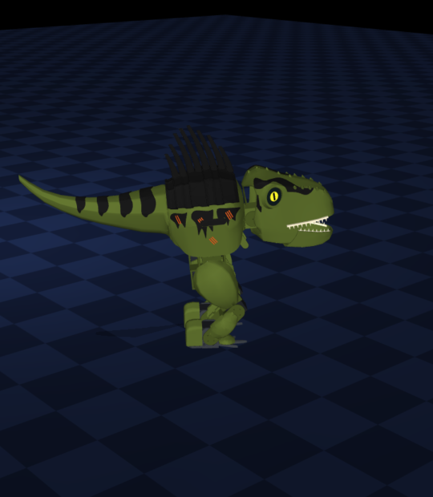
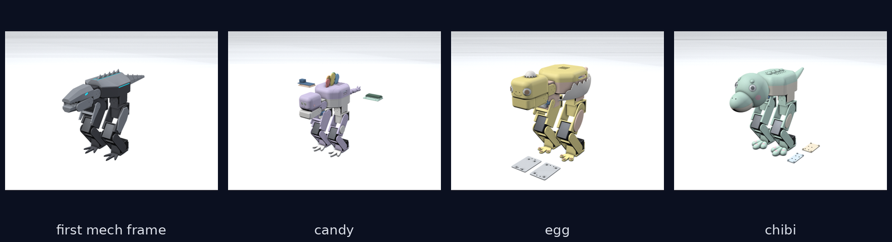

# Dino robot
{: .no_toc }

*30 of 30 perturbed robots finish the full sequence in MuJoCo. Nothing is printed yet.*

*MuJoCo, November 2026: the simulated robot with the CAD shells drawn over its links. No part of it is printed yet.*

This is a two-legged dinosaur with a passive TPU tail, on a frame I'm drawing myself. It came out of
reading how Microduck learns to walk (see the [Microduck hub](/robotics/microduck/)): I wanted
something that walks like that, but on my own frame and with servos I already own: 7 MX-28, 10 AX-12A
and some SG90s. So the robot ended up with
13 DYNAMIXEL joints: five per leg, plus neck, head yaw and jaw. One SG90 moves both arms, and two round
1.28" LCDs are the eyes. If it ever works well I might turn it into a kit, but that's far off.

The shape took a few days of trying. Cute concepts first (candy, egg, chibi), then two brick-toy
dinosaurs from my shelf as the reference. A slim raptor got dropped because it looked plain ugly. A
sail-backed one with a big head and a deep body is the one I kept.

*Early concepts, all CadQuery renders from 18 November 2026. None of them got past the drawing.*

## What works so far

Everything here lives in CAD or in simulation. The CAD scripts give me masses, centres of mass and
static joint loads on the B-rep, which is how the MX-28s got placed. The head can turn and nod at the
same time without hitting the neck. A MuJoCo model built straight from the CAD walks, turns, looks around
and roars, and after a lot of bad news it survives the full sequence on 30 of 30 perturbed
robots.

## The write-ups



## Still open

Nothing is printed and no servo is wired. I don't know yet whether my MX-28s are the T or the AR/AT
revision; the brackets take both, but the thread depth is unmeasured. The 0.8 sole friction in the
sim is a guess until I tilt a printed TPU pad on a board, and the hip roll is still over its torque budget
while walking. The next real step is printing one leg and putting three servos on a bus.
