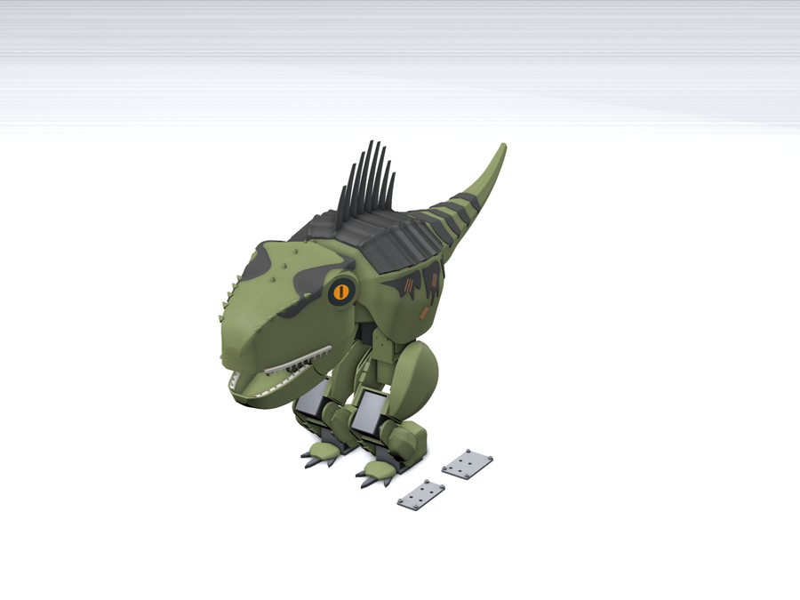

# A head that turns and nods at the same time
{: .no_toc }

[Back to the Dino robot hub](/robotics/dino-robot/)

1. TOC
{:toc}

## Situation

The head carries two round GC9A01 LCDs (1.28", 240 × 240) as eyes, one AX-12A for head yaw and one for
neck pitch. I'd already capped yaw at ±20°: ±45° would have meant moving the jaw servo and redrawing the
head I liked. Then I swept revision r3 of the CAD and found the real problem. Turned 20° to the side, the
head could nod only 2.8° down and 0° up before the back of the skull touched the neck.

A dinosaur that can look sideways or nod, but not both, isn't much of a character.

## Task

Get a useful nod at every yaw angle without changing how the head looks, and keep at least 0.5 mm of
air between every moving part and the fixed ones.

## Action

The sweep script turns the head on the B-rep from −20° to +20° in 5° steps (plus a 2.5° pass for the
gap) and, at each yaw, finds how far it can pitch down and up before the clearance drops under 0.5 mm.

The obvious fix was moving the yaw axis forward. I tried it and it made things worse. What worked was
a deeper trim on the back of the skull that tapers with height, plus two notches in the neck socket for
the skull to swing into. That went into r4. From the outside it's the same head.

*Revision r4 in a plain CadQuery render: the trim is on the back of the skull, where you can't see it.*

## Result

Nod range at each yaw on r4, from the sweep:

| Yaw | −20° | −15° | −10° | −5° | 0° | +5° | +10° | +15° | +20° |
|---|---|---|---|---|---|---|---|---|---|
| nose down | 18.52° | 18.52° | 18.52° | 18.28° | 18.05° | 18.28° | 18.52° | 18.52° | 18.52° |
| nose up | 8.44° | 8.20° | 8.20° | 8.20° | 8.20° | 8.20° | 8.20° | 8.20° | 8.44° |

So at 20° of yaw it went from 2.8° down / 0° up to 18.52° down / 8.44° up. The closest gap over the whole
yaw sweep is 0.50 mm, skull against the fixed parts at −20°. A separate sweep of the legs on r6 gives ±30°
at hip yaw, hip pitch and ankle, ±10° at hip roll and −30° to +8° at the knee.

## What I'd do next

0.5 mm is tight for a printed part. I'd print the skull and the neck socket first and check the gap with
a feeler gauge before trusting any of these angles.
