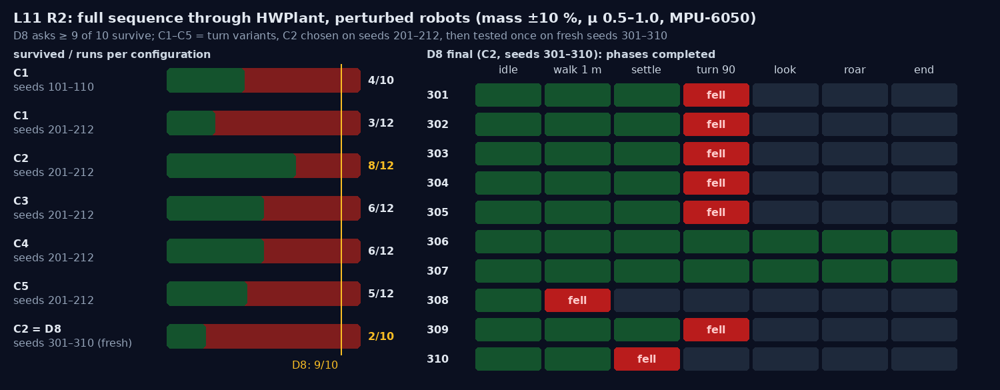
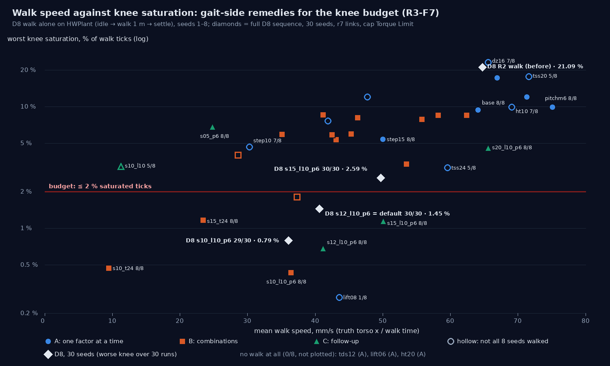

# It walked in MuJoCo, then I made the sim honest
{: .no_toc }

[Back to the Dino robot hub](/robotics/dino-robot/)

*From 0 of 5 to 30 of 30 perturbed robots through the full sequence, walking at 40.7 mm/s.*

1. TOC
{:toc}

## Situation

By 22 November 2026 I had static loads for every joint and no idea whether the thing could walk. Static
numbers say nothing about a knee pushing a 2.7 kg body through a step. Nothing was printed, so the first
walk had to be a simulated one.

## Task

Build a MuJoCo model from the CAD itself, no retyped numbers. Then write a controller for the behaviours
I want on the real robot: stand, walk 1 m, turn 90°, look around, roar. And make it survive robots that
aren't exactly the CAD, because the printed one won't be.

## Action

An exporter reads masses, centres of mass, inertia tensors, joint axes and foot outlines from the
B-rep. The model got 15 bodies, 13 position actuators (6 MX-28, 7 AX-12A) and a two-hinge spring tail. The
first validation failed twice. One bounding box per leg link made the legs "touch" each other when they
didn't, so I switched to one capsule per CAD slab. And my tail stiffness formula let the tail sag 4.5°;
treating it as lumped masses brought that to 0.009°. After that the model mass was 2714.9 g against
2715.4 g in CAD.

The controller is a classic LIPM walker with IK. 53 of 360 gait settings were stable over 20 steps,
the fastest at 132.6 mm/s. The whole sequence ran without a fall: walk 1196.6 mm, turn 87.9°, look
around, roar. It even went through my real servo-layer code (Protocol 1.0 Sync Writes, 1904 of them)
into the sim.

Then I tried to prove it wrong, and it was. The sole friction was μ 1.2, a rubber value on a PLA sole.
And the sim ignored the Torque Limit register my servo code writes. With mass and friction off by ±10 %,
the full sequence survived 0 of 5 robots. Four fell while turning in place.

So the model got TPU soles at μ 0.8, the Torque Limit at 90 % of stall, a 0.5 ms step and an
MPU-6050 noise model, and the turn now steers on integrated gyro yaw instead of the sim's perfect one.
On 10 fresh perturbed robots it survived 2. Six of the eight falls were in the turn: the roll grows while
it stands on one foot.

*MuJoCo, robots with ±10 % mass, μ 0.5 to 1.0 and gyro noise. Left: turn variants I tried; right: the final run, green = phase done, red = fell there.*

Two things changed after that. The turn became a pair turn: 6° per two steps, then 0.8 s standing on
both feet before the next chunk. And the knee, which was saturated on 21.1 % of walk ticks (my budget
is 2 %), got a gentler gait: 12 mm steps, 10 mm foot lift, body pitched −6°. The lift mattered more than
the step length. Shorter steps alone still saturated it 6.8 % of the time.

*Each dot is one gait setting in MuJoCo. Only a few land under the 2 % line; the default is the diamond at 1.45 %.*

## Result

All in MuJoCo, full sequence (idle, walk 1 m, settle, turn 90°, look, roar) on perturbed robots:

| Version | Survived |
|---|---|
| first controller, rubber friction, no torque limit | 0 / 5 |
| TPU soles, Torque Limit 90 %, gyro yaw | 2 / 10 |
| + pair turn | 28 / 30 |
| + pair turn, 12 mm steps, 10 mm lift (now the default) | 30 / 30 |

The default walk does 40.7 mm/s, down from 64.8 mm/s, with the knee saturated on 1.45 % of walk ticks.
One lesson about my own testing: on 10 seeds the same robot scored 2/10 or 8/10 depending on a head 0.98 g
heavier. Since then I only trust 30 seeds or more.

## What I'd do next

μ 0.8 has no source; the closest data I found, dense printed TPU on steel, is 0.37 to 0.40. The pair turn
held 10/10 at μ 0.40, which is reassuring, but I want my own tilt test on a printed pad. The hip roll is
still over budget (saturated 4.34 % of walk ticks), and with a PWM-style torque limit the knee goes back up
to 4.77 %. None of that gets settled in a simulator.
