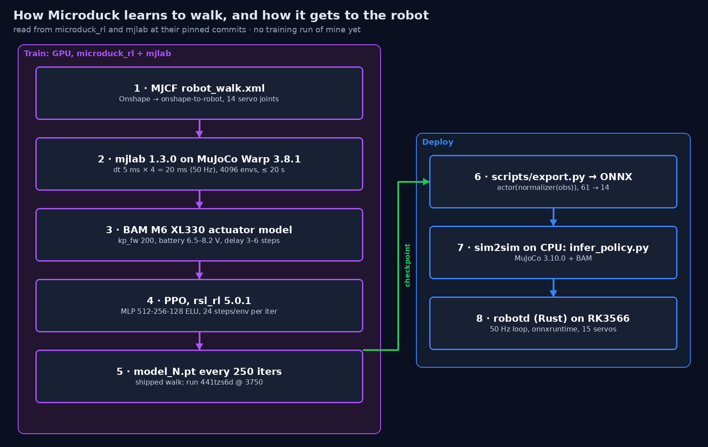

# How the duck learns to walk: no reference motion, 16 rewards
{: .no_toc }

[Back to the Microduck hub](/robotics/microduck/)


*The result first: the walk comes from 16 reward terms and no reference motion. Read from the code, not trained yet; the duck is my MuJoCo render of the open model (Microduck · Pollen Robotics · CC BY-NC-SA 4.0).*

1. TOC
{:toc}

## Situation

My own humanoid walks in MuJoCo on a gait I wrote: a LIPM model and IK, every step planned. Microduck's walk comes out
of training, and I couldn't train yet (no working GPU here). I wanted to know what actually shapes that
walk before I try it on a robot of my own.

## Task

Read the training repo at the commit the shipped policy came from and answer it in numbers: simulator,
rewards, randomisation, schedule, network, and what part the "AI agents" from the NVIDIA post really
played.

## Action

I cloned the training repo, the runtime and the exact mjlab version its lock file resolves, all at pinned
commits. I didn't trust my reading for the gait question, so I grepped:

```
$ grep -o '<joint[^>]*name="[^"]*"' src/mjlab_microduck/robot/microduck/robot_walk.xml | wc -l
14
$ grep -n -i -E 'reference|phase|imitation|motion_file|gait_gen' src/mjlab_microduck/tasks/microduck_velocity_env_cfg.py
638:    # (make_velocity_env_cfg() returns objects with shared mutable references;
```

Fourteen joints, and the only hit is the word "references" in a comment. No reference motion, no phase
clock.


*From the training repo and mjlab at their pinned commits: MJCF model, mjlab on MuJoCo Warp, the XL330 servo model, PPO, then ONNX export and the 50 Hz loop on the RK3566.*

## Result

It's mjlab 1.3.0 on MuJoCo Warp, PPO from rsl_rl, 4096 robots in parallel, a 5 ms physics step and a
20 ms policy step, the same 50 Hz the robot runs. The gait comes only from 16 reward terms. The biggest
weight is `air_time` at +3.0 (each foot must stay up 0.125 to 0.300 s), then speed, turn, head and
upright tracking at +2.0. Sim-to-real rests on the fitted XL330 model plus randomisation: battery 6.5 to
8.2 V, command delay, friction, mass, centre of mass, IMU tilt up to 6°, encoder offset, pushes. A
curriculum tightens the smoothness penalty from −0.1 to −1.0 by iteration 1500. Upstream says about 1 to
2 h for a usable gait on a CUDA GPU; the shipped walk is iteration 3750 of one run.

The "AI agents" in the NVIDIA post didn't design the gait. They wrote a plan, built 3D assets and an
obstacle course, and RL then fine-tuned an existing walk policy on ramps. In the training repo, the agent
part is a rule book for coding agents.

Two of my earlier notes were wrong and I corrected them. The centre-of-mass randomisation is ±15 mm,
not ±8 mm (I'd copied a stale comment), and "Arena" isn't only in the NVIDIA post: it's in the Hugging
Face tutorial and has its own public repo. All 14 code blocks I quote in my notes matched their files at
the pinned commit.

## What I'd do next

When the GPU is back: a 5-iteration smoke test at 64 robots first, as their rules say, then the 4096 run,
logging wall time per 1000 iterations. And the parts that scale with leg length (foot lift target,
air-time window, home pose) have to be redone before any of this fits my dinosaur.
