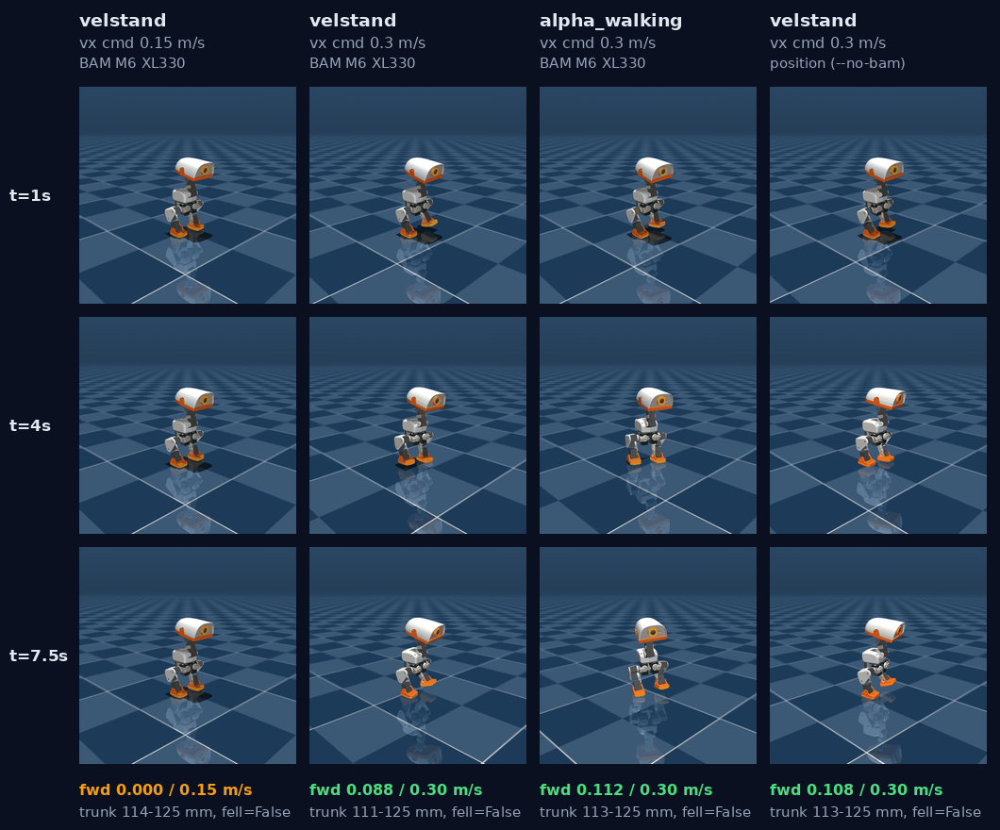

# Microduck
{: .no_toc }

*Simulation only so far: 4 runs of the official policies and no fall, at about a third of the commanded speed.*

*My own MuJoCo renders of the open Microduck model (Microduck · Pollen Robotics · CC BY-NC-SA 4.0), November 2026.*

Microduck is a small biped from Pollen Robotics and Hugging Face: about 25 cm tall, about 800 g, 14
Dynamixel XL330 joints driven by its walking policy plus one for the mouth. It doesn't walk with a
hand-written gait. A neural network trained with reinforcement learning on thousands of simulated ducks
reads 61 numbers every 20 ms and outputs 14 joint targets. The software is Apache-2.0 and the printable
parts are CC BY-NC-SA 4.0, so a personal, non-commercial build with credit is fine.

I came across it in November 2026 through an NVIDIA blog post about teaching it to walk. My own humanoid
walks in MuJoCo on a gait I wrote by hand, with LIPM and IK, and I wanted to see the other approach
from the inside: run their pipeline myself, then build the robot. That reading is also
where my [dino robot](/robotics/dino-robot/) started.

## What works so far

Only the simulation side. The official policies run headless on a laptop CPU, and I read the hardware,
the runtime and the training code closely enough to know what I'd have to make myself. Training my own
policy is waiting on the GPU machine (a driver mismatch that needs a reboot), and there's no hardware on
the bench yet.

## The write-ups



## Still open

The policies only reach about a third of the speed I command, and I haven't found out why. There's no
BOM and no IMU board, and the XL330 variant (M077 or M288) isn't written anywhere upstream. Before I order
fifteen servos I want those three answered.
