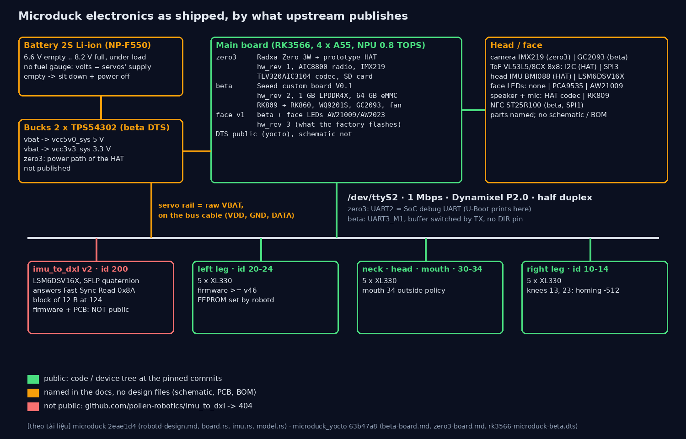

# What the repos give you, and the three holes I'd fill myself
{: .no_toc }

[Back to the Microduck hub](/robotics/microduck/)

1. TOC
{:toc}

## Situation

The policies ran in simulation (see the [first story](/robotics/microduck/headless-policies)). Next
step on paper: order parts. But I had no parts list, and "open source" can mean very different things
for the hardware.

## Task

Read the public repos (runtime, training, OS image) at pinned commits and answer three questions. What
exactly is on the robot, what's published, and what would I have to design myself.

## Action

I went through the runtime design doc, the Rust daemon that runs the 50 Hz loop, the board files and
device trees, and checked every related repo with a plain HTTP request.

*Drawn from the public repos: green = code or device tree published, orange = named but no design files, red = not public.*

The robot is 15 XL330 and one IMU board on a single 1 Mbps half-duplex Dynamixel bus, an RK3566 board
(a Radxa Zero 3W with a prototype HAT, or Seeed's own board on the factory robots), and a 2S NP-F550 pack.
The servo IDs are 10 to 14 for the right leg, 20 to 24 left, 30 to 34 for neck, head and mouth, and the
IMU board answers as ID 200.

The one I'd lose sleep over is that IMU board. Its firmware repo returns 404, and so do three other
related repos. But the runtime source gives away the contract. ID 200 answers a Fast Sync Read (0x8A) at
address 124 with 12 bytes: three gyro axes as int16 and the chip's own fused quaternion as three
half-floats, first in the status packet, every 20 ms. That's enough to write my own.

## Result

The software path is complete: runtime, training, OS image and device trees, policies, 43 printable
parts. The hardware path has three holes: the IMU board, the HAT (half-duplex buffer and 5 V from the
pack) and a BOM.

A few things I'd have got wrong without reading:

| What | What the source says |
|---|---|
| servo supply | XL330 is rated 3.7 to 6.0 V and runs on the raw 2S pack, 6.6 to 8.2 V, on purpose; the input-voltage shutdown bit is left clear |
| servo variant | M077 or M288 is written nowhere, and the servo model the policies trust is fitted to theirs |
| action filter | the runtime low-passes actions 0.5 / 0.7 "as trained", the training repo's notes say policies are unfiltered |
| bus on the Zero 3W | it's the SoC debug UART, so U-Boot prints onto the servo wires at power-on |
| print files | the meshes are an older electronics revision (Pi Zero 2W, NP-F970) than the robots sold now |
| loop timing | upstream measured 3 missed ticks in 15 022 (0.02 %) at 50 Hz on a stock kernel |

## What I'd do next

For bring-up I'd skip the HAT and use a USB-to-Dynamixel adapter, since the daemon takes a port argument.
The IMU board I'd do as a dev-board MCU plus an LSM6DSV16X breakout first, tested against real servos
before any PCB. And I'd pick the servo variant before ordering fifteen of them.
